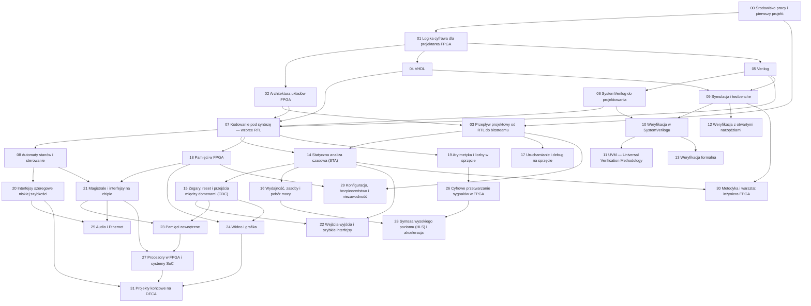

# Roadmapa — kolejność, zależności i czas

[← README](README.md)

Cała baza to ok. **550 godzin** nauki (209 tematów w 32 modułach). Nie trzeba przerabiać wszystkiego — poniżej są trzy ścieżki, które prowadzą do konkretnego celu, i graf zależności, z którego wynika, co trzeba znać wcześniej.

## Graf zależności

Strzałka A → B oznacza, że moduł A trzeba znać przed modułem B.

## Ścieżki nauki

### 🛠️ Szybki start na DECA — ok. 160 h

Dla osoby, która chce jak najszybciej budować działające układy na płytce. Wystarczy jeden język HDL na start (Verilog jest najkrótszy, VHDL najbardziej rygorystyczny); pozostałe dwa dochodzą później.

`00` → `01` → `03` → `05` (albo `04`) → `07` → `08` → `09` → `17` → `15` (tematy 01–03 i 05) → `20` → `24` → projekty 1 i 2 z modułu `31`

### 🧩 Projektant RTL — ok. 425 h

Poziom inżyniera projektującego układy FPGA w firmie: wszystkie trzy języki, analiza czasowa, CDC, interfejsy, pamięci, DSP, systemy z procesorem.

| Etap | Moduły | Czas | Po etapie potrafisz |
|------|--------|------|---------------------|
| 1. Podstawy | 00, 01, 02, 03 | ok. 45 h | przejść cały przepływ na DECA i wyjaśnić, co jest w układzie |
| 2. Języki i wzorce | 04, 05, 06, 07, 08 | ok. 90 h | pisać czysty, syntezowalny RTL w trzech językach |
| 3. Weryfikacja podstawowa | 09 | ok. 15 h | pisać samosprawdzające się testbenche |
| 4. Czas i zegary | 14, 15, 16, 17 | ok. 60 h | zamknąć timing, bezpiecznie przejść między domenami, uruchomić projekt na sprzęcie |
| 5. Bloki i interfejsy | 18, 19, 20, 21, 22, 23 | ok. 90 h | zaprojektować pamięci, arytmetykę, interfejsy i magistrale |
| 6. Systemy | 26, 27, 29 | ok. 55 h | zbudować tor DSP i system z procesorem |
| 7. Warsztat i portfolio | 30, 31 | ok. 70 h | prowadzić projekt jak w firmie i pokazać go na rozmowie |

Moduły 24, 25 i 28 są uzupełnieniem — warto je przerobić, jeśli celujesz w wideo, sieci albo akcelerację obliczeń.

### 🔍 Inżynier weryfikacji — ok. 270 h

Weryfikacja to osobna ścieżka kariery, w dużych zespołach zatrudniająca więcej osób niż projektowanie.

`00` → `01` → `02` → `03` → `04`, `05`, `06` → `07` → `08` → `09` → `10` → `11` → `12` → `13` → `15` → `21` → `30`

Najważniejsze są moduły 10 (SystemVerilog weryfikacyjny) i 11 (UVM) — na nich opiera się większość ofert pracy w weryfikacji.

## Jak rozłożyć naukę w czasie

| Tempo | Szybki start | Projektant RTL | Weryfikacja | Całość |
|-------|--------------|----------------|-------------|--------|
| 5 h tygodniowo | ok. 7 miesięcy | ok. 20 miesięcy | ok. 12 miesięcy | ok. 25 miesięcy |
| 10 h tygodniowo | ok. 4 miesiące | ok. 10 miesięcy | ok. 6 miesięcy | ok. 13 miesięcy |
| 20 h tygodniowo | ok. 2 miesiące | ok. 5 miesięcy | ok. 3 miesiące | ok. 6,5 miesiąca |

Czasy są szacunkowe dla osoby, która zna podstawy elektroniki cyfrowej albo programowania. Bez tego doliczyć ok. 30% do modułów 01–08.

## Szacowany czas modułów

| # | Moduł | Czas |
|---|-------|------|
| 00 | [Środowisko pracy i pierwszy projekt](modules/00-srodowisko-pracy/README.md) | 8 h |
| 01 | [Logika cyfrowa dla projektanta FPGA](modules/01-logika-cyfrowa/README.md) | 14 h |
| 02 | [Architektura układów FPGA](modules/02-architektura-fpga/README.md) | 12 h |
| 03 | [Przepływ projektowy od RTL do bitstreamu](modules/03-przeplyw-projektowy/README.md) | 10 h |
| 04 | [VHDL](modules/04-vhdl/README.md) | 24 h |
| 05 | [Verilog](modules/05-verilog/README.md) | 18 h |
| 06 | [SystemVerilog do projektowania](modules/06-systemverilog-rtl/README.md) | 16 h |
| 07 | [Kodowanie pod syntezę — wzorce RTL](modules/07-kodowanie-pod-synteze/README.md) | 20 h |
| 08 | [Automaty stanów i sterowanie](modules/08-automaty-stanow/README.md) | 14 h |
| 09 | [Symulacja i testbenche](modules/09-symulacja-i-testbench/README.md) | 16 h |
| 10 | [Weryfikacja w SystemVerilogu](modules/10-weryfikacja-systemverilog/README.md) | 24 h |
| 11 | [UVM — Universal Verification Methodology](modules/11-uvm/README.md) | 24 h |
| 12 | [Weryfikacja z otwartymi narzędziami](modules/12-weryfikacja-open-source/README.md) | 16 h |
| 13 | [Weryfikacja formalna](modules/13-weryfikacja-formalna/README.md) | 12 h |
| 14 | [Statyczna analiza czasowa (STA)](modules/14-analiza-czasowa/README.md) | 16 h |
| 15 | [Zegary, reset i przejścia między domenami (CDC)](modules/15-zegary-reset-cdc/README.md) | 18 h |
| 16 | [Wydajność, zasoby i pobór mocy](modules/16-wydajnosc-zasoby-moc/README.md) | 14 h |
| 17 | [Uruchamianie i debug na sprzęcie](modules/17-debug-na-sprzecie/README.md) | 10 h |
| 18 | [Pamięci w FPGA](modules/18-pamieci/README.md) | 14 h |
| 19 | [Arytmetyka i liczby w sprzęcie](modules/19-arytmetyka/README.md) | 16 h |
| 20 | [Interfejsy szeregowe niskiej szybkości](modules/20-interfejsy-szeregowe/README.md) | 16 h |
| 21 | [Magistrale i interfejsy na chipie](modules/21-magistrale-on-chip/README.md) | 16 h |
| 22 | [Wejścia-wyjścia i szybkie interfejsy](modules/22-io-i-szybkie-interfejsy/README.md) | 14 h |
| 23 | [Pamięci zewnętrzne](modules/23-pamieci-zewnetrzne/README.md) | 16 h |
| 24 | [Wideo i grafika](modules/24-wideo-i-grafika/README.md) | 18 h |
| 25 | [Audio i Ethernet](modules/25-audio-i-ethernet/README.md) | 16 h |
| 26 | [Cyfrowe przetwarzanie sygnałów w FPGA](modules/26-dsp-w-fpga/README.md) | 20 h |
| 27 | [Procesory w FPGA i systemy SoC](modules/27-procesory-i-soc/README.md) | 22 h |
| 28 | [Synteza wysokiego poziomu (HLS) i akceleracja](modules/28-hls-i-akceleracja/README.md) | 14 h |
| 29 | [Konfiguracja, bezpieczeństwo i niezawodność](modules/29-konfiguracja-niezawodnosc/README.md) | 12 h |
| 30 | [Metodyka i warsztat inżyniera FPGA](modules/30-warsztat-inzyniera/README.md) | 8 h |
| 31 | [Projekty końcowe na DECA](modules/31-projekty-koncowe/README.md) | 60 h |
| | **Razem** | **548 h** |
