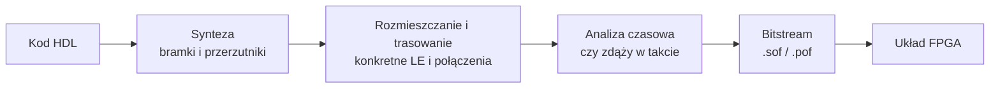
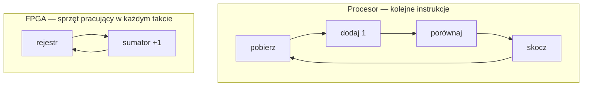

# 00.01 — Czym jest FPGA i gdzie się go używa

> **Moduł:** [00 — Środowisko pracy i pierwszy projekt](README.md) · **Kod:** — · **DECA:** —
>
> **Czytaj:**
>
> - S. Harris, D. Harris, *Digital Design and Computer Architecture, RISC-V Edition* — rozdz. 5.6 *Logic Arrays* (PLA i FPGA)
> - R. Merrick, *Getting Started with FPGAs* — rozdz. 1 *Meet the FPGA*
> - [MAX 10 FPGA Device Overview](https://www.intel.com/content/www/us/en/docs/programmable/683658/) — przegląd zasobów rodziny MAX 10
> - [Nandland](https://nandland.com/) — wprowadzenie „What is an FPGA”

← · [spis modułu](README.md) · [00.02](00.02-fpga-mikrokontroler-procesor-gpu-i-asic-kiedy-co.md) →

## Po co to jest

Zanim napiszesz pierwszą linię VHDL, musisz wiedzieć, **co właściwie programujesz**. FPGA nie wykonuje programu — FPGA *staje się* układem, który opisujesz. To jedno zdanie tłumaczy większość błędów początkujących i jest pierwszym pytaniem na prawie każdej rozmowie kwalifikacyjnej.

## Intuicja

Wyobraź sobie ogromną płytkę stykową z tysiącami bramek, przerzutników i kabelków — ale zamkniętą w jednym układzie scalonym. Zamiast wtykać przewody ręką, wgrywasz plik, który mówi: *ten przerzutnik połącz z tą bramką, a tę bramkę z tamtym wyprowadzeniem*. Po wgraniu w układzie nie ma żadnego programu — jest gotowy obwód, który działa tak, jakbyś go zlutował.

Dlatego wszystko, co opiszesz, działa **jednocześnie**. Licznik, odbiornik UART i filtr cyfrowy nie czekają na swoją kolej jak instrukcje w procesorze — każdy z nich to osobny kawałek sprzętu, który pracuje w każdym takcie zegara.

## Teoria

**FPGA** (*Field-Programmable Gate Array*) — układ scalony, którego funkcję logiczną określa się po wyprodukowaniu („w polu”, *field*) przez wgranie **pliku konfiguracyjnego** (*bitstream*). Składa się z trzech rodzajów zasobów:

| Zasób | Co robi | W MAX 10 |
|-------|---------|----------|
| **Bloki logiczne** | Realizują dowolną funkcję kombinacyjną kilku wejść (tablica LUT) i zapamiętują wynik (przerzutnik) | Element logiczny LE: 4-wejściowy LUT + przerzutnik; 10M50 ma ok. 50 000 LE |
| **Programowalne połączenia** | Łączą bloki ze sobą i z wyprowadzeniami | Sieć połączeń wierszowych i kolumnowych |
| **Bloki wejścia-wyjścia** | Obsługują wyprowadzenia układu, różne napięcia i standardy | Banki I/O od 1,2 V do 3,3 V |

Do tego współczesne FPGA mają **bloki wyspecjalizowane**: pamięć RAM (w MAX 10 bloki M9K), mnożarki sprzętowe, pętle PLL do generowania zegarów, a w niektórych rodzinach — procesory, przetworniki ADC czy nadajniki-odbiorniki wielogigabitowe. Szczegóły architektury opisuje [moduł 02](../02-architektura-fpga/README.md).

### Skąd FPGA wie, czym ma być

Opis układu piszesz w **języku opisu sprzętu** (*HDL — Hardware Description Language*): VHDL, Verilog albo SystemVerilog. Narzędzie (Quartus, Vivado, Yosys) przekształca ten opis w plik konfiguracyjny w kilku krokach:

Każdy z tych etapów omawia [moduł 03](../03-przeplyw-projektowy/README.md).

### Ulotna i nieulotna konfiguracja

Konfiguracja większości FPGA siedzi w pamięci **SRAM** — znika po wyłączeniu zasilania, więc przy starcie układ wczytuje ją z zewnętrznej pamięci flash. MAX 10 ma pamięć konfiguracyjną **flash wbudowaną w układ**: po włączeniu zasilania sam się konfiguruje w czasie rzędu milisekund („instant-on”). Na płytce DECA odpowiada to dwóm plikom:

- `.sof` — wgrywany przez JTAG do SRAM; szybki do testów, ale znika po wyłączeniu,
- `.pof` — wgrywany do wewnętrznej pamięci flash; zostaje na stałe.

### Gdzie używa się FPGA

| Dziedzina | Do czego | Dlaczego FPGA |
|-----------|----------|---------------|
| Telekomunikacja | Stacje bazowe 4G/5G, przetwarzanie sygnałów radiowych, przełączniki sieciowe | Ogromna przepustowość i równoległość, możliwość aktualizacji standardu |
| Pomiary i nauka | Oscyloskopy, analizatory, systemy wyzwalania w fizyce cząstek | Deterministyczny czas reakcji rzędu nanosekund |
| Przemysł i motoryzacja | Sterowanie silnikami, wizja maszynowa, łączenie czujników | Wiele interfejsów naraz, praca w czasie rzeczywistym |
| Lotnictwo, kosmos, obronność | Radary, awionika, satelity | Długi cykl życia produktu, wersje odporne na promieniowanie, certyfikacja |
| Finanse | Handel wysokich częstotliwości | Opóźnienie liczone w nanosekundach |
| Centra danych | Akceleracja sieci, kompresja, szyfrowanie, uczenie maszynowe | Wydajność na wat, przeprogramowanie pod nowe zadanie |
| Projektowanie układów ASIC | Prototypowanie i emulacja przyszłego układu | Uruchomienie oprogramowania na sprzęcie, zanim powstanie krzem |
| Wideo i audio | Kamery, mieszanie obrazu, konwersja formatów | Przetwarzanie strumieni pikseli w czasie rzeczywistym |

## Schemat i przebiegi

Ten sam licznik w procesorze i w FPGA:

W procesorze licznik zajmuje kilka instrukcji i dzieli czas z resztą programu. W FPGA to sumator i rejestr, które w każdym takcie zegara robią dokładnie jedną rzecz — niezależnie od tego, co dzieje się w reszcie układu.

## Reguły i liczby do zapamiętania

| Reguła lub liczba | Kiedy obowiązuje |
|-------------------|------------------|
| FPGA nie wykonuje programu — kod HDL opisuje sprzęt | zawsze; to podstawa myślenia przy pisaniu RTL |
| Wszystkie bloki opisane w HDL pracują równocześnie | zawsze |
| `.sof` → SRAM (ulotny), `.pof` → wewnętrzny flash MAX 10 (trwały) | MAX 10, Quartus |
| MAX 10 10M50: ok. 50 tys. LE, 1638 Kb RAM M9K, 4 PLL | płytka DECA |
| FPGA = bloki logiczne + połączenia + I/O + bloki wyspecjalizowane | ogólna budowa |

## Typowe pułapki

- **Myślenie programistyczne.** Pętla `for` w HDL nie „wykonuje się wiele razy” — narzędzie powiela opisany sprzęt tyle razy, ile ma iteracji. Pętla do 1000 to 1000 kopii układu.
- **„Wgrałem i zniknęło po wyłączeniu”.** Wgrany był `.sof`. Do trwałej konfiguracji MAX 10 trzeba wgrać `.pof`.
- **Mylenie FPGA z CPLD.** CPLD (np. starsze MAX II, MAX V) to mniejsze układy o innej architekturze; MAX 10 mimo nazwy jest pełnoprawnym FPGA.
- **Przecenianie zegara.** FPGA taktowane 100 MHz nie jest „wolniejsze” od procesora 3 GHz — w każdym takcie może wykonać tysiące operacji równolegle. Liczy się przepustowość i opóźnienie, nie sama częstotliwość.

## Pytania rekrutacyjne

1. **Czym jest FPGA i czym różni się od mikroprocesora?**

Odpowiedź

FPGA to układ z programowalnymi blokami logicznymi, połączeniami i wyprowadzeniami, którego funkcję określa plik konfiguracyjny. Mikroprocesor ma stały sprzęt i wykonuje sekwencję instrukcji z pamięci. W FPGA opisuje się sam sprzęt, który pracuje równolegle i deterministycznie — każda funkcja ma własne zasoby, nie dzieli czasu z innymi.

2. **Z jakich podstawowych zasobów składa się FPGA?**

Odpowiedź

Z bloków logicznych (tablice LUT i przerzutniki, w Alterze nazywane LE lub ALM, w AMD — slice/CLB), programowalnej sieci połączeń i bloków wejścia-wyjścia. Do tego bloki wyspecjalizowane: pamięć blokowa, bloki DSP (mnożarki), pętle PLL, a w części układów procesory i nadajniki-odbiorniki szeregowe.

3. **Dlaczego większość FPGA trzeba konfigurować po każdym włączeniu zasilania?**

Odpowiedź

Bo konfiguracja przechowywana jest w komórkach SRAM, które tracą zawartość bez zasilania. Przy starcie układ wczytuje bitstream z zewnętrznej pamięci flash albo dostaje go od procesora. Wyjątkami są układy z wbudowanym flashem (MAX 10, Lattice MachXO, Microchip PolarFire/IGLOO) i układy antifuse.

4. **Podaj trzy zastosowania, w których FPGA wygrywa z procesorem, i uzasadnij.**

Odpowiedź

Na przykład: przetwarzanie sygnałów radiowych (ogromny strumień próbek i równoległe filtry), handel wysokich częstotliwości (deterministyczne opóźnienie w nanosekundach), prototypowanie ASIC (emulacja przyszłego układu przed produkcją). Wspólny mianownik: równoległość, przewidywalny czas reakcji i własne interfejsy sprzętowe.

## Zadania

1. Licznik w procesorze wykonującym jedną instrukcję na takt przy 1 GHz potrzebuje 4 instrukcji na jedno zwiększenie. Ile zwiększeń na sekundę wykona? Ile wykona w tym czasie 100 niezależnych liczników w FPGA taktowanym 100 MHz?

Odpowiedź

Procesor: 10⁹ / 4 = 2,5·10⁸ zwiększeń na sekundę — i to tylko jednego licznika naraz. FPGA: 100 liczników × 10⁸ = 10¹⁰ zwiększeń na sekundę, 40 razy więcej, choć zegar jest 10 razy wolniejszy.

2. Wypisz z [opisu płytki DECA](../../plytka-deca/README.md) trzy bloki wyspecjalizowane układu MAX 10, z których skorzystasz w tej bazie, i moduły, w których się pojawią.

Odpowiedź

Na przykład: pamięć M9K (moduł 18), pętle PLL (moduł 15), przetworniki ADC (moduł 20), wewnętrzna pamięć flash UFM i podwójny obraz konfiguracji (moduły 18 i 29), mnożarki sprzętowe (moduł 19).

## Źródła

- Harris & Harris, *Digital Design and Computer Architecture, RISC-V Edition*, rozdz. 5.6.
- R. Merrick, *Getting Started with FPGAs*, rozdz. 1.
- [MAX 10 FPGA Device Overview](https://www.intel.com/content/www/us/en/docs/programmable/683658/).
- *DECA User Manual*, rozdz. 2 i 3.1 — [zrodla.md](../../plytka-deca/zrodla.md).
