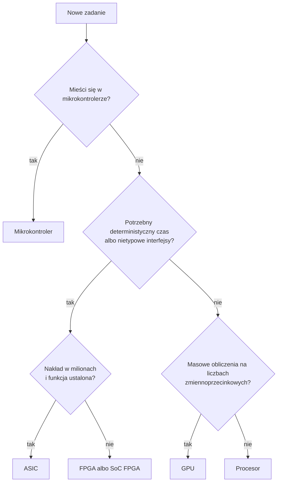

# 00.02 — FPGA, mikrokontroler, procesor, GPU i ASIC — kiedy co

> **Moduł:** [00 — Środowisko pracy i pierwszy projekt](README.md) · **Kod:** — · **DECA:** —
>
> **Czytaj:**
>
> - S. Kilts, *Advanced FPGA Design* — rozdz. 1 (architektura pod kątem szybkości, powierzchni i mocy)
> - R. Kastner i in., [*Parallel Programming for FPGAs*](https://kastner.ucsd.edu/hlsbook/) — rozdz. 1.1–1.3 (porównanie FPGA z procesorami i GPU)
> - [AMD UG949 — UltraFast Design Methodology Guide](https://docs.amd.com/r/en-US/ug949-vivado-design-methodology) — rozdz. 1 (decyzje na początku projektu)

← [00.01](00.01-czym-jest-fpga-i-gdzie-sie-go-uzywa.md) · [spis modułu](README.md) · [00.03](00.03-instalacja-quartus-prime-lite-i-questa-starter.md) →

## Po co to jest

Inżynier FPGA bardzo często musi uzasadnić, **dlaczego** w produkcie jest FPGA, a nie tańszy mikrokontroler albo procesor graficzny. Na rozmowie kwalifikacyjnej to pytanie sprawdza, czy rozumiesz kompromisy, a nie tylko składnię języka.

## Intuicja

Pomyśl o pięciu sposobach wykonania pracy w kuchni:

- **Mikrokontroler** — jeden kucharz z przepisem. Robi wszystko po kolei, tanio i bez zużycia prądu, ale jedną rzecz naraz.
- **Procesor (CPU)** — kilku bardzo szybkich kucharzy. Poradzą sobie z każdym przepisem, ale każdy wciąż pracuje krok po kroku.
- **GPU** — tysiące pomocników robiących dokładnie to samo na różnych składnikach. Świetni do krojenia tysiąca marchewek, gorsi do zadań, w których każdy krok jest inny.
- **FPGA** — kuchnia, którą przebudowujesz pod jedno danie: taśmociąg, przy którym każde stanowisko robi jedną rzecz, a produkty płyną bez przerwy. Wymaga zaprojektowania linii, ale działa szybko i przewidywalnie.
- **ASIC** — fabryka zbudowana pod jedno danie. Najszybsza i najtańsza w przeliczeniu na porcję, ale budowa kosztuje miliony i nie da się jej przerobić.

## Teoria

### Porównanie

| Cecha | Mikrokontroler | CPU | GPU | FPGA | ASIC |
|-------|----------------|-----|-----|------|------|
| Sposób działania | Sekwencyjny program | Sekwencyjny program, kilka do kilkudziesięciu rdzeni | Tysiące prostych rdzeni wykonujących ten sam kod (SIMT) | Sprzęt opisany przez projektanta, równoległość dowolnego rodzaju | Sprzęt zaprojektowany na stałe |
| Opóźnienie i determinizm | Mikrosekundy, przewidywalne przy prostym programie | Zmienne (pamięć podręczna, system operacyjny) | Duże opóźnienie, wysoka przepustowość | Nanosekundy, w pełni deterministyczne | Nanosekundy, deterministyczne |
| Przepustowość | Niska | Średnia | Bardzo wysoka dla danych równoległych | Wysoka, skrojona pod zadanie | Najwyższa |
| Pobór mocy | Bardzo niski | Wysoki | Bardzo wysoki | Średni, zależny od projektu | Najniższy dla danej funkcji |
| Interfejsy sprzętowe | Stałe peryferia | Stałe | Stałe (PCIe, pamięć) | Dowolne — sam je projektujesz | Dowolne, ale na stałe |
| Koszt jednostkowy | Bardzo niski | Średni | Wysoki | Średni do bardzo wysokiego | Najniższy przy milionach sztuk |
| Koszt jednorazowy (NRE) | Niski | Niski | Niski | Średni (czas projektu, narzędzia) | Bardzo wysoki (maski, weryfikacja) |
| Zmiana funkcji po wdrożeniu | Aktualizacja oprogramowania | Aktualizacja oprogramowania | Aktualizacja oprogramowania | Nowy bitstream | Niemożliwa |
| Czas wprowadzenia na rynek | Krótki | Krótki | Krótki | Średni | Długi (rok i więcej) |
| Typowy język | C, C++ | C, C++, Python… | CUDA, OpenCL | VHDL, Verilog, SystemVerilog, HLS | Verilog, SystemVerilog |

### Kiedy FPGA jest dobrym wyborem

1. **Potrzebny jest deterministyczny czas reakcji** — sterowanie, wyzwalanie pomiarów, systemy bezpieczeństwa.
2. **Strumień danych jest za szybki dla procesora** — próbki ADC w setkach megaherców, wideo, pakiety sieciowe przy pełnej przepustowości łącza.
3. **Potrzebne są nietypowe lub liczne interfejsy** — dziesiątki magistral, własne protokoły, sklejanie układów, które „nie rozmawiają” ze sobą.
4. **Nakład produkcji jest za mały na ASIC**, a funkcja zbyt wymagająca na mikrokontroler.
5. **Standard jeszcze się zmienia** — FPGA można zaktualizować u klienta.
6. **Prototypujesz ASIC** — logikę przyszłego układu uruchamia się na FPGA, zanim powstanie krzem.

### Kiedy FPGA nie jest dobrym wyborem

- Zadanie mieści się w możliwościach mikrokontrolera — tańsze, prostsze i łatwiejsze w utrzymaniu.
- Algorytm to głównie rozgałęziona logika sterująca (interfejs użytkownika, protokoły wysokiego poziomu) — tę część lepiej zostawić procesorowi, nawet jeśli siedzi w tym samym układzie FPGA.
- Obliczenia równoległe na dużych zbiorach liczb zmiennoprzecinkowych, gdzie liczy się przepustowość, a nie opóźnienie — zwykle GPU wygra kosztem i czasem pisania kodu.
- Produkt sprzedaje się w milionach sztuk i ma ustaloną funkcję — tańszy będzie ASIC.

### Rozwiązania pośrednie

- **SoC FPGA** (AMD Zynq, Altera Cyclone V SoC, Agilex) — procesor ARM i logika programowalna w jednym układzie. Procesor obsługuje system operacyjny i sterowanie, FPGA — szybkie przetwarzanie. Opisuje je [moduł 27](../27-procesory-i-soc/README.md).
- **Procesor programowy** (Nios V, MicroBlaze, rdzenie RISC-V) — procesor zbudowany z zasobów FPGA. Na DECA uruchomisz Nios V w module 27.
- **Mikrokontroler + małe FPGA lub CPLD** — mikrokontroler steruje, FPGA obsługuje szybkie interfejsy.

## Schemat i przebiegi

Uproszczony schemat decyzji:

## Reguły i liczby do zapamiętania

| Reguła | Kiedy obowiązuje |
|--------|------------------|
| FPGA wygrywa opóźnieniem, determinizmem i elastycznością interfejsów | wybór platformy |
| ASIC ma najniższy koszt jednostkowy i najwyższy koszt jednorazowy | produkcja masowa |
| GPU wygrywa przepustowością przy jednakowych operacjach na dużych zbiorach danych | obliczenia równoległe bez wymagań czasu rzeczywistego |
| Logika sterująca — procesor, ścieżka danych — FPGA | podział sprzęt–oprogramowanie |

## Typowe pułapki

- **„FPGA, bo jest szybsze”.** Bez określenia, czy chodzi o przepustowość, opóźnienie czy pobór mocy, taka teza nic nie znaczy. Procesor na pojedynczym, rozgałęzionym zadaniu często będzie szybszy.
- **Pomijanie kosztu projektu.** Czas inżyniera FPGA i weryfikacji bywa droższy niż różnica w cenie układów.
- **Pisanie całej logiki sterującej w HDL.** Rozbudowane menu, protokoły tekstowe czy obsługa systemu plików są dużo łatwiejsze w C na procesorze (choćby programowym w tym samym FPGA).

## Pytania rekrutacyjne

1. **Kiedy wybierzesz FPGA zamiast mikrokontrolera, a kiedy zamiast GPU?**

Odpowiedź

Zamiast mikrokontrolera — gdy przepustowość lub czas reakcji przekraczają jego możliwości albo potrzebne są nietypowe, liczne lub bardzo szybkie interfejsy. Zamiast GPU — gdy liczy się niskie, deterministyczne opóźnienie, przetwarzanie strumieniowe w czasie rzeczywistym, niski pobór mocy albo bezpośrednie podłączenie do przetworników i interfejsów sprzętowych. GPU jest lepsze przy masowych obliczeniach wsadowych.

2. **Co to jest NRE i dlaczego decyduje o wyborze między FPGA a ASIC?**

Odpowiedź

NRE (*Non-Recurring Engineering*) to jednorazowy koszt projektu: zespół, narzędzia, weryfikacja, a w ASIC także maski produkcyjne liczone w milionach dolarów. ASIC ma niski koszt jednostkowy, więc opłaca się dopiero przy dużym nakładzie, gdy NRE rozłoży się na wiele sztuk. FPGA ma niskie NRE i wyższy koszt jednostkowy — wygrywa przy małych i średnich nakładach oraz gdy funkcja może się zmieniać.

3. **Czym jest SoC FPGA i jak dzielisz w nim pracę?**

Odpowiedź

To układ z twardym procesorem (zwykle ARM) i logiką programowalną połączonymi szybkimi magistralami (np. AXI). Procesor dostaje system operacyjny, sieć, interfejs użytkownika i sterowanie wysokiego poziomu; logika programowalna — przetwarzanie strumieni danych, interfejsy czasu rzeczywistego i akceleratory. Granica przebiega tam, gdzie zadanie przestaje być rozgałęzioną logiką, a staje się regularnym przepływem danych.

## Zadania

1. Dla każdego zadania wskaż najlepszą platformę i uzasadnij jednym zdaniem: (a) termostat z wyświetlaczem, (b) odbiór i dekodowanie 8 kanałów ADC po 250 MS/s, (c) trening sieci neuronowej, (d) kontroler dysku SSD produkowany w 10 mln sztuk rocznie, (e) prototyp tego kontrolera przed produkcją.

Odpowiedź

(a) mikrokontroler — wolne, proste sterowanie; (b) FPGA — 2 GS/s łącznie w czasie rzeczywistym, bezpośredni interfejs z przetwornikami; (c) GPU — masowe obliczenia zmiennoprzecinkowe bez wymagań na opóźnienie; (d) ASIC — ogromny nakład i ustalona funkcja; (e) FPGA — emulacja logiki przed wykonaniem masek.

2. Projekt na FPGA kosztuje 40 000 zł NRE i 300 zł za układ. ASIC: 4 000 000 zł NRE i 20 zł za sztukę. Od ilu sztuk ASIC jest tańszy?

Odpowiedź

40 000 + 300·n = 4 000 000 + 20·n → 280·n = 3 960 000 → n ≈ 14 143. Powyżej ok. 14 tys. sztuk ASIC jest tańszy — o ile nie liczyć czasu wprowadzenia na rynek i ryzyka błędu w krzemie.

## Źródła

- S. Kilts, *Advanced FPGA Design*, rozdz. 1.
- R. Kastner, J. Matai, S. Neuendorffer, [*Parallel Programming for FPGAs*](https://kastner.ucsd.edu/hlsbook/), rozdz. 1.
- [AMD UG949 — UltraFast Design Methodology Guide](https://docs.amd.com/r/en-US/ug949-vivado-design-methodology).
