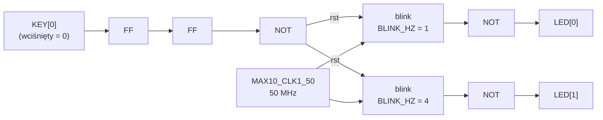

# 00.06 — Pierwszy projekt: migająca dioda w trzech językach

> **Moduł:** [00 — Środowisko pracy i pierwszy projekt](README.md) · **Kod:** VHDL · Verilog · SystemVerilog · **DECA:** 🛠️ tak
>
> **Czytaj:**
>
> - P. Chu, *FPGA Prototyping by VHDL Examples* / *… by SystemVerilog Examples* — rozdz. 1–2 (przepływ projektowy i pierwszy układ na płytce)
> - R. Merrick, *Getting Started with FPGAs* — rozdz. 2–3 (pierwszy projekt, przepływ w Quartusie)
> - *DECA User Manual*, rozdz. 3.3 (zegary) i 3.4.1 (przyciski, diody) — [zrodla.md](../../plytka-deca/zrodla.md)
> - [tomverbeure/arrow_deca](https://github.com/tomverbeure/arrow_deca) — minimalny projekt na DECA, z którym porównano ustawienia

← [00.05](00.05-edytor-i-podglad-przebiegow-vs-code-teroshdl.md) · [spis modułu](README.md) · [00.07](00.07-struktura-repozytorium-projektu-fpga-i-git.md) →

## Po co to jest

Migająca dioda to „Hello, world” sprzętu. Nie chodzi o samą diodę, tylko o **przejście całej drogi**: kod → symulacja → synteza → piny i ograniczenia → plik konfiguracyjny → płytka. Jeśli ta droga działa, każdy kolejny projekt w tej bazie uruchomisz tak samo.

## Intuicja

Zegar na płytce tyka 50 milionów razy na sekundę — za szybko, żeby zobaczyć cokolwiek okiem. Potrzebujemy licznika, który zlicza takty i co 25 milionów taktów (pół sekundy) przełącza diodę. Dioda będzie świecić pół sekundy i gasnąć na pół sekundy — miga raz na sekundę.

To jak kuchenny minutnik, który dzwoni co pół sekundy i za każdym dzwonkiem przestawia włącznik światła.

## Teoria

### Dzielnik częstotliwości z licznikiem

Pół okresu migania to

$$
\text{HALF} = \frac{f_\text{clk}}{2 \cdot f_\text{blink}} = \frac{50\,000\,000}{2 \cdot 1} = 25\,000\,000 \text{ taktów}
$$

Licznik liczy od 0 do `HALF − 1`. Gdy osiągnie tę wartość, wraca do zera i odwraca stan diody. Szerokość licznika to

$$
W = \lceil \log_2(\text{HALF}) \rceil = \lceil \log_2(25\,000\,000) \rceil = 25 \text{ bitów}
$$

bo $2^{24} \approx 16{,}8$ mln jest za mało, a $2^{25} \approx 33{,}6$ mln wystarcza. W kodzie liczy to za nas `$clog2` (Verilog, SystemVerilog) albo typ `natural range` (VHDL).

### Parametry zamiast liczb w kodzie

Moduł `blink` ma dwa parametry: częstotliwość zegara `CLK_HZ` i migania `BLINK_HZ`. Dzięki temu:

- ten sam kod działa na płytce (50 MHz → 1 Hz) i w symulacji (1000 Hz → 50 Hz, żeby test trwał 100 taktów zamiast 25 milionów),
- na płytce wstawiamy dwie kopie modułu z różnymi parametrami — 1 Hz i 4 Hz.

### Kod przenośny i kod płytki

Projekt jest podzielony na dwie warstwy (zasada z [docs/STYL-KODU.md](../../docs/STYL-KODU.md)):

| Warstwa | Katalog | Co zawiera |
|---------|---------|-----------|
| Kod przenośny | `hdl/` | Moduł `blink` i jego testbench — działa na każdym FPGA i w każdym symulatorze |
| Kod płytki | `deca/blink/` | Moduł nadrzędny `deca_top` z nazwami pinów DECA, ograniczenia czasowe, skrypt tworzący projekt |

Moduł nadrzędny dostosowuje logikę do płytki: na DECA **diody świecą przy stanie niskim**, a **przycisk daje 0 po wciśnięciu** (*DECA User Manual*, rozdz. 3.4.1). Logika wewnątrz pracuje „normalnie” (1 = świeci, 1 = reset), a odwrócenie robi tylko `deca_top`.

### Synchronizacja przycisku

Przycisk zmienia stan w dowolnej chwili, niezależnie od zegara. Gdyby trafił do przerzutnika tuż przy zboczu zegara, przerzutnik mógłby wejść w stan metastabilny i różne części układu zobaczyłyby różne wartości. Dlatego sygnał z przycisku przechodzi przez **dwa przerzutniki pod rząd** (synchronizator) i dopiero potem jest używany jako reset. Pełne wyjaśnienie, z rachunkiem prawdopodobieństwa błędu, jest w [module 15](../15-zegary-reset-cdc/README.md) — tu wystarczy zasada: **każdy sygnał spoza domeny zegara synchronizuj, zanim go użyjesz**.

## Schemat i przebiegi



Wewnątrz `blink`: rejestr licznika z sumatorem `+1`, komparator „licznik = HALF − 1” i przerzutnik `led`, który zmienia stan, gdy komparator zgłosi równość. Przebieg z symulacji pokazuje [00.05](00.05-edytor-i-podglad-przebiegow-vs-code-teroshdl.md#schemat-i-przebiegi).

## Kod: VHDL

```vhdl
architecture rtl of blink is
  constant HALF : positive := CLK_HZ / (2 * BLINK_HZ);  -- takty na pół okresu
  signal cnt_q : natural range 0 to HALF - 1 := 0;
  signal led_q : std_logic := '0';
begin
  process (clk)
  begin
    if rising_edge(clk) then
      if rst = '1' then
        cnt_q <= 0;
        led_q <= '0';
      elsif cnt_q = HALF - 1 then
        cnt_q <= 0;
        led_q <= not led_q;
      else
        cnt_q <= cnt_q + 1;
      end if;
    end if;
  end process;

  led <= led_q;
end architecture rtl;
```

<!-- plik: hdl/vhdl/blink.vhd -->
Pełny plik: [hdl/vhdl/blink.vhd](hdl/vhdl/blink.vhd) · testbench: [hdl/vhdl/tb_blink.vhd](hdl/vhdl/tb_blink.vhd)

- Licznik ma typ `natural range 0 to HALF − 1` — syntezator sam dobierze 25 bitów. Nie trzeba liczyć szerokości ręcznie.
- Wyjście `led` jest portem `out`, a w VHDL-2008 można go czytać, ale tu i tak używamy wewnętrznego sygnału `led_q` — to czytelniejsze i działa w starszych standardach.
- `rising_edge(clk)` — jedyna zalecana forma opisu zbocza w tej bazie.

## Kod: Verilog

```verilog
    localparam integer HALF = CLK_HZ / (2 * BLINK_HZ);  // takty na pół okresu
    localparam integer W    = (HALF > 1) ? $clog2(HALF) : 1;

    reg [W-1:0] cnt_q;
    reg         led_q;

    always @(posedge clk) begin
        if (rst) begin
            cnt_q <= {W{1'b0}};
            led_q <= 1'b0;
        end else if (cnt_q == HALF - 1) begin
            cnt_q <= {W{1'b0}};
            led_q <= ~led_q;
        end else begin
            cnt_q <= cnt_q + 1'b1;
        end
    end

    assign led = led_q;
```

<!-- plik: hdl/verilog/blink.v -->
Pełny plik: [hdl/verilog/blink.v](hdl/verilog/blink.v) · testbench: [hdl/verilog/tb_blink.v](hdl/verilog/tb_blink.v)

- Szerokość licznika liczy `$clog2(HALF)`; warunek `HALF > 1` chroni przed zerową szerokością przy skrajnych parametrach.
- W bloku sekwencyjnym tylko przypisania nieblokujące `<=` — dlaczego, wyjaśnia [05.04](../05-verilog/README.md).
- `` `default_nettype none `` na początku pliku sprawia, że literówka w nazwie sygnału jest błędem, a nie nowym, niejawnym przewodem.

## Kod: SystemVerilog

```systemverilog
    localparam int unsigned HALF = CLK_HZ / (2 * BLINK_HZ);  // takty na pół okresu
    localparam int unsigned W    = (HALF > 1) ? $clog2(HALF) : 1;

    logic [W-1:0] cnt_q;

    always_ff @(posedge clk) begin
        if (rst) begin
            cnt_q <= '0;
            led   <= 1'b0;
        end else if (cnt_q == W'(HALF - 1)) begin
            cnt_q <= '0;
            led   <= ~led;
        end else begin
            cnt_q <= cnt_q + 1'b1;
        end
    end
```

<!-- plik: hdl/sv/blink.sv -->
Pełny plik: [hdl/sv/blink.sv](hdl/sv/blink.sv) · testbench: [hdl/sv/tb_blink.sv](hdl/sv/tb_blink.sv)

- `always_ff` mówi narzędziu wprost: tu ma powstać przerzutnik. Jeśli opiszesz w nim coś innego, dostaniesz ostrzeżenie.
- `'0` wypełnia zerami wektor dowolnej szerokości.
- `W'(HALF - 1)` rzutuje stałą 32-bitową na szerokość licznika — porównanie wektorów o tej samej szerokości nie generuje ostrzeżeń lintu.
- Port wyjściowy `led` typu `logic` można przypisywać bezpośrednio w `always_ff` — nie trzeba osobnego sygnału jak w Verilogu.

## Co powstaje po syntezie

Jedna kopia `blink` z parametrami płytki to:

- 25-bitowy rejestr licznika i sumator `+1` zbudowany na łańcuchu przeniesień (po jednym LE na bit),
- komparator równości z wartością 24 999 999 — kilka LUT-ów połączonych w drzewo,
- jeden przerzutnik `led`.

Dwie kopie i synchronizator przycisku zajmują łącznie rzędu kilkudziesięciu do stu elementów logicznych — **ułamek procenta** z 50 000 LE układu 10M50. Dokładną liczbę podaje raport *Fitter → Resource Usage Summary*. Maksymalna częstotliwość takiego licznika na MAX 10 jest kilkakrotnie wyższa niż 50 MHz, więc raport czasowy pokaże duży dodatni zapas (*slack*).

## Weryfikacja

Testbench `tb_blink` (w trzech językach) ustawia `CLK_HZ = 1000`, `BLINK_HZ = 50`, więc `HALF = 10`. Sprawdza:

1. że po resecie `led = 0`,
2. że pięć kolejnych zmian stanu `led` następuje dokładnie co 10 taktów.

Pobudzenia zmienia na opadającym zboczu zegara, żeby nie było wyścigu z układem (zasada 5 w [docs/STYL-KODU.md](../../docs/STYL-KODU.md#testbenche)). Na końcu wypisuje `PASS` albo `FAIL`. Uruchomienie:

```bash
python3 tools/run_hdl_tests.py modules/00-srodowisko-pracy
```

## Na płytce DECA

### Moduł nadrzędny

<!-- zakladki: deca/blink/deca_top.vhd | deca/blink/deca_top.v | deca/blink/deca_top.sv -->
Pliki: [deca_top.vhd](deca/blink/deca_top.vhd) · [deca_top.v](deca/blink/deca_top.v) · [deca_top.sv](deca/blink/deca_top.sv)

Kluczowe linie (Verilog):

```verilog
    reg [1:0] key0_sync = 2'b11;
    always @(posedge MAX10_CLK1_50)
        key0_sync <= {key0_sync[0], KEY[0]};
    wire rst = ~key0_sync[1];
    // …
    assign LED = ~{6'b000000, blink_4hz, blink_1hz};
```

Nazwy portów (`MAX10_CLK1_50`, `KEY`, `LED`) są takie same jak w instrukcji płytki i w [deca_piny.tcl](../../plytka-deca/deca_piny.tcl) — dzięki temu przypisania pinów nie wymagają żadnych zmian.

### Ograniczenia czasowe

[deca/blink/blink.sdc](deca/blink/blink.sdc):

```tcl
create_clock -name clk50 -period 20.000 [get_ports {MAX10_CLK1_50}]
derive_clock_uncertainty
set_false_path -from [get_ports {KEY[*]}]
set_false_path -to   [get_ports {LED[*]}]
```

Bez `create_clock` Quartus nie wie, jak szybki jest zegar, i analizuje projekt dla domyślnego, nierealnego zegara. Ścieżki od przycisku i do diod wyłączamy z analizy (`set_false_path`), bo są asynchroniczne i powolne — przycisk i tak przechodzi przez synchronizator. Ograniczenia czasowe szczegółowo omawia [moduł 14](../14-analiza-czasowa/README.md).

### Utworzenie projektu, kompilacja, wgranie

Projekt tworzy skrypt [utworz_projekt.tcl](deca/blink/utworz_projekt.tcl) — w repozytorium nie ma plików `.qpf` ani `.qsf` ([00.07](00.07-struktura-repozytorium-projektu-fpga-i-git.md) wyjaśnia dlaczego).

```bash
cd modules/00-srodowisko-pracy/deca/blink

# 1. utwórz projekt: język vhdl | verilog | sv; drugi argument — układ bez dopisku ES, jeśli taki masz
quartus_sh -t utworz_projekt.tcl vhdl
# quartus_sh -t utworz_projekt.tcl vhdl 10M50DAF484C6G

# 2. pełna kompilacja: synteza, rozmieszczenie, analiza czasowa, pliki .sof i .pof
quartus_sh --flow compile blink

# 3. wgranie do SRAM przez JTAG (na chwilę — znika po wyłączeniu zasilania)
quartus_pgm -c 1 -m jtag -o "p;output_files/blink.sof"

# 4. wgranie do wewnętrznej pamięci flash (na stałe)
quartus_pgm -c 1 -m jtag -o "p;output_files/blink.pof"
```

`-c 1` to numer programatora z wyniku `jtagconfig`. To samo zrobisz w interfejsie graficznym: *File → Open Project → blink.qpf*, *Processing → Start Compilation*, *Tools → Programmer → Add File → Start*.

### Co sprawdzić w raportach

| Raport | Czego szukać |
|--------|--------------|
| *Flow Summary* | Układ `10M50DAF484C6GES` (lub bez ES), zużycie LE rzędu dziesiątek, 0 błędów |
| *Analysis & Synthesis → Messages* | Brak ostrzeżeń o niezamierzonych zatrzaskach (*inferred latch*) i o odłączonych sygnałach |
| *Fitter → Pin-Out File* lub *Pin Planner* | `MAX10_CLK1_50` na M8, `LED[0]` na C7, `KEY[0]` na H21, standardy jak w [piny.md](../../plytka-deca/piny.md) |
| *Timing Analyzer → Slow 1200mV 85C Model → Setup Summary* | Zegar `clk50`, **dodatni** zapas (*slack*) |
| *Timing Analyzer → Unconstrained Paths* | Brak nieograniczonych ścieżek |

### Jak sprawdzić działanie

- `LED[0]` miga raz na sekundę, `LED[1]` cztery razy na sekundę, pozostałe diody nie świecą.
- Przytrzymaj `KEY[0]` — obie diody gasną (reset trzyma liczniki w zerze). Po puszczeniu `LED[0]` zapala się po pół sekundy, a `LED[1]` po 1/8 sekundy — oba liczniki startują od zera w tym samym takcie.
- Po wgraniu `.pof` wyłącz i włącz zasilanie — projekt uruchamia się sam.

## Reguły i liczby do zapamiętania

| Reguła lub liczba | Kiedy obowiązuje |
|-------------------|------------------|
| $\text{HALF} = f_\text{clk} / (2 f_\text{blink})$, szerokość $\lceil\log_2 \text{HALF}\rceil$ | dzielnik licznikowy |
| 50 MHz → 1 Hz: `HALF` = 25 000 000, licznik 25-bitowy | DECA, `MAX10_CLK1_50` |
| Diody DECA: 0 = świeci; przyciski: 0 = wciśnięty | moduł nadrzędny DECA |
| Każdy sygnał spoza domeny zegara przez synchronizator (2 FF) | przyciski, przełączniki, sygnały z innych zegarów |
| Zawsze `create_clock` w pliku SDC | każdy projekt |
| `.sof` — SRAM, chwilowo; `.pof` — wewnętrzny flash, trwale | programowanie MAX 10 |

## Typowe pułapki

- ⚠️ **Wszystkie diody świecą, migające są ciemne** — zapomniane odwrócenie w module nadrzędnym. Na DECA dioda świeci przy `0`.
- **Błąd programatora o niezgodnym identyfikatorze układu** — projekt skompilowany dla `10M50DAF484C6GES`, a na płytce jest wersja bez ES (albo odwrotnie). Utwórz projekt ponownie z właściwym układem.
- **Błąd fittera o standardzie I/O niezgodnym z bankiem** — pin dostał standard, którego napięcie nie pasuje do banku (np. `3.3-V LVTTL` dla diody w banku 1,2 V). Używaj [deca_piny.tcl](../../plytka-deca/deca_piny.tcl).
- **Brak pliku SDC** — Quartus zgłasza nieograniczony zegar i „nieudany” timing, choć układ jest prosty.
- ⚠️ **Przycisk bezpośrednio jako reset**, bez synchronizatora — zwykle działa, czasem nie. Błąd tego typu pojawia się losowo i przechodzi każdą symulację.
- **Dzielenie zegara** — kuszące jest użycie bitu licznika jako zegara dla dalszej logiki. Nie rób tego: zegar musi przychodzić z sieci zegarowej lub z PLL. Poprawne rozwiązanie (*clock enable*) pokazuje [07.04](../07-kodowanie-pod-synteze/README.md).

## Pytania rekrutacyjne

1. **Ile bitów potrzebuje licznik, żeby z zegara 100 MHz zrobić impuls co 1 ms?**

<details>
<summary>Odpowiedź</summary>

1 ms przy 100 MHz to 100 000 taktów. Licznik liczy od 0 do 99 999, więc potrzeba $\lceil\log_2 100\,000\rceil = 17$ bitów ($2^{16} = 65\,536$ to za mało, $2^{17} = 131\,072$ wystarcza).
</details>

2. **Dlaczego nie użyjesz najstarszego bitu licznika jako zegara dla reszty układu?**

<details>
<summary>Odpowiedź</summary>

Bo taki „zegar” jest wyjściem zwykłej logiki: nie idzie globalną siecią zegarową, ma duży i nieprzewidywalny skew, tworzy nową domenę zegarową z problemami CDC i komplikuje analizę czasową. Poprawnie: wszystko taktujemy jednym zegarem, a licznik generuje jednotaktowy impuls *clock enable*, który zezwala wolniejszej logice na pracę.
</details>

3. **Po co synchronizator na przycisku, skoro przycisk ma przerzutnik Schmitta?**

<details>
<summary>Odpowiedź</summary>

Przerzutnik Schmitta usuwa szum i powolne zbocza na wejściu (częściowo także drgania styków), ale nie wyrównuje chwili zmiany sygnału do zegara. Zmiana tuż przy zboczu zegara może wprowadzić przerzutnik w stan metastabilny; dwa przerzutniki pod rząd dają metastabilności czas na wygaśnięcie i zapewniają, że cała logika widzi tę samą wartość.
</details>

4. **Czym różni się plik `.sof` od `.pof` w MAX 10?**

<details>
<summary>Odpowiedź</summary>

`.sof` (*SRAM Object File*) wgrywa się przez JTAG wprost do pamięci konfiguracyjnej SRAM — działa od razu, ale znika po wyłączeniu zasilania. `.pof` (*Programmer Object File*) zapisuje konfigurację do wewnętrznej pamięci flash (CFM) MAX 10, z której układ sam się konfiguruje przy każdym włączeniu.
</details>

5. **Dlaczego ścieżki do diod i od przycisku są oznaczone jako `false path`?**

<details>
<summary>Odpowiedź</summary>

Bo nie mają związku czasowego z zegarem, który dałoby się sensownie sprawdzić: przycisk zmienia się w dowolnej chwili (i przechodzi przez synchronizator), a diody są obserwowane okiem. Bez wyjątku Timing Analyzer próbowałby analizować je jak ścieżki I/O bez zdefiniowanych opóźnień wejścia i wyjścia i zgłaszałby nieograniczone ścieżki.
</details>

## Zadania

1. Zmień projekt tak, żeby `LED[0]` migał z częstotliwością 2 Hz. Ile wynosi wtedy `HALF` i ile bitów ma licznik?

<details>
<summary>Odpowiedź</summary>

`HALF = 50 000 000 / (2 · 2) = 12 500 000`, licznik $\lceil\log_2 12\,500\,000\rceil = 24$ bity. Wystarczy zmienić parametr `BLINK_HZ` w module nadrzędnym — kod `blink` się nie zmienia.
</details>

2. Dodaj obsługę `KEY[1]`: gdy przycisk jest wciśnięty, `LED[0]` miga dwa razy szybciej. Napisz rozwiązanie w wybranym języku i uruchom na płytce.

<details>
<summary>Wskazówka</summary>

Najprościej: dwie instancje `blink` (1 Hz i 2 Hz) i multiplekser wybierający jedną z nich zsynchronizowanym `KEY[1]`. Pamiętaj o synchronizatorze i o tym, że wciśnięty przycisk daje 0.
</details>

3. Zrób z ośmiu diod binarny licznik sekund (0–255). Użyj jednej instancji `blink` jako źródła zmian — ale **nie** jako zegara. **Kryterium zaliczenia:** licznik zmienia się raz na sekundę, cała logika jest taktowana `MAX10_CLK1_50`, testbench sprawdza co najmniej trzy kolejne wartości.

<details>
<summary>Wskazówka</summary>

Wykryj zbocze narastające wyjścia `blink` (porównaj z wartością z poprzedniego taktu) i zwiększ 8-bitowy rejestr w takcie, w którym zbocze wystąpiło. To pierwszy przykład *clock enable*, rozwijany w [07.04](../07-kodowanie-pod-synteze/README.md).
</details>

## Źródła

- *DECA User Manual*, rozdz. 3.3 i 3.4.1 — zegary, przyciski, diody (stany aktywne, standardy I/O).
- [tomverbeure/arrow_deca](https://github.com/tomverbeure/arrow_deca) — minimalny projekt na DECA; z nim porównano napięcia banków i ustawienia konfiguracji.
- P. Chu, *FPGA Prototyping by VHDL Examples* / *… by SystemVerilog Examples*, rozdz. 1–2.
- R. Merrick, *Getting Started with FPGAs*, rozdz. 2–3.
