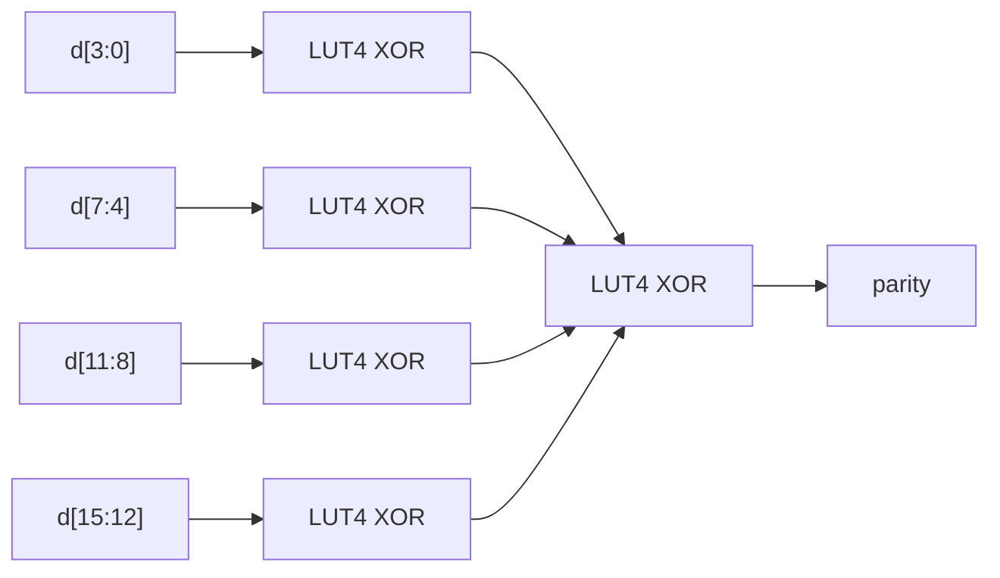

# 01.02 — Algebra Boole'a i minimalizacja — co z tego robi syntezator

> **Moduł:** [01 — Logika cyfrowa dla projektanta FPGA](README.md) · **Kod:** — · **DECA:** —
>
> **Czytaj:**
>
> - S. Harris, D. Harris, *Digital Design and Computer Architecture, RISC-V Edition* 💲, rozdz. 2.2–2.9 (algebra Boole'a, mapy Karnaugha, hazardy)
> - [MAX 10 FPGA Handbook](https://www.intel.com/programmable/technical-pdfs/max10-handbook.pdf) — część *Logic Elements and Logic Array Blocks*: budowa elementu LE i tablicy LUT
> - [HDLBits](https://hdlbits.01xz.net/) — działy *Basic Gates* i *Karnaugh Map to Circuit*

← [01.01](01.01-systemy-liczbowe-kody-i-liczby-ze-znakiem.md) · [spis modułu](README.md) · [01.03](01.03-bloki-kombinacyjne-multipleksery-dekodery.md) →

## Po co to jest

Algebra Boole'a jest językiem, w którym myśli syntezator. Projektant FPGA nie minimalizuje już wyrażeń ręcznie — robi to narzędzie, i robi to lepiej. Trzeba za to rozumieć, **na co** narzędzie zamienia logikę: na tablice LUT o stałej liczbie wejść. Od tego zależy, ile poziomów logiki ma ścieżka i czy projekt zmieści się w czasie zegara ([moduł 14](../14-analiza-czasowa/README.md)). Na rozmowie padają pytania o prawa De Morgana, mapy Karnaugha i o to, co jest w środku LUT.

## Intuicja

Tablica LUT (*look-up table*) to mała pamięć: $k$ wejść jest adresem, a zawartość komórki pod tym adresem jest wyjściem. LUT o 4 wejściach ma 16 komórek i potrafi zrealizować **każdą** funkcję 4 zmiennych — XOR, AND, dowolną dziwną tablicę prawdy — w tym samym czasie i za tę samą cenę. Dlatego w FPGA nie liczy się liczba bramek, tylko:

- **liczba wejść** funkcji (ile LUT trzeba, żeby je wszystkie „zebrać”),
- **głębokość** — przez ile LUT po kolei przechodzi sygnał.

Ręczna minimalizacja, która w technice TTL oszczędzała układy scalone, w FPGA zwykle niczego nie zmienia. Zmienia za to zmniejszenie liczby zmiennych, od których zależy wynik.

## Teoria

### Prawa algebry Boole'a

| Prawo | Postać iloczynowa | Postać sumowa |
|-------|-------------------|---------------|
| Element neutralny | $a \cdot 1 = a$ | $a + 0 = a$ |
| Element pochłaniający | $a \cdot 0 = 0$ | $a + 1 = 1$ |
| Idempotentność | $a \cdot a = a$ | $a + a = a$ |
| Dopełnienie | $a \cdot \overline{a} = 0$ | $a + \overline{a} = 1$ |
| Rozdzielność | $a(b + c) = ab + ac$ | $a + bc = (a+b)(a+c)$ |
| Pochłanianie (*absorption*) | $a(a + b) = a$ | $a + ab = a$ |
| Sklejanie (*combining*) | $(a+b)(a+\overline{b}) = a$ | $ab + a\overline{b} = a$ |
| Konsensus | $(a+b)(\overline{a}+c)(b+c) = (a+b)(\overline{a}+c)$ | $ab + \overline{a}c + bc = ab + \overline{a}c$ |
| **De Morgan** | $\overline{a \cdot b} = \overline{a} + \overline{b}$ | $\overline{a + b} = \overline{a} \cdot \overline{b}$ |

Prawo De Morgana tłumaczy, dlaczego sygnały aktywne niskim stanem nie są problemem: „dioda świeci, gdy przycisk A **lub** B jest wciśnięty” przy aktywnych niskich wejściach to `led_n = key_a_n & key_b_n` — iloczyn.

### Postacie kanoniczne

Każdą funkcję da się zapisać prosto z tablicy prawdy:

- **suma iloczynów** (*sum of products*, SOP) — suma mintermów, czyli wierszy, w których $f = 1$,
- **iloczyn sum** (*product of sums*, POS) — iloczyn makstermów, czyli wierszy, w których $f = 0$.

Mapa Karnaugha to tablica prawdy ułożona w kodzie Graya, tak że sąsiednie pola różnią się jedną zmienną. Grupując sąsiednie jedynki w prostokąty o rozmiarach $2^k$, korzysta się z prawa sklejania i dostaje minimalną postać SOP. Pola „obojętne” (*don't care*, oznaczane X lub −) można dołączyć do grupy, jeśli to ją powiększa.

### Co robi syntezator

1. **Optymalizacja logiczna** — upraszcza wyrażenia, usuwa logikę, która nie wpływa na wyjścia, propaguje stałe (wejście przyłączone do `0` usuwa całą gałąź).
2. **Odwzorowanie technologiczne** (*technology mapping*) — dzieli sieć logiczną na kawałki o co najwyżej $k$ wejściach i każdy umieszcza w jednej LUT. W MAX 10 $k = 4$; w nowszych układach (Cyclone 10 GX, Agilex, seria 7 AMD) $k = 6$.
3. **Wykorzystanie zasobów specjalnych** — łańcuchy przeniesień dla sumatorów i liczników ([01.04](01.04-uklady-arytmetyczne-sumatory-przeniesienia.md)), mnożarki sprzętowe, pamięci blokowe.

Szacowanie dla LUT o $k$ wejściach:

| Funkcja $n$ wejść | Liczba LUT | Poziomy logiki |
|-------------------|-----------|----------------|
| dowolna, $n \le k$ | 1 | 1 |
| AND, OR, XOR (parzystość) $n$ bitów — drzewo | $\approx \lceil (n-1)/(k-1) \rceil$ | $\lceil \log_k n \rceil$ |
| dowolna, $n > k$ (rozkład Shannona) | rośnie wykładniczo: $\approx 2^{n-k}$ | $\approx n - k + 1$ |
| multiplekser $2^m:1$ (dane + wybór) | patrz [01.03](01.03-bloki-kombinacyjne-multipleksery-dekodery.md) | |

Przykład: parzystość 16 bitów w LUT4 — na pierwszym poziomie 4 LUT po 4 bity, na drugim 1 LUT łączy ich 4 wyniki. Razem **5 LUT, 2 poziomy**.

**Rozkład Shannona** (*Shannon expansion*): $f = \overline{x} \cdot f|_{x=0} + x \cdot f|_{x=1}$. To dokładnie multiplekser sterowany zmienną $x$ — dlatego funkcja 5 zmiennych to dwie LUT4 i multiplekser (w MAX 10 realizowany w kolejnej LUT).

### Hazardy

Hazard (*glitch*) to krótki fałszywy impuls na wyjściu logiki kombinacyjnej, gdy wejścia zmieniają się jednocześnie, a ścieżki mają różne opóźnienia. W układzie **synchronicznym** hazardy nie mają znaczenia: przerzutnik próbkuje wynik dopiero na zboczu zegara, gdy wszystko się ustaliło (to warunek czasu setup — [01.06](01.06-parametry-czasowe-propagacja-setup-hold-clock.md)). Mają znaczenie, gdy wyjście logiki kombinacyjnej:

- steruje wejściem zegara albo asynchronicznego resetu,
- wychodzi bezpośrednio na pin do układu, który reaguje na zbocza (np. sygnał wyboru układu SPI),
- przekracza granicę domen zegara ([moduł 15](../15-zegary-reset-cdc/README.md)).

Lekarstwo w FPGA to nie dodawanie nadmiarowych implikantów jak w podręczniku, tylko **rejestr na wyjściu**.

## Schemat i przebiegi

Drzewo XOR liczące parzystość 16 bitów w LUT4:



Mapa Karnaugha dla $f(a,b,c,d)$ z mintermami 0, 2, 5, 7, 8, 10, 13, 15 (przykład z zadania 2):

```text
            cd
          00  01  11  10
   ab 00 | 1 | 0 | 0 | 1 |
      01 | 0 | 1 | 1 | 0 |
      11 | 0 | 1 | 1 | 0 |
      10 | 1 | 0 | 0 | 1 |
```

## Reguły i liczby do zapamiętania

| Reguła lub liczba | Kiedy obowiązuje |
|-------------------|------------------|
| LUT o $k$ wejściach realizuje dowolną funkcję $k$ zmiennych w jednym poziomie | MAX 10: $k = 4$; nowe rodziny: $k = 6$ |
| Koszt logiki w FPGA = liczba wejść i liczba poziomów LUT, nie liczba bramek | szacowanie zasobów i timingu |
| Drzewo AND/OR/XOR $n$ bitów: $\lceil \log_k n \rceil$ poziomów | szerokie porównania, parzystość, dekodery adresów |
| De Morgan: $\overline{ab} = \overline{a} + \overline{b}$, $\overline{a+b} = \overline{a}\,\overline{b}$ | sygnały aktywne niskim stanem |
| Hazardy są nieszkodliwe, jeśli wynik trafia do przerzutnika z tym samym zegarem | projekt synchroniczny |
| Nigdy nie steruj zegarem ani resetem asynchronicznym z logiki kombinacyjnej | zawsze |

## Typowe pułapki

- **Ręczna „optymalizacja” kosztem czytelności.** Wyrażenie przepisane na NAND-y nie da mniejszego układu — syntezator i tak sprowadzi je do LUT. Pisz tak, jak brzmi specyfikacja.
- ⚠️ **Zegar bramkowany logiką** (`assign gclk = clk & en;`). Hazard na `en` daje dodatkowe zbocze zegara, a przesunięcie zegara psuje analizę czasową. W FPGA zamiast tego używa się wejścia zezwolenia przerzutnika (*clock enable*) albo dedykowanych bloków bramkowania zegara.
- **Obojętne wartości w symulacji.** Przypisanie `y = 'x;` w gałęzi `default` daje syntezatorowi swobodę, ale w symulacji maskuje błędy: `X` może przejść przez porównanie `if` jako fałsz. W kodzie do produkcji wybierz konkretną wartość albo dodaj asercję.
- **Za szerokie wyrażenia na jednej ścieżce.** Porównanie dwóch słów 64-bitowych w LUT4 to drzewo 3–4 poziomów. Przy wysokim zegarze trzeba je podzielić rejestrem ([moduł 16](../16-wydajnosc-zasoby-moc/README.md)).

## Pytania rekrutacyjne

1. **Co jest w środku tablicy LUT i ile funkcji realizuje LUT o 4 wejściach?**

<details>
<summary>Odpowiedź</summary>

LUT to mała pamięć 16 × 1 bit (wypełniana podczas konfiguracji) i multiplekser 16:1, którego wejściami wyboru są cztery sygnały logiki. Realizuje dowolną z $2^{16} = 65\,536$ funkcji czterech zmiennych z tym samym opóźnieniem.
</details>

2. **Ile LUT4 i ile poziomów logiki zajmie 16-bitowy AND?**

<details>
<summary>Odpowiedź</summary>

Pięć LUT w dwóch poziomach: cztery LUT po 4 bity i jedna łącząca ich wyniki. Ogólnie drzewo $n$ wejść w LUT o $k$ wejściach ma $\lceil \log_k n \rceil$ poziomów.
</details>

3. **Czym jest hazard i kiedy w FPGA trzeba się nim przejmować?**

<details>
<summary>Odpowiedź</summary>

To krótki fałszywy impuls na wyjściu logiki kombinacyjnej, wynikający z różnych opóźnień ścieżek przy jednoczesnej zmianie wejść. W projekcie synchronicznym jest nieszkodliwy, bo przerzutnik próbkuje sygnał po jego ustaleniu. Szkodzi, gdy taki sygnał steruje zegarem, resetem asynchronicznym, wyjściem do układu reagującego na zbocza albo przechodzi do innej domeny zegara. Rozwiązanie: rejestr na wyjściu.
</details>

4. **Po co mapy Karnaugha, skoro syntezator minimalizuje sam?**

<details>
<summary>Odpowiedź</summary>

Do zrozumienia, jak działa sklejanie i wartości obojętne, do szybkiej analizy małych funkcji na papierze i na rozmowach kwalifikacyjnych. W pracy z FPGA ręcznej minimalizacji się nie robi — ważniejsze jest ograniczenie liczby zmiennych i poziomów logiki.
</details>

## Zadania

1. Uprość $f = \overline{a}\,b\,c + a\,b\,c + a\,b\,\overline{c} + a\,\overline{b}\,c$.

<details>
<summary>Odpowiedź</summary>

$\overline{a}bc + abc = bc$; $abc + ab\overline{c} = ab$; $abc + a\overline{b}c = ac$ (term $abc$ można użyć wielokrotnie, bo $x + x = x$). Wynik: $f = ab + bc + ac$ — funkcja większościowa, czyli przeniesienie sumatora pełnego.
</details>

2. Odczytaj z mapy Karnaugha w sekcji „Schemat i przebiegi” minimalną postać funkcji.

<details>
<summary>Odpowiedź</summary>

Narożniki (0, 2, 8, 10) dają $\overline{b}\,\overline{d}$, środkowy kwadrat (5, 7, 13, 15) daje $bd$. $f = \overline{b}\,\overline{d} + bd = \overline{b \oplus d}$ — funkcja nie zależy od $a$ i $c$. Syntezator zrobi z niej jedną LUT o dwóch użytych wejściach.
</details>

3. Ile LUT4 i ile poziomów logiki potrzebuje porównanie równości dwóch słów 12-bitowych?

<details>
<summary>Odpowiedź</summary>

Każda LUT4 porówna 2 pary bitów (4 wejścia) → 6 LUT na pierwszym poziomie. Sześć wyników łączy AND: jedna LUT na drugim poziomie zbiera cztery z nich, druga na trzecim — jej wynik i dwa pozostałe. Razem 8 LUT, 3 poziomy. (Narzędzie może też użyć łańcucha przeniesień — wtedy wynik bywa inny.)
</details>

4. Znajdź błąd:

```verilog
wire load_clk = clk & load_en;
always @(posedge load_clk) data_q <= data_in;
```

<details>
<summary>Odpowiedź</summary>

Zegar jest bramkowany logiką. Hazard na `load_en` może wygenerować dodatkowe zbocze, a opóźnienie bramki przesuwa zegar względem reszty układu, co psuje analizę czasową. Poprawnie: `always @(posedge clk) if (load_en) data_q <= data_in;` — syntezator użyje wejścia zezwolenia przerzutnika.
</details>

## Źródła

- Harris & Harris, *Digital Design and Computer Architecture, RISC-V Edition*, rozdz. 2.
- [MAX 10 FPGA Handbook](https://www.intel.com/programmable/technical-pdfs/max10-handbook.pdf) — *Logic Elements and Logic Array Blocks*.
- [UG949 — UltraFast Design Methodology Guide](https://docs.amd.com/r/en-US/ug949-vivado-design-methodology) — rozdział o poziomach logiki i ich wpływie na timing.
- [HDLBits](https://hdlbits.01xz.net/) — *Basic Gates*, *Karnaugh Map to Circuit*.
