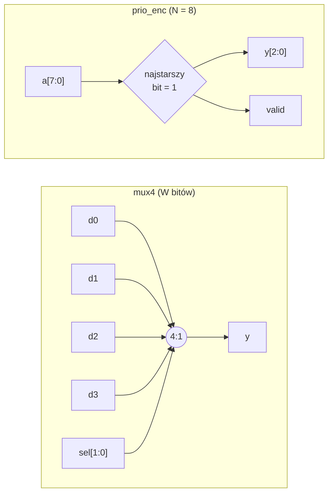

# 01.03 — Bloki kombinacyjne: multipleksery, dekodery, enkodery, komparatory

> **Moduł:** [01 — Logika cyfrowa dla projektanta FPGA](README.md) · **Kod:** VHDL · Verilog · SystemVerilog · **DECA:** 🛠️ tak · **Status:** ✅ pełny
>
> **Czytaj:**
>
> - S. Harris, D. Harris, *Digital Design and Computer Architecture, RISC-V Edition* 💲, rozdz. 2.8 (multipleksery i dekodery) i 5.2.4 (komparatory)
> - [Quartus Prime Standard Edition — Design Recommendations](https://www.intel.com/content/www/us/en/docs/programmable/683323/) — rozdział o zalecanych stylach HDL: multipleksery, instrukcje `case` i `if`
> - [HDLBits](https://hdlbits.01xz.net/) — działy *Multiplexers* i *Procedures* (`always` z `case`, unikanie zatrzasków)

← [01.02](01.02-algebra-boole-a-i-minimalizacja-co-z-tego-robi.md) · [spis modułu](README.md) · [01.04](01.04-uklady-arytmetyczne-sumatory-przeniesienia.md) →

## Po co to jest

Z tych czterech bloków składa się prawie cała logika sterująca: multiplekser wybiera dane (ścieżka danych procesora, przełączanie źródeł obrazu), dekoder zamienia adres na sygnały wyboru rejestrów i układów, enkoder priorytetowy wybiera zgłoszenie przerwania albo pierwszego klienta arbitra, komparator sprawdza, czy licznik doszedł do końca. W HDL nie buduje się ich z bramek, tylko opisuje zachowanie — trzeba jednak wiedzieć, ile kosztują i jak je opisać, żeby nie powstał zatrzask.

## Intuicja

- **Multiplekser** to przełącznik obrotowy: sygnał wyboru wskazuje, które wejście trafia na wyjście.
- **Dekoder** odwrotnie — zamienia numer na „zapal tę jedną lampkę z $2^N$”.
- **Enkoder** zamienia lampkę z powrotem na numer. Wersja **priorytetowa** radzi sobie z kilkoma zapalonymi lampkami naraz: zwraca numer najważniejszej i osobno mówi, czy zapalona jest jakakolwiek (`valid`).
- **Komparator** odpowiada na pytania „równe?”, „mniejsze?”, „większe?”. Równość to drzewo XOR i AND; „mniejsze” to w praktyce odejmowanie i sprawdzenie pożyczki.

## Teoria

### Multiplekser

Multiplekser $2^m : 1$ dla słów 1-bitowych ma $2^m + m$ wejść. Koszt w LUT:

| Multiplekser | Wejścia | LUT4 (MAX 10) | LUT6 |
|--------------|---------|---------------|------|
| 2:1 | 3 | 1 | 1 |
| 4:1 | 6 | 2 (podział z użyciem jednego z bitów wyboru w obu LUT) | 1 |
| 8:1 | 11 | ok. 5 | 2 + mux w strukturze bloku |
| 16:1 | 20 | ok. 10 | 4 + mux w strukturze bloku |

Dla słów $W$-bitowych koszt mnoży się przez $W$. Szeroki multiplekser to jedna z najdroższych konstrukcji w FPGA — jeśli 32 źródła po 32 bity trafiają do jednego rejestru, to ok. 32 × 21 LUT4 w kilku poziomach logiki. Rozwiązania: potokowanie, multiplekser w pamięci blokowej, magistrala z kodowaniem 1 z n i bramką OR (*AND-OR mux*).

**Multiplekser AND-OR**: przy sygnałach wyboru w kodzie 1 z n $y = \bigvee_i (sel_i \wedge d_i)$. Nie potrzebuje dekodowania numeru i dobrze się skaluje, ale wymaga gwarancji, że co najwyżej jeden bit wyboru jest ustawiony.

### Dekoder

Dekoder $N : 2^N$ to $2^N$ bramek AND, każda rozpoznaje jeden wzór wejścia. Wyjście w kodzie 1 z n (*one-hot*). Typowe użycie: dekodowanie adresu w szynie rejestrów ([moduł 21](../21-magistrale-on-chip/README.md)) — tam porównuje się tylko starsze bity adresu i dekoder ma często dodatkowe wejście zezwolenia.

### Enkoder priorytetowy

Zwraca numer najstarszego (albo najmłodszego — to umowa) ustawionego bitu. Zwykły enkoder bez priorytetu ma sens tylko wtedy, gdy wejście na pewno jest w kodzie 1 z n; wtedy wystarczy OR odpowiednich bitów. Enkoder priorytetowy jest łańcuchem decyzji „jeśli bit 7, to 7, w przeciwnym razie jeśli bit 6…” — syntezator buduje z niego strukturę o głębokości rosnącej z $\log_k N$, ale z większą liczbą LUT niż prosty enkoder.

W HDL priorytet daje kolejność: łańcuch `if … else if` albo pętla, w której późniejsza iteracja nadpisuje wcześniejszą. Instrukcja `case` z rozłącznymi gałęziami priorytetu **nie** tworzy.

### Komparator

- **Równość** $W$ bitów: $W$ bramek XNOR i AND wszystkich wyników — drzewo $\lceil \log_k 2W \rceil$ poziomów.
- **Porównanie wielkości** liczb bez znaku: $a < b \iff$ odejmowanie $a - b$ daje pożyczkę. Syntezator używa do tego łańcucha przeniesień ([01.04](01.04-uklady-arytmetyczne-sumatory-przeniesienia.md)), więc komparator 32-bitowy kosztuje ok. 32 LE i jest szybki.
- **Liczby ze znakiem** porównuje się inaczej: różne bity znaku rozstrzygają od razu. W HDL wystarczy zadeklarować typ ze znakiem (`signed`).

### Jak opisać logikę kombinacyjną w procesie

Proces kombinacyjny (`process (all)`, `always @*`, `always_comb`) musi przypisać **każdemu** wyjściu wartość w **każdej** ścieżce wykonania. Jeśli w którejś ścieżce wyjście nie dostanie wartości, musi „pamiętać” poprzednią — i syntezator wstawia zatrzask ([01.05](01.05-przerzutniki-zatrzaski-i-rejestry.md)). Najprostsza obrona: na początku procesu przypisz wartości domyślne, potem nadpisuj je warunkami. Tak są napisane wszystkie przykłady w tym temacie.

## Schemat i przebiegi



Enkoder priorytetowy dla kilku wartości wejścia:

| `a` | `y` | `valid` |
|-----|-----|---------|
| `0000_0000` | 0 (bez znaczenia) | 0 |
| `0000_0001` | 0 | 1 |
| `0001_0110` | 4 | 1 |
| `1000_0001` | 7 | 1 |

## Kod: VHDL

```vhdl
  -- mux4.vhd: wybór przez przypisanie warunkowe
  with sel select y <=
    d0 when "00",
    d1 when "01",
    d2 when "10",
    d3 when others;

  -- prio_enc.vhd: wartości domyślne, potem pętla od najmłodszego bitu
  process (all)
  begin
    y     <= (others => '0');
    valid <= '0';
    for i in 0 to N - 1 loop
      if a(i) = '1' then
        y     <= std_logic_vector(to_unsigned(i, y'length));
        valid <= '1';
      end if;
    end loop;
  end process;
```

<!-- plik: hdl/vhdl/prio_enc.vhd -->
Pliki: [mux4.vhd](hdl/vhdl/mux4.vhd) · [decoder.vhd](hdl/vhdl/decoder.vhd) · [prio_enc.vhd](hdl/vhdl/prio_enc.vhd) · [comparator.vhd](hdl/vhdl/comparator.vhd) · [util_pkg.vhd](hdl/vhdl/util_pkg.vhd) · testbench: [tb_comb_blocks.vhd](hdl/vhdl/tb_comb_blocks.vhd)

- `when others` w multiplekserze pokrywa też wartości `'X'`, `'U'` i inne z typu `std_logic` — bez niego instrukcja nie skompilowałaby się, bo `with … select` musi pokryć wszystkie przypadki.
- VHDL nie ma wbudowanej funkcji $\lceil \log_2 \rceil$, dlatego szerokość wyjścia enkodera liczy `clog2` z pakietu [util_pkg.vhd](hdl/vhdl/util_pkg.vhd). Funkcja jest wywoływana w czasie elaboracji, więc nie powstaje z niej żaden sprzęt.
- W procesie sygnał przyjmuje **ostatnią** przypisaną wartość — dlatego pętla od najmłodszego bitu daje priorytet najstarszemu.

## Kod: Verilog

```verilog
    // decoder.v
    always @* begin
        y    = {(1<<N){1'b0}};   // wartość domyślna: brak zatrzasku
        y[a] = 1'b1;
    end

    // comparator.v
    assign eq = (a == b);
    assign lt = (a <  b);
    assign gt = (a >  b);
```

<!-- plik: hdl/verilog/decoder.v -->
Pliki: [mux4.v](hdl/verilog/mux4.v) · [decoder.v](hdl/verilog/decoder.v) · [prio_enc.v](hdl/verilog/prio_enc.v) · [comparator.v](hdl/verilog/comparator.v) · testbench: [tb_comb_blocks.v](hdl/verilog/tb_comb_blocks.v)

- W bloku kombinacyjnym używa się przypisań blokujących `=` — kolejne linie widzą już nowe wartości, dzięki czemu wartość domyślna może być nadpisana.
- `y[a] = 1'b1` to indeksowanie zmienną — syntezator zamienia je na dekoder. Ten sam zapis po prawej stronie (`x = d[a]`) daje multiplekser.
- `$clog2` jest w Verilogu-2005 funkcją systemową liczoną w czasie elaboracji.

## Kod: SystemVerilog

```systemverilog
    // mux4.sv
    always_comb begin
        unique case (sel)
            2'd0: y = d0;
            2'd1: y = d1;
            2'd2: y = d2;
            2'd3: y = d3;
        endcase
    end
```

<!-- plik: hdl/sv/mux4.sv -->
Pliki: [mux4.sv](hdl/sv/mux4.sv) · [decoder.sv](hdl/sv/decoder.sv) · [prio_enc.sv](hdl/sv/prio_enc.sv) · [comparator.sv](hdl/sv/comparator.sv) · testbench: [tb_comb_blocks.sv](hdl/sv/tb_comb_blocks.sv)

- `always_comb` sprawdza, czy blok jest naprawdę kombinacyjny — przypadkowy zatrzask kończy się ostrzeżeniem albo błędem narzędzia.
- `unique case` mówi: gałęzie się wykluczają i jedna z nich zawsze pasuje. Symulator zgłasza naruszenie w czasie działania, a syntezator może pominąć logikę priorytetu. Tu wszystkie cztery wartości są wymienione, więc `default` nie jest potrzebny.
- `'0` wypełnia zerami wektor dowolnej szerokości — nie trzeba powtarzać szerokości jak w `{W{1'b0}}`.

## Co powstaje po syntezie

Oczekiwany wynik dla MAX 10 (LUT4) — sprawdź go w raporcie *Analysis & Synthesis → Resource Usage Summary* po skompilowaniu każdego modułu osobno jako modułu nadrzędnego:

| Blok | Parametry | MAX 10, szacunkowo LE | Yosys, LUT4 | Uwagi |
|------|-----------|-----------------------|-------------|-------|
| `mux4` | W = 8 | ok. 16 | 25 | 2 LUT na bit przy sprytnym podziale |
| `decoder` | N = 3 | 8 | 8 | jedna LUT na wyjście (3 wejścia) |
| `prio_enc` | N = 8 | ok. 5–8 | 8 | zależnie od tego, jak narzędzie podzieli łańcuch |
| `comparator` | W = 8 | ok. 10–20 | 20 | `lt` i `gt` na łańcuchu przeniesień, `eq` jako drzewo |

Kolumna *Yosys* to wynik syntezy ogólnej na LUT4 (`synth -lut 4`, Yosys 0.33) z zadania CI *Synteza Verilog (Yosys)* — bez łańcuchów przeniesień i bloków specjalnych MAX 10, więc liczby są orientacyjne. Kolumna *MAX 10* to oczekiwanie dla Quartusa — sprawdź je w raporcie.

Na schemacie *Tools → Netlist Viewers → RTL Viewer* zobaczysz bloki ogólne (MUX, operatory porównania), a w *Technology Map Viewer* — rzeczywiste elementy LE.

## Weryfikacja

Testbench `tb_comb_blocks` sprawdza wszystkie kombinacje wejść:

- multiplekser — każde wejście ma inny wzór (`1`, `2`, `4`, `8`), więc pomylenie wejść od razu wychodzi,
- dekoder N = 3 — wszystkie 8 adresów,
- enkoder priorytetowy N = 8 — wszystkie 256 wartości, a oczekiwany wynik liczy **niezależny** model w testbenchu (pętla szukająca najstarszego bitu),
- komparator W = 4 — wszystkie 256 par liczb.

Dla małych układów kombinacyjnych pełne sprawdzenie (*exhaustive test*) jest najprostsze i daje pewność. Dla szerokich słów trzeba wybierać przypadki albo losować ([moduł 10](../10-weryfikacja-systemverilog/README.md)).

```bash
python3 tools/run_hdl_tests.py modules/01-logika-cyfrowa
```

## Na płytce DECA

Projekt [deca/logika](deca/logika/) łączy trzy bloki z tego modułu w czysto kombinacyjny układ — bez zegara. Dwa przełączniki to liczba `a`, dwa przyciski to liczba `b`:

| Wejście / wyjście | Znaczenie |
|-------------------|-----------|
| `SW[1:0]` | `a` (przełącznik w dół = 0) |
| `KEY[1:0]` | `b` = odwrócone `KEY` (wciśnięty = 1) |
| `LED[3:0]` | dekoder `a` — świeci dokładnie jedna dioda, o numerze `a` |
| `LED[5:4]` | suma `a + b` (dwa młodsze bity) |
| `LED[6]` | przeniesienie sumy |
| `LED[7]` | `a > b` |

<!-- zakladki: deca/logika/deca_top.vhd | deca/logika/deca_top.v | deca/logika/deca_top.sv -->
Pliki: [deca_top.vhd](deca/logika/deca_top.vhd) · [deca_top.v](deca/logika/deca_top.v) · [deca_top.sv](deca/logika/deca_top.sv) · [logika.sdc](deca/logika/logika.sdc) · [utworz_projekt.tcl](deca/logika/utworz_projekt.tcl)

Kluczowe linie (Verilog):

```verilog
    wire [1:0] b = ~KEY;               // wciśnięty przycisk = jedynka logiczna
    decoder    #(.N(2)) u_dec (.a(a), .y(dec));
    rca_adder  #(.W(2)) u_add (.a(a), .b(b), .cin(1'b0), .s(sum), .cout(cout));
    comparator #(.W(2)) u_cmp (.a(a), .b(b), .eq(), .lt(), .gt(gt));
    assign LED = ~{gt, cout, sum, dec};   // diody DECA świecą przy 0
```

Projekt nie ma zegara, więc w pliku SDC nie ma `create_clock`. Ścieżki od przełączników do diod są wyłączone z analizy (`set_false_path`), żeby Timing Analyzer nie zgłaszał ich jako nieograniczonych.

```bash
cd modules/01-logika-cyfrowa/deca/logika
quartus_sh -t utworz_projekt.tcl sv        # albo vhdl, verilog
quartus_sh --flow compile logika
quartus_pgm -c 1 -m jtag -o "p;output_files/logika.sof"
```

Jak sprawdzić: przy wszystkich przełącznikach w dół i niewciśniętych przyciskach świeci tylko `LED[0]` (dekoder wskazuje 0). Przesuń `SW[0]` w górę — zapala się `LED[1]` zamiast `LED[0]`, a `LED[4]` pokazuje sumę 1 i `LED[7]` pokazuje, że $1 > 0$. Wciśnij oba przyciski ($b = 3$) przy $a = 3$: suma 6 = `110`, więc świecą `LED[6]` i `LED[5]`, a `LED[4]` gaśnie.

## Reguły i liczby do zapamiętania

| Reguła lub liczba | Kiedy obowiązuje |
|-------------------|------------------|
| Proces kombinacyjny: każde wyjście dostaje wartość w każdej ścieżce — najprościej przez wartości domyślne na początku | `process (all)`, `always @*`, `always_comb` |
| Multiplekser 4:1 = 2 LUT4 lub 1 LUT6 na bit | szacowanie zasobów |
| Priorytet tworzy kolejność `if … else if` (albo ostatnie przypisanie w pętli), nie `case` | enkodery, arbitry |
| Porównanie `<`, `>` idzie na łańcuch przeniesień; `==` na drzewo LUT | komparatory |
| Małe układy kombinacyjne testuj wyczerpująco — wszystkie kombinacje wejść | do ok. 20 bitów wejścia |

## Typowe pułapki

- ⚠️ **Niekompletny `case` lub `if` bez `else` w procesie kombinacyjnym** → zatrzask. W symulacji układ „działa”, w sprzęcie zatrzask psuje analizę czasową. Quartus zgłasza ostrzeżenie *inferring latch(es) for variable …* — traktuj je jak błąd.
- **Niepełna lista czułości w Verilogu-1995** (`always @(a or b)` bez `sel`). Symulacja nie reaguje na zmianę pominiętego sygnału, synteza tak — wyniki się rozjeżdżają. Zawsze `always @*` albo `always_comb`.
- ⚠️ **`unique case` / `parallel_case` przy niespełnionym założeniu.** Jeśli gałęzie w rzeczywistości się nakładają, syntezator usunie priorytet i sprzęt zachowa się inaczej niż symulacja bez sprawdzania. W SystemVerilogu `unique` przynajmniej zgłasza ostrzeżenie w symulacji — czytaj je.
- **Dekoder adresu bez zezwolenia.** Wyjście „wybrano rejestr 3” jest aktywne cały czas, gdy na szynie jest adres 3, a nie tylko podczas zapisu. Do dekodera adresu prawie zawsze dochodzi sygnał ważności transakcji.

## Pytania rekrutacyjne

1. **Kiedy w procesie kombinacyjnym powstaje zatrzask i jak tego uniknąć?**

<details>
<summary>Odpowiedź</summary>

Gdy istnieje ścieżka wykonania, w której wyjście nie dostaje wartości — brak `else`, niekompletny `case` bez `default`. Wtedy sygnał musi pamiętać poprzednią wartość, czyli powstaje zatrzask. Zapobiega się przez przypisanie wartości domyślnych na początku procesu albo przez pełne `if/else` i `default` w `case`. W SystemVerilogu `always_comb` dodatkowo każe narzędziu sprawdzić, czy zatrzask nie powstał.
</details>

2. **Jak zrealizować multiplekser 32:1 dla słów 32-bitowych, żeby nie był wąskim gardłem timingu?**

<details>
<summary>Odpowiedź</summary>

Podzielić go potokowo: np. osiem multiplekserów 4:1 w pierwszym takcie i 8:1 w drugim, z rejestrem pomiędzy. Inne możliwości: wybór w kodzie 1 z n z logiką AND-OR (gdy sygnał wyboru i tak jest w tym kodzie), zastąpienie multipleksera pamięcią blokową, jeśli dane są zapisywane w różnych chwilach, albo przeniesienie wyboru wcześniej w potoku.
</details>

3. **Czym różni się enkoder od enkodera priorytetowego?**

<details>
<summary>Odpowiedź</summary>

Zwykły enkoder zakłada, że na wejściu jest dokładnie jedna jedynka, i zwraca jej numer — dla wejść z kilkoma jedynkami wynik jest bez sensu (OR numerów). Enkoder priorytetowy wybiera najważniejszy (np. najstarszy) ustawiony bit i ma wyjście `valid`, mówiące, czy jakikolwiek bit jest ustawiony. Używa się go w kontrolerach przerwań i arbitrach.
</details>

4. **Dlaczego w Verilogu nie pisze się `always @(a or b)` dla logiki kombinacyjnej?**

<details>
<summary>Odpowiedź</summary>

Bo łatwo pominąć sygnał w liście czułości. Symulator wykonuje blok tylko przy zmianie sygnałów z listy, więc przy zmianie pominiętego sygnału wyjście się nie zmieni. Syntezator listę czułości ignoruje i buduje pełną logikę. Wynik: niezgodność symulacji i sprzętu. `always @*` albo `always_comb` wyznaczają listę automatycznie.
</details>

## Zadania

1. Ile LUT4 i ile poziomów logiki potrzebuje dekoder 4 na 16? A 6 na 64?

<details>
<summary>Odpowiedź</summary>

4 na 16: każde wyjście zależy od 4 bitów → 16 LUT w jednym poziomie. 6 na 64: każde wyjście zależy od 6 bitów → najpierw wspólne częściowe dekodery (np. 2 na 4 i 4 na 16, czyli 4 + 16 LUT), potem 64 LUT łączące po jednym wyjściu z każdego → ok. 84 LUT w 2 poziomach.
</details>

2. Napisz w wybranym języku enkoder priorytetowy, w którym wygrywa **najmłodszy** ustawiony bit. Zmodyfikuj testbench tak, żeby go sprawdzał. **Kryterium zaliczenia:** testbench wypisuje `PASS` dla wszystkich 256 wartości.

<details>
<summary>Wskazówka</summary>

Wystarczy odwrócić kierunek pętli (od `N - 1` do `0`) — ostatnie przypisanie wygrywa. W modelu w testbenchu też trzeba szukać najmłodszego bitu.
</details>

3. Znajdź błąd:

```systemverilog
always_comb begin
    case (op)
        2'b00: y = a + b;
        2'b01: y = a - b;
        2'b10: y = a & b;
    endcase
end
```

<details>
<summary>Odpowiedź</summary>

Brak gałęzi dla `op = 2'b11` — `y` musi wtedy pamiętać poprzednią wartość, więc powstaje zatrzask (`always_comb` to wykryje i zgłosi). Naprawa: `default: y = '0;` albo przypisanie domyślne przed `case`.
</details>

4. Zmień projekt `logika` na DECA tak, żeby `LED[7]` pokazywała `a == b` zamiast `a > b` (we wszystkich trzech językach albo w wybranym). **Kryterium zaliczenia:** dioda świeci dokładnie wtedy, gdy liczba ustawiona przełącznikami jest równa liczbie wciśniętych przycisków (zapisanej dwójkowo).

## Źródła

- Harris & Harris, *Digital Design and Computer Architecture, RISC-V Edition*, rozdz. 2.8 i 5.2.4.
- [Quartus Prime Standard Edition — Design Recommendations](https://www.intel.com/content/www/us/en/docs/programmable/683323/) — zalecane style HDL.
- [HDLBits](https://hdlbits.01xz.net/) — *Multiplexers*, *Procedures*.
- C. Cummings, *"full_case parallel_case", the Evil Twins of Verilog Synthesis* ([Sunburst Design](http://www.sunburst-design.com/papers/)).
