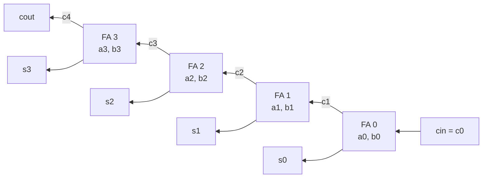

# 01.04 — Układy arytmetyczne: sumatory, przeniesienia, mnożenie

> **Moduł:** [01 — Logika cyfrowa dla projektanta FPGA](README.md) · **Kod:** VHDL · Verilog · SystemVerilog · **DECA:** 🛠️ tak · **Status:** ✅ pełny
>
> **Czytaj:**
>
> - S. Harris, D. Harris, *Digital Design and Computer Architecture, RISC-V Edition* 💲, rozdz. 5.2 (sumatory: ripple-carry, carry-lookahead, prefiksowe; odejmowanie, komparatory, mnożenie)
> - [MAX 10 FPGA Handbook](https://www.intel.com/programmable/technical-pdfs/max10-handbook.pdf) — *Logic Elements*: tryb arytmetyczny elementu LE i łańcuch przeniesień; *Embedded Multipliers*
> - [HDLBits](https://hdlbits.01xz.net/) — dział *Arithmetic Circuits* (sumator pełny, ripple-carry, przepełnienie, sumator BCD)

← [01.03](01.03-bloki-kombinacyjne-multipleksery-dekodery.md) · [spis modułu](README.md) · [01.05](01.05-przerzutniki-zatrzaski-i-rejestry.md) →

## Po co to jest

Liczniki, wskaźniki kolejek, akumulatory, filtry, adresy pamięci — wszystko to sumatory. W FPGA sumator ma osobny, szybki sprzęt (łańcuch przeniesień), a mnożenie — dedykowane bloki mnożarek. Projektant musi wiedzieć, kiedy narzędzie użyje tych zasobów, ile bitów ma wynik i dlaczego podręcznikowe sumatory „szybkie” (carry-lookahead) w FPGA zwykle są wolniejsze od zwykłego `+`. To również stały punkt rozmów: „narysuj sumator pełny”, „jak wykryć przepełnienie”, „ile mnożarek zajmie mnożenie 32 × 32”.

## Intuicja

Dodawanie w słupku: każda kolumna dodaje dwie cyfry i przeniesienie z prawej, oddaje cyfrę wyniku i przeniesienie w lewo. Sumator pełny to jedna kolumna, sumator *ripple-carry* to rząd kolumn połączonych przeniesieniami. Wolne jest tylko jedno: przeniesienie musi „przebiec” przez wszystkie kolumny, zanim najstarszy bit będzie pewny.

Szybkie sumatory ASIC liczą przeniesienia równolegle, za cenę dużo większej logiki. FPGA rozwiązuje problem inaczej — prowadzi przeniesienie specjalną, bardzo krótką ścieżką między sąsiednimi elementami logicznymi. Wąskie gardło zostaje, ale jest kilkukrotnie szybsze niż przejście przez LUT i połączenia ogólne.

## Teoria

### Półsumator i sumator pełny

| Układ | Wejścia | Suma | Przeniesienie |
|-------|---------|------|---------------|
| półsumator (*half adder*) | $a, b$ | $s = a \oplus b$ | $c = ab$ |
| sumator pełny (*full adder*) | $a, b, c_{in}$ | $s = a \oplus b \oplus c_{in}$ | $c_{out} = ab + c_{in}(a \oplus b)$ |

Dwa sygnały pomocnicze opisują, co kolumna robi z przeniesieniem:

- **generowanie** $g = ab$ — kolumna wytwarza przeniesienie niezależnie od wejścia,
- **propagacja** $p = a \oplus b$ — kolumna przepuszcza przeniesienie z wejścia.

Wtedy $c_{out} = g + p \cdot c_{in}$.

### Sumatory wielobitowe

| Architektura | Opóźnienie | Koszt | W FPGA |
|--------------|-----------|-------|--------|
| *ripple-carry* (RCA) | $\propto W$ | $W$ sumatorów pełnych | **domyślna** — na łańcuchu przeniesień |
| *carry-lookahead* (CLA) | $\propto \log W$ (bloki) | duża logika $g, p$ | zwykle wolniejsza niż łańcuch przeniesień |
| *carry-select* | $\propto \sqrt{W}$ | dwa sumatory + multipleksery | czasem przy bardzo szerokich słowach |
| prefiksowe (Kogge-Stone, Brent-Kung) | $\propto \log W$ | dużo połączeń | ASIC, rzadko w FPGA |
| *carry-save* (CSA) | $O(1)$ na poziom | 1 sumator pełny na bit | sumowanie wielu składników (drzewa mnożarek, akumulatory) |

**Łańcuch przeniesień w MAX 10.** Element logiczny (LE) w trybie arytmetycznym dzieli LUT4 na dwie LUT3: jedna liczy sumę, druga przeniesienie, które idzie dedykowanym połączeniem do następnego LE. Łańcuch biegnie przez 16 LE w bloku LAB i przechodzi do sąsiedniego bloku. Każdy bit sumatora to **jeden LE**. Syntezator buduje łańcuch, gdy rozpozna operator `+`, `-`, porównanie `<`, `>` albo licznik.

Sumator opisany strukturalnie z bramek (jak `rca_adder` w tym temacie) jest **poprawny**, ale narzędzie widzi w nim zwykłą sieć logiczną. Część syntezatorów odtworzy z niej łańcuch przeniesień, część zrealizuje ją na LUT i połączeniach ogólnych — wolniej. Dlatego w kodzie produkcyjnym pisze się `a + b`, a strukturalny sumator jest tu tylko po to, żeby zobaczyć budowę układu.

### Odejmowanie i jednostka dodająco-odejmująca

$a - b = a + \overline{b} + 1$ w kodzie U2 ([01.01](01.01-systemy-liczbowe-kody-i-liczby-ze-znakiem.md)). Jednostka `add/sub`: wejście $b$ przechodzi przez XOR z sygnałem `sub`, a `sub` trafia też na wejście przeniesienia $c_{in}$. W MAX 10 mieści się to w tym samym LE co sumator.

**Flagi** (jak w procesorze):

| Flaga | Wzór | Znaczenie |
|-------|------|-----------|
| C (*carry*) | $c_{out}$ najstarszego bitu | przeniesienie (dodawanie) lub brak pożyczki (odejmowanie) — liczby bez znaku |
| V (*overflow*) | $c_{W} \oplus c_{W-1}$ | przepełnienie w U2 |
| N (*negative*) | $s_{W-1}$ | wynik ujemny w U2 |
| Z (*zero*) | $\overline{s_{W-1} + \dots + s_0}$ | wynik równy zero |

### Mnożenie

Iloczyn liczb $N$- i $M$-bitowych ma $N + M$ bitów. Mnożenie dwójkowe to suma iloczynów częściowych: $a \cdot b = \sum_i b_i \cdot (a \ll i)$ — każdy iloczyn częściowy to $a$ albo zero.

| Sposób | Koszt | Kiedy |
|--------|-------|-------|
| **mnożarka sprzętowa** (*embedded multiplier*, DSP) | 1 blok na mnożenie do 18 × 18 (MAX 10; dwa niezależne 9 × 9 w jednym bloku) | domyślnie dla `a * b` o szerokości od kilku bitów |
| mnożenie w logice (drzewo sumatorów) | rzędu $N \cdot M$ LE | gdy zabraknie bloków mnożarek; bardzo małe szerokości |
| mnożenie przez stałą | przesunięcia i dodawania: $x \cdot 10 = (x \ll 3) + (x \ll 1)$ | stałe współczynniki; syntezator zwykle robi to sam |
| mnożenie sekwencyjne (przesuń i dodaj) | 1 sumator, $N$ taktów | gdy przepustowość nie jest ważna |

MAX 10 10M50 ma 144 bloki mnożarek 18 × 18. Mnożenie 32 × 32 bez znaku składa się z czterech iloczynów 16 × 16 (lub 18 × 18), czyli zajmuje 4 bloki i sumatory w logice. Szczegóły, potokowanie mnożarek i liczby ze znakiem — [moduł 19](../19-arytmetyka/README.md).

### Dzielenie

Dzielenie przez potęgę dwójki to przesunięcie (dla U2 — arytmetyczne, z zaokrągleniem w dół). Dzielenie przez stałą zastępuje się mnożeniem przez odwrotność w zapisie stałoprzecinkowym. Ogólne dzielenie jest kosztowne: operator `/` z dwoma zmiennymi argumentami tworzy ogromną sieć kombinacyjną o bardzo długiej ścieżce. Używa się dzielników sekwencyjnych (1 bit wyniku na takt) albo gotowych bloków IP.

## Schemat i przebiegi

Sumator ripple-carry 4-bitowy:



Najdłuższa ścieżka (*critical path*): od $a_0$ lub $c_{in}$ przez wszystkie przeniesienia do $s_3$ i $c_{out}$. Najgorszy przypadek: $a = 1111$, $b = 0000$, a $c_{in}$ zmienia się z 0 na 1 — przeniesienie musi przejść przez wszystkie bity.

Mnożenie 4 × 4 na papierze ($11 \cdot 13 = 143$):

```text
        1011      a = 11
      × 1101      b = 13
      ------
        1011      b0 = 1
       0000       b1 = 0
      1011        b2 = 1
     1011         b3 = 1
    --------
    10001111      = 143 (8 bitów)
```

## Kod: VHDL

```vhdl
  -- rca_adder.vhd: generowanie W sumatorów pełnych
  c(0) <= cin;
  g_fa : for i in 0 to W - 1 generate
    u_fa : entity work.full_adder
      port map (a => a(i), b => b(i), cin => c(i), s => s(i), cout => c(i + 1));
  end generate g_fa;
  cout <= c(W);

  -- adder.vhd: opis behawioralny, poszerzenie do W + 1 bitów
  sum  <= resize(unsigned(a), W + 1) + resize(unsigned(b), W + 1) + unsigned'(0 => cin);
  s    <= std_logic_vector(sum(W - 1 downto 0));
  cout <= sum(W);
```

<!-- plik: hdl/vhdl/adder.vhd -->
Pliki: [full_adder.vhd](hdl/vhdl/full_adder.vhd) · [rca_adder.vhd](hdl/vhdl/rca_adder.vhd) · [adder.vhd](hdl/vhdl/adder.vhd) · [mult.vhd](hdl/vhdl/mult.vhd) · testbench: [tb_adders.vhd](hdl/vhdl/tb_adders.vhd)

- `numeric_std` liczy `+` na szerokości **dłuższego** argumentu — bez `resize` przeniesienie by zginęło. Stąd poszerzenie obu składników do $W + 1$ bitów.
- `unsigned'(0 => cin)` to jednobitowy wektor `unsigned` utworzony z sygnału `std_logic` (kwalifikacja typu i agregat). `+` z `std_logic` bezpośrednio nie istnieje.
- Mnożenie `unsigned * unsigned` daje wynik o sumie szerokości argumentów — tu $2W$, bez dodatkowych zabiegów.

## Kod: Verilog

```verilog
    // rca_adder.v
    wire [W:0] c;
    assign c[0] = cin;
    genvar i;
    generate
        for (i = 0; i < W; i = i + 1) begin : g_fa
            full_adder u_fa (.a(a[i]), .b(b[i]), .cin(c[i]), .s(s[i]), .cout(c[i+1]));
        end
    endgenerate
    assign cout = c[W];

    // adder.v
    assign {cout, s} = a + b + cin;
```

<!-- plik: hdl/verilog/rca_adder.v -->
Pliki: [full_adder.v](hdl/verilog/full_adder.v) · [rca_adder.v](hdl/verilog/rca_adder.v) · [adder.v](hdl/verilog/adder.v) · [mult.v](hdl/verilog/mult.v) · testbench: [tb_adders.v](hdl/verilog/tb_adders.v)

- W Verilogu szerokość działania wynika z kontekstu: lewa strona `{cout, s}` ma $W + 1$ bitów, więc wszystkie argumenty są poszerzane do $W + 1$ **przed** dodawaniem i przeniesienie się zachowuje. To samo wyrażenie przypisane do `s` ($W$ bitów) zgubiłoby przeniesienie.
- Nazwa bloku `g_fa` w pętli `generate` jest potrzebna, żeby hierarchia miała przewidywalne nazwy (`g_fa[2].u_fa`) — przydaje się w przebiegach i ograniczeniach.

## Kod: SystemVerilog

```systemverilog
    // rca_adder.sv: pętla generate bez słów kluczowych generate/endgenerate i bez osobnego genvar
    for (genvar i = 0; i < W; i++) begin : g_fa
        full_adder u_fa (.a(a[i]), .b(b[i]), .cin(c[i]), .s(s[i]), .cout(c[i+1]));
    end

    // mult.sv
    assign p = a * b;
```

<!-- plik: hdl/sv/rca_adder.sv -->
Pliki: [full_adder.sv](hdl/sv/full_adder.sv) · [rca_adder.sv](hdl/sv/rca_adder.sv) · [adder.sv](hdl/sv/adder.sv) · [mult.sv](hdl/sv/mult.sv) · testbench: [tb_adders.sv](hdl/sv/tb_adders.sv)

- Reguły szerokości są takie same jak w Verilogu. SystemVerilog dodaje rzutowanie na szerokość `W'(x)` i na typ `int'(x)` — testbench używa ich, żeby porównywać wyniki z arytmetyką liczb całkowitych bez ostrzeżeń o szerokości.
- Skrót `.a` zamiast `.a(a)` przy instancji działa, gdy port i sygnał mają tę samą nazwę.

## Co powstaje po syntezie

Oczekiwany wynik dla MAX 10 przy W = 8 — sprawdź go w raporcie *Resource Usage Summary* i w *Technology Map Viewer*:

| Moduł | Szacunkowo | Uwagi |
|-------|-----------|-------|
| `adder` | 8–9 LE w trybie arytmetycznym | jeden LE na bit, łańcuch przeniesień |
| `rca_adder` | 8–16 LE | zależy od tego, czy Quartus odtworzy łańcuch przeniesień z sieci bramek — porównaj z `adder` |
| `mult` | 1 blok mnożarki 9 × 9 lub 18 × 18 | *Embedded Multiplier 9-bit elements* w raporcie |

Porównaj czas propagacji `adder` i `rca_adder` dla W = 32 w *Timing Analyzer → Report Path* (ścieżka od wejścia do wyjścia) — to dobre ćwiczenie pokazujące wartość łańcucha przeniesień.

## Weryfikacja

`tb_adders` porównuje wszystkie układy z arytmetyką liczb całkowitych symulatora — to **model referencyjny** (*golden model*):

- sumator pełny — 8 kombinacji wejść,
- `rca_adder` i `adder` (W = 4) — wszystkie $16 \cdot 16 \cdot 2 = 512$ kombinacji `a`, `b`, `cin`; sprawdzany jest wynik $W + 1$-bitowy razem z przeniesieniem,
- `mult` (W = 4) — wszystkie 256 par.

```bash
python3 tools/run_hdl_tests.py modules/01-logika-cyfrowa
```

## Na płytce DECA

Sumator 2-bitowy `rca_adder` pracuje w projekcie [deca/logika](deca/logika/) opisanym w [01.03](01.03-bloki-kombinacyjne-multipleksery-dekodery.md#na-płytce-deca): `LED[5:4]` pokazują sumę `SW[1:0]` i liczby wciśniętych przycisków, `LED[6]` — przeniesienie. Sprawdź wszystkie 16 kombinacji i porównaj z tabelą dodawania; na przykład $2 + 3 = 5$ = `101`: świecą `LED[6]` i `LED[4]`.

## Reguły i liczby do zapamiętania

| Reguła lub liczba | Kiedy obowiązuje |
|-------------------|------------------|
| $s = a \oplus b \oplus c_{in}$, $c_{out} = ab + c_{in}(a \oplus b)$ | sumator pełny |
| W FPGA pisz `a + b` — narzędzie użyje łańcucha przeniesień; nie projektuj CLA ręcznie | sumatory do kilkudziesięciu bitów |
| MAX 10: 1 LE na bit sumatora lub licznika | szacowanie zasobów |
| $a - b = a + \overline{b} + 1$ | odejmowanie w U2 |
| Przepełnienie U2: $V = c_W \oplus c_{W-1}$ | flagi ALU |
| Mnożarka MAX 10: 18 × 18 lub dwie 9 × 9 w jednym bloku; 10M50 ma 144 bloki | mnożenie |
| Iloczyn $N \times M$ bitów ma $N + M$ bitów | szerokość wyniku |
| Nie używaj `/` i `%` ze zmiennym dzielnikiem w logice kombinacyjnej | dzielenie |

## Typowe pułapki

- ⚠️ **Utrata przeniesienia przez szerokość.** `s = a + b` z `s` tej samej szerokości co argumenty — przeniesienie ginie bez błędu. W VHDL dodatkowo `numeric_std` liczy na szerokości dłuższego argumentu, więc `resize` jest obowiązkowy.
- ⚠️ **Mieszanie liczb ze znakiem i bez w mnożeniu** (Verilog). `$signed(a) * b` z `b` bez znaku liczy się bez znaku — wynik dla ujemnych `a` jest błędny. Oba argumenty muszą być `signed`.
- **Sumator w pętli `for` w procesie** (`for i … sum = sum + x[i]`) tworzy łańcuch $N$ sumatorów jeden za drugim — ścieżka krytyczna rośnie liniowo. Do sumowania wielu składników używa się drzewa sumatorów, często z potokowaniem ([moduł 16](../16-wydajnosc-zasoby-moc/README.md)).
- **Ręczny sumator CLA „dla szybkości”.** W FPGA zwykle wychodzi wolniejszy i większy niż `+` na łańcuchu przeniesień.
- **Dzielenie operatorem `/`.** Syntezuje się, ale daje ogromną, wolną sieć kombinacyjną. Zwykle oznacza, że trzeba przemyśleć algorytm.

## Pytania rekrutacyjne

1. **Narysuj sumator pełny i podaj równania.**

<details>
<summary>Odpowiedź</summary>

Dwa półsumatory i bramka OR: pierwszy liczy $p = a \oplus b$ i $g = ab$, drugi — $s = p \oplus c_{in}$ i $p \cdot c_{in}$; $c_{out} = g + p \cdot c_{in}$. Równoważnie $c_{out}$ to funkcja większościowa $ab + ac_{in} + bc_{in}$.
</details>

2. **Dlaczego w FPGA nie stosuje się sumatora carry-lookahead, skoro ma opóźnienie logarytmiczne?**

<details>
<summary>Odpowiedź</summary>

Bo FPGA ma dedykowany łańcuch przeniesień: przeniesienie między sąsiednimi elementami logicznymi biegnie krótkim, szybkim połączeniem, kilkukrotnie szybszym niż przejście przez LUT i połączenia ogólne. Sumator CLA musiałby liczyć sygnały $g$ i $p$ w LUT i przesyłać je ogólną siecią połączeń — przy typowych szerokościach jest wolniejszy i większy. Przy bardzo szerokich sumatorach dzieli się je potokowo albo na bloki *carry-select*.
</details>

3. **Jak wykryć przepełnienie w dodawaniu liczb ze znakiem, mając dostęp do przeniesień?**

<details>
<summary>Odpowiedź</summary>

$V = c_W \oplus c_{W-1}$ — przeniesienie wychodzące z bitu znaku różni się od przeniesienia wchodzącego do niego. Bez dostępu do przeniesień: oba składniki mają ten sam znak, a wynik ma inny.
</details>

4. **Ile bloków mnożarek MAX 10 zajmie mnożenie 32 × 32 bez znaku?**

<details>
<summary>Odpowiedź</summary>

Cztery bloki 18 × 18: dzielimy każdy argument na połowy 16-bitowe i liczymy $a_H b_H$, $a_H b_L$, $a_L b_H$, $a_L b_L$, a potem sumujemy je z przesunięciami o 0, 16 i 32 bity w logice. Wynik ma 64 bity. Dla liczb ze znakiem rozkład jest podobny, ale młodsze połówki traktuje się jako liczby bez znaku.
</details>

5. **Co to jest sumator carry-save i gdzie się go używa?**

<details>
<summary>Odpowiedź</summary>

To rząd niezależnych sumatorów pełnych, który z trzech liczb robi dwie (wektor sum i wektor przeniesień) bez propagacji przeniesień — opóźnienie nie zależy od szerokości. Używa się go do sumowania wielu składników naraz (drzewa Wallace'a w mnożarkach, sumy wielu próbek), a na końcu jeden zwykły sumator łączy dwa wektory.
</details>

## Zadania

1. Policz $0110 + 0111$ w U2 na 4 bitach. Podaj wynik, $c_{out}$, $c_3$ i flagę V.

<details>
<summary>Odpowiedź</summary>

$6 + 7 = 13$, wzór wyniku `1101` (w U2 to −3). Przeniesienia: $c_1 = 0$, $c_2 = 1$, $c_3 = 1$, $c_4 = c_{out} = 0$. $V = c_4 \oplus c_3 = 1$ — przepełnienie: suma dwóch liczb dodatnich wyszła ujemna.
</details>

2. Ile LE w MAX 10 zajmie 24-bitowy licznik? A sumator trzech liczb 16-bitowych?

<details>
<summary>Odpowiedź</summary>

Licznik: ok. 24 LE (jeden LE na bit, łańcuch przeniesień, rejestr w tym samym LE). Sumator trzech liczb: dwa sumatory jeden za drugim — 17 + 18 bitów, czyli ok. 35 LE; wynik ma 18 bitów. (Narzędzie może też użyć drzewa carry-save.)
</details>

3. Zapisz mnożenie przez 10 i przez 7 za pomocą przesunięć i dodawania/odejmowania.

<details>
<summary>Odpowiedź</summary>

$10x = (x \ll 3) + (x \ll 1)$. $7x = (x \ll 3) - x$ — jedno odejmowanie zamiast dwóch dodawań. Pamiętaj o szerokości wyniku: dla $x$ na $N$ bitach $10x$ potrzebuje $N + 4$ bitów.
</details>

4. Znajdź błąd (VHDL):

```vhdl
signal a, b : unsigned(7 downto 0);
signal s    : unsigned(8 downto 0);
...
s <= a + b;
```

<details>
<summary>Odpowiedź</summary>

Wynik `a + b` ma 8 bitów (szerokość dłuższego argumentu), a `s` — 9. W VHDL to błąd kompilacji (niezgodne szerokości przypisania). Nawet gdyby się skompilowało, przeniesienie byłoby stracone. Poprawnie: `s <= resize(a, 9) + resize(b, 9);` albo `s <= ('0' & a) + ('0' & b);`.
</details>

5. Zaprojektuj w wybranym języku 8-bitową jednostkę dodająco-odejmującą z wejściem `sub` i wyjściami `s`, `c`, `v` (przepełnienie U2). Dopisz samosprawdzający się testbench sprawdzający wszystkie $2^{17}$ kombinacji. **Kryterium zaliczenia:** testbench wypisuje `PASS`, a w kodzie jest jeden operator `+`.

<details>
<summary>Wskazówka</summary>

`bx = b ^ {8{sub}}`, `{c, s} = a + bx + sub`. Przepełnienie: `v = (a[7] == bx[7]) && (s[7] != a[7])`. W modelu referencyjnym licz w liczbach całkowitych ze znakiem i sprawdzaj, czy wynik mieści się w −128…127.
</details>

## Źródła

- Harris & Harris, *Digital Design and Computer Architecture, RISC-V Edition*, rozdz. 5.2.
- [MAX 10 FPGA Handbook](https://www.intel.com/programmable/technical-pdfs/max10-handbook.pdf) — *Logic Elements* (tryb arytmetyczny) i *Embedded Multipliers*.
- [MAX 10 Embedded Multipliers User Guide](https://www.intel.com/content/www/us/en/docs/programmable/683467/) — rozdz. 1: liczba bloków mnożarek w poszczególnych układach (10M50: 144 × 18 × 18 lub 288 × 9 × 9), tryby pracy, mnożarki w pamięci M9K.
- [HDLBits](https://hdlbits.01xz.net/) — *Arithmetic Circuits*.
