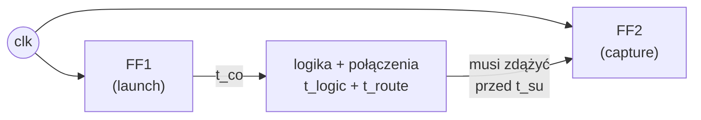

# 01.06 — Parametry czasowe: propagacja, setup, hold, clock-to-out

> **Moduł:** [01 — Logika cyfrowa dla projektanta FPGA](README.md) · **Kod:** — · **DECA:** —
>
> **Czytaj:**
>
> - S. Harris, D. Harris, *Digital Design and Computer Architecture, RISC-V Edition* 💲, rozdz. 2.9 (opóźnienia logiki kombinacyjnej) i 3.5 (timing układów sekwencyjnych, przesunięcie zegara)
> - [Quartus Prime — przewodniki użytkownika](https://www.altera.com/design/guidance/software/quartus-user-guides) — *Timing Analyzer*: rozdział o podstawach analizy czasowej (relacje setup i hold, zapas, ścieżki)
> - [UG906 — Design Analysis and Closure Techniques](https://docs.amd.com/r/en-US/ug906-vivado-design-analysis) — rozdział o raportach czasowych (to samo z perspektywy Vivado)

← [01.05](01.05-przerzutniki-zatrzaski-i-rejestry.md) · [spis modułu](README.md) · [01.07](01.07-metastabilnosc-pierwsze-spotkanie.md) →

## Po co to jest

Projekt, który działa w symulacji, w sprzęcie działa tylko wtedy, gdy każdy sygnał zdąży dotrzeć do przerzutnika przed zboczem zegara i nie zmieni się zbyt wcześnie po nim. Te dwa warunki — setup i hold — sprawdza analizator czasowy po każdej kompilacji. Ten temat daje słownik i dwa wzory, na których opiera się cały [moduł 14](../14-analiza-czasowa/README.md). Na rozmowie kwalifikacyjnej prawie na pewno padnie pytanie „co to jest setup i hold” albo „jak policzyć maksymalną częstotliwość”.

## Intuicja

Sztafeta: zawodnik (dane) musi dobiec do strefy zmiany **zanim** sędzia gwizdnie (setup) i nie może z niej wybiec **zaraz po** gwizdku (hold). Przerzutnik potrzebuje stabilnego wejścia przez krótki czas przed zboczem zegara i krótki czas po nim — inaczej nie wiadomo, co zapamięta ([01.07](01.07-metastabilnosc-pierwsze-spotkanie.md)).

Między dwoma przerzutnikami jest wyścig z czasem: dane wychodzą z pierwszego przerzutnika po zboczu, przechodzą przez logikę i połączenia i muszą dotrzeć do drugiego przed **następnym** zboczem. Im dłuższa droga, tym wolniejszy musi być zegar. Warunek hold jest odwrotny: dane z **tego samego** zbocza nie mogą dotrzeć do drugiego przerzutnika tak szybko, że zepsują wartość, którą on właśnie zapamiętuje.

## Teoria

### Parametry elementów

| Symbol | Nazwa | Znaczenie |
|--------|-------|-----------|
| $t_{pd}$ | opóźnienie propagacji (*propagation delay*) | najdłuższy czas od zmiany wejścia do ustalenia wyjścia logiki |
| $t_{cd}$ | opóźnienie minimalne (*contamination delay*) | najkrótszy czas od zmiany wejścia do pierwszej zmiany wyjścia |
| $t_{co}$, $t_{clk \to q}$ | czas zegar–wyjście (*clock-to-output*) | od zbocza zegara do pojawienia się nowej wartości na wyjściu przerzutnika |
| $t_{su}$ | czas ustalenia (*setup time*) | jak długo **przed** zboczem zegara wejście musi być stabilne |
| $t_h$ | czas utrzymania (*hold time*) | jak długo **po** zboczu zegara wejście musi pozostać stabilne |
| $t_{skew}$ | przesunięcie zegara (*clock skew*) | różnica czasów dotarcia zbocza do przerzutnika docelowego i źródłowego |
| $t_{jitter}$ | drżenie zegara (*jitter*) | losowe odchylenie chwil zboczy od idealnych |

W FPGA opóźnienie ścieżki to suma opóźnień **logiki** (LUT) i **połączeń** (*routing*). W układach z rodziny MAX 10 połączenia często stanowią połowę lub więcej opóźnienia ścieżki — dlatego to, gdzie narzędzie rozmieści logikę, ma tak duże znaczenie.

### Warunek setup — maksymalna częstotliwość

Dla ścieżki z przerzutnika źródłowego (*launch*) do docelowego (*capture*) przy tym samym zegarze o okresie $T$:

$$t_{co} + t_{logic,max} + t_{route,max} + t_{su} \le T + t_{skew} - t_{unc}$$

gdzie $t_{skew} = t_{clk,capture} - t_{clk,launch}$ (dodatnie, gdy zegar dociera do celu później), a $t_{unc}$ to niepewność zegara (jitter i zapas). Stąd

$$f_{max} = \frac{1}{t_{co} + t_{logic} + t_{route} + t_{su} - t_{skew}}$$

**Zapas** (*slack*) dla setup to różnica między czasem, w którym dane **muszą** dotrzeć (*data required time*), a czasem, w którym **docierają** (*data arrival time*). Dodatni zapas — warunek spełniony; ujemny — ścieżka jest za wolna.

### Warunek hold

Dane wypuszczone na zboczu nie mogą dotrzeć do celu przed upływem $t_h$ od **tego samego** zbocza w przerzutniku docelowym:

$$t_{co,min} + t_{logic,min} + t_{route,min} \ge t_h + t_{skew}$$

Warunek hold **nie zależy od częstotliwości zegara**. Jeśli nie jest spełniony, układ nie zadziała przy żadnym zegarze — spowolnienie nic nie da. W FPGA narzędzie samo naprawia ścieżki hold, dokładając opóźnienie w połączeniach; problem pojawia się głównie przy dużym przesunięciu zegara (zegar prowadzony zwykłą logiką zamiast sieci globalnej) i na wejściach z zewnątrz.

### Ścieżki w projekcie

Analizator czasowy rozkłada projekt na cztery rodzaje ścieżek:

| Ścieżka | Od | Do | Co ogranicza |
|---------|----|----|--------------|
| rejestr → rejestr | przerzutnik | przerzutnik | zegar (`create_clock`) |
| wejście → rejestr | pin | przerzutnik | zegar i opóźnienie zewnętrzne (`set_input_delay`) |
| rejestr → wyjście | przerzutnik | pin | zegar i wymaganie zewnętrzne (`set_output_delay`) |
| wejście → wyjście | pin | pin | `set_max_delay` albo `set_false_path` (jak w projekcie [logika](deca/logika/logika.sdc)) |

Każda ścieżka, dla której nie podano ograniczenia, jest **nieograniczona** (*unconstrained*) — analizator jej nie sprawdza, a projekt może nie działać, choć raport nie pokazuje błędów.

### Warunki pracy (*corners*)

Opóźnienia zależą od napięcia zasilania, temperatury i rozrzutu produkcyjnego. Quartus analizuje projekt w kilku modelach — dla MAX 10 zasilanego 1,2 V są to m.in. *Slow 1200mV 85C*, *Slow 1200mV 0C* i *Fast 1200mV 0C*. Setup sprawdza się zwykle najostrzej w modelu wolnym (gorąco, opóźnienia największe), hold — w szybkim (zimno, opóźnienia najmniejsze). Projekt musi spełniać oba warunki we wszystkich modelach.

Klasa szybkości (*speed grade*) układu to kolejny czynnik: na płytce DECA jest układ C6 — najszybsza klasa komercyjna MAX 10 (cyfra 6; klasy 7 i 8 są wolniejsze).

## Schemat i przebiegi



Okno próbkowania przerzutnika — w zaznaczonym przedziale wokół zbocza wejście musi być stabilne:

```text
clk          ________________/‾‾‾‾‾‾‾‾‾‾‾‾‾‾‾‾
                             ↑ zbocze
d            XXXXXXX|========|====|XXXXXXXXXX
                    |← t_su →|←th→|
                    stabilne wejście
```

Bilans ścieżki dla setup (okres $T$ = 20 ns, 50 MHz):

```text
0 ns: zbocze w FF1                                      20 ns: następne zbocze w FF2
|--- t_co ---|------ t_logic + t_route ------|-- t_su --|....... zapas .......|
0           0,5                             12        12,2                   20
                                    zapas setup = 20 − 12,2 = 7,8 ns
```

## Reguły i liczby do zapamiętania

| Reguła lub liczba | Kiedy obowiązuje |
|-------------------|------------------|
| Setup: $t_{co} + t_{logic} + t_{route} + t_{su} \le T + t_{skew} - t_{unc}$ | ścieżki rejestr → rejestr |
| Hold: $t_{co,min} + t_{logic,min} + t_{route,min} \ge t_h + t_{skew}$ | ścieżki rejestr → rejestr |
| Naruszenia hold nie naprawi wolniejszy zegar | zawsze |
| Zapas (*slack*) = czas wymagany − czas przybycia; ujemny = błąd | raporty czasowe |
| Ścieżka bez ograniczenia nie jest sprawdzana | każdy projekt — sprawdzaj *Unconstrained Paths* |
| Setup sprawdzaj w modelu wolnym, hold w szybkim; projekt musi przejść wszystkie | Quartus, MAX 10 |
| 50 MHz → 20 ns, 100 MHz → 10 ns, 200 MHz → 5 ns | szybkie przeliczanie okresów |

## Typowe pułapki

- ⚠️ **Brak `create_clock`.** Bez ograniczenia zegara Quartus analizuje projekt dla domyślnego zegara 1 GHz albo w ogóle pomija ścieżki — raport nie pokazuje nic przydatnego, a projekt może zawodzić w sprzęcie.
- ⚠️ **Zignorowane nieograniczone ścieżki.** Wejścia i wyjścia bez `set_input_delay` / `set_output_delay` albo jawnego `set_false_path` nie są sprawdzane. Raport *Unconstrained Paths* musi być pusty.
- **Zegar prowadzony zwykłą logiką.** Duże przesunięcie zegara pogarsza setup na części ścieżek i powoduje naruszenia hold na innych. Zegary muszą iść przez sieci globalne (*global clock networks*) i PLL.
- **„Działa na moim biurku”.** Projekt z ujemnym zapasem może działać w temperaturze pokojowej i przestać w obudowie albo na innym egzemplarzu układu. Liczy się wynik analizy we wszystkich modelach, nie test na jednej płytce.
- **Mylenie $t_{pd}$ i $t_{cd}$.** Setup liczy się z opóźnieniami **maksymalnymi**, hold — z **minimalnymi**.

## Pytania rekrutacyjne

1. **Co to jest czas setup i czas hold?**

<details>
<summary>Odpowiedź</summary>

Setup to minimalny czas, przez jaki wejście przerzutnika musi być stabilne **przed** zboczem zegara; hold — minimalny czas, przez jaki musi pozostać stabilne **po** zboczu. Naruszenie któregokolwiek może spowodować zapamiętanie złej wartości albo stan metastabilny.
</details>

2. **Jak policzyć maksymalną częstotliwość zegara dla ścieżki między dwoma rejestrami?**

<details>
<summary>Odpowiedź</summary>

$f_{max} = 1 / (t_{co} + t_{logic} + t_{route} + t_{su} - t_{skew})$, gdzie składniki są wartościami maksymalnymi dla najgorszej ścieżki w projekcie, a $t_{skew}$ to opóźnienie zegara w przerzutniku docelowym względem źródłowego. W praktyce odejmuje się jeszcze niepewność zegara. Analizator liczy to dla wszystkich ścieżek i podaje $f_{max}$ najwolniejszej.
</details>

3. **Masz naruszenie hold. Czy zmniejszenie częstotliwości zegara pomoże?**

<details>
<summary>Odpowiedź</summary>

Nie. Warunek hold porównuje dane i zegar z **tego samego** zbocza, więc okres zegara w nim nie występuje. Trzeba wydłużyć najkrótszą ścieżkę danych (narzędzie robi to automatycznie przez opóźnienia w połączeniach) albo zmniejszyć przesunięcie zegara — zwykle przez poprowadzenie go siecią globalną.
</details>

4. **Czy dodatnie przesunięcie zegara (zegar dociera później do przerzutnika docelowego) jest dobre czy złe?**

<details>
<summary>Odpowiedź</summary>

Dla setup pomaga — daje danym więcej czasu. Dla hold szkodzi — przerzutnik docelowy próbkuje później, więc nowe dane z tego samego zbocza łatwiej go „dogonią”. Dlatego przesunięcie zegara trzeba minimalizować, a nie wykorzystywać, chyba że narzędzie robi to świadomie (*useful skew*).
</details>

5. **Co to jest ścieżka nieograniczona i dlaczego jest groźna?**

<details>
<summary>Odpowiedź</summary>

To ścieżka, dla której analizator nie zna wymagań czasowych — np. wejście bez `set_input_delay` albo zegar bez `create_clock`. Nie jest sprawdzana, więc raport może nie pokazywać żadnych błędów, a ścieżka i tak może być za wolna. Każdą ścieżkę trzeba ograniczyć albo świadomie wyłączyć z analizy (`set_false_path`, `set_max_delay`) z uzasadnieniem.
</details>

## Zadania

1. $t_{co} = 0{,}6$ ns, $t_{su} = 0{,}2$ ns, logika: 3 poziomy LUT po 0,4 ns, połączenia: łącznie 3,0 ns, przesunięcie zegara 0, niepewność 0,1 ns. Jaka jest $f_{max}$? Czy ścieżka spełni zegar 100 MHz? Jaki jest zapas?

<details>
<summary>Odpowiedź</summary>

Ścieżka: $0{,}6 + 1{,}2 + 3{,}0 + 0{,}2 = 5{,}0$ ns, z niepewnością 5,1 ns. $f_{max} = 1 / 5{,}1\ \text{ns} \approx 196$ MHz. Przy 100 MHz ($T = 10$ ns) zapas wynosi $10 - 5{,}1 = 4{,}9$ ns — warunek spełniony.
</details>

2. Dla tej samej ścieżki: $t_{co,min} = 0{,}4$ ns, najkrótsza ścieżka logiki i połączeń 0,1 ns, $t_h = 0{,}3$ ns, przesunięcie zegara $+0{,}5$ ns (zegar dociera później do celu). Czy warunek hold jest spełniony? Co zrobi narzędzie?

<details>
<summary>Odpowiedź</summary>

Lewa strona: $0{,}4 + 0{,}1 = 0{,}5$ ns. Prawa: $0{,}3 + 0{,}5 = 0{,}8$ ns. $0{,}5 < 0{,}8$ — **naruszenie hold**, zapas −0,3 ns. Fitter doda co najmniej 0,3 ns opóźnienia w połączeniach tej ścieżki; jeśli przesunięcie zegara wynika z prowadzenia zegara logiką, trzeba to naprawić w projekcie.
</details>

3. Zegar ma 125 MHz. Ścieżka ma $t_{co} = 0{,}5$ ns, $t_{su} = 0{,}2$ ns i 4 poziomy LUT po 0,4 ns. Ile czasu zostaje na połączenia?

<details>
<summary>Odpowiedź</summary>

$T = 8$ ns. $8 - 0{,}5 - 0{,}2 - 1{,}6 = 5{,}7$ ns na wszystkie połączenia — średnio ok. 1,1 ns na każdy z 5 odcinków (wyjście rejestru → LUT1 → … → LUT4 → rejestr). Jeśli fitter musi rozmieścić logikę daleko, może tego nie wystarczyć.
</details>

4. Otwórz raport *Timing Analyzer* projektu `blink` z [modułu 00](../00-srodowisko-pracy/00.06-pierwszy-projekt-migajaca-dioda-w-trzech.md). Znajdź najgorszą ścieżkę setup w modelu *Slow 1200mV 85C*, odczytaj z *Report Path* czas $t_{co}$ (*micro clock-to-output*), opóźnienia LUT i połączeń oraz $t_{su}$. **Kryterium zaliczenia:** suma zgadza się z czasem przybycia danych w raporcie, a zapas jest dodatni.

## Źródła

- Harris & Harris, *Digital Design and Computer Architecture, RISC-V Edition*, rozdz. 2.9 i 3.5.
- [Quartus Prime — przewodniki użytkownika](https://www.altera.com/design/guidance/software/quartus-user-guides) — *Timing Analyzer*.
- [UG906 — Design Analysis and Closure Techniques](https://docs.amd.com/r/en-US/ug906-vivado-design-analysis).
- [MAX 10 FPGA Device Datasheet](https://www.intel.com/content/www/us/en/docs/programmable/683794/) — parametry czasowe elementów i klasy szybkości.
