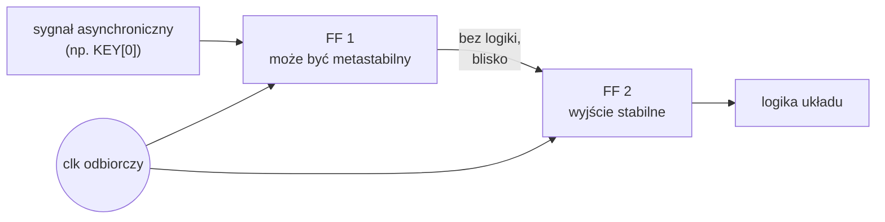

# 01.07 — Metastabilność — pierwsze spotkanie

> **Moduł:** [01 — Logika cyfrowa dla projektanta FPGA](README.md) · **Kod:** — · **DECA:** —
>
> **Czytaj:**
>
> - S. Harris, D. Harris, *Digital Design and Computer Architecture, RISC-V Edition* 💲, rozdz. 3.5.4–3.5.5 (metastabilność, synchronizatory, MTBF)
> - [Quartus Prime Standard Edition — Design Recommendations](https://www.intel.com/content/www/us/en/docs/programmable/683323/) — rozdział *Managing Metastability*: identyfikacja synchronizatorów i raport MTBF
> - C. Cummings, *Clock Domain Crossing (CDC) Design & Verification Techniques Using SystemVerilog* — [Sunburst Design](http://www.sunburst-design.com/papers/), część o synchronizatorach dwuprzerzutnikowych

← [01.06](01.06-parametry-czasowe-propagacja-setup-hold-clock.md) · [spis modułu](README.md) · [01.08](01.08-automaty-skonczone-na-papierze-moore-i-mealy.md) →

## Po co to jest

Każdy sygnał, który przychodzi do FPGA bez związku z jego zegarem — przycisk, przerwanie z innego układu, dane z innej domeny zegara — w końcu zmieni się w oknie setup/hold przerzutnika. Tego nie da się uniknąć, da się tylko ograniczyć skutki. Błędy metastabilności są rzadkie, losowe i nie do odtworzenia w symulacji — dlatego są jednymi z najdroższych błędów w FPGA. Ten temat wyjaśnia zjawisko i podstawowe lekarstwo; pełne przejścia między domenami zegara omawia [moduł 15](../15-zegary-reset-cdc/README.md).

## Intuicja

Ołówek postawiony na ostrzu: w końcu przewróci się w lewo albo w prawo, ale nie wiadomo kiedy ani w którą stronę. Przerzutnik to dwa stany stabilne (0 i 1) i jeden niestabilny pośrodku. Jeśli wejście zmieni się dokładnie w chwili próbkowania, przerzutnik może „zawisnąć” w stanie pośrednim i potrzebować dodatkowego czasu, żeby zdecydować. Zwykle trwa to ułamki nanosekundy, ale **czas rozstrzygnięcia nie ma górnego ograniczenia** — prawdopodobieństwo, że jeszcze się nie rozstrzygnął, maleje wykładniczo.

Rozwiązanie: dać mu czas. Drugi przerzutnik próbkuje wyjście pierwszego dopiero po pełnym okresie zegara. Do tego czasu pierwszy prawie na pewno się zdecyduje — a „prawie” można policzyć.

## Teoria

### Kiedy powstaje stan metastabilny

Gdy dane na wejściu przerzutnika zmieniają się w oknie $[t_{su}, t_h]$ wokół zbocza zegara ([01.06](01.06-parametry-czasowe-propagacja-setup-hold-clock.md)). W projekcie synchronicznym analiza czasowa gwarantuje, że to się nie zdarza. Nie gwarantuje tego dla sygnałów **asynchronicznych** względem zegara:

- wejścia z zewnątrz bez wspólnego zegara: przyciski, przełączniki, sygnały z innych układów,
- sygnały z innej domeny zegara wewnątrz FPGA,
- zwolnienie asynchronicznego resetu ([01.05](01.05-przerzutniki-zatrzaski-i-rejestry.md)).

Skutki stanu metastabilnego:

1. wyjście przerzutnika ustala się później niż $t_{co}$ — logika za nim dostaje mniej czasu, niż zakładała analiza,
2. wartość pośrednia może zostać odczytana **różnie** przez dwa odbiorniki — jeden zobaczy 0, drugi 1,
3. ostateczna wartość (0 lub 1) jest przypadkowa.

Punkt 2 jest najgroźniejszy: automat, który na podstawie jednego sygnału przechodzi do dwóch różnych stanów jednocześnie, trafia w stan niedozwolony.

### Średni czas między awariami (MTBF)

$$MTBF = \frac{e^{t_r / \tau}}{T_0 \cdot f_{clk} \cdot f_{data}}$$

| Symbol | Znaczenie |
|--------|-----------|
| $t_r$ | czas na rozstrzygnięcie (*resolution time*) — zapas czasu między wyjściem pierwszego przerzutnika a wejściem następnego |
| $\tau$ | stała czasowa rozstrzygania przerzutnika (parametr technologii, rzędu dziesiątek pikosekund) |
| $T_0$ | parametr technologii — szerokość „okna” podatności |
| $f_{clk}$ | częstotliwość zegara próbkującego |
| $f_{data}$ | częstotliwość zmian sygnału asynchronicznego |

Najważniejsza obserwacja: $t_r$ jest w **wykładniku**. Każde dodatkowe $\tau$ czasu mnoży MTBF przez $e \approx 2{,}7$, każda dodatkowa nanosekunda — przez $e^{1\,\text{ns}/\tau}$, czyli przy $\tau = 50$ ps przez $e^{20} \approx 5 \cdot 10^8$. Dlatego drugi przerzutnik, który dodaje prawie cały okres zegara czasu na rozstrzygnięcie, zmienia MTBF z godzin na miliony lat.

### Synchronizator dwuprzerzutnikowy

Sygnał asynchroniczny przechodzi przez dwa (czasem trzy) przerzutniki taktowane zegarem odbiorczym, **bez logiki pomiędzy**. Pierwszy może wejść w stan metastabilny, drugi dostaje prawie cały okres na jego rozstrzygnięcie. Logika układu czyta tylko wyjście drugiego.

Zasady:

- **między przerzutnikami synchronizatora nie ma logiki** — każda nanosekunda logiki to mniejsze $t_r$; przerzutniki powinny leżeć blisko siebie,
- **synchronizator przenosi jeden bit**. Słowo wielobitowe zsynchronizowane bit po bicie może przyjść jako mieszanka starych i nowych bitów — do magistral służą inne techniki (kod Graya, uzgadnianie, asynchroniczna kolejka FIFO — moduł 15),
- **sygnał wejściowy musi trwać dłużej niż okres zegara odbiorczego**, inaczej krótki impuls może zostać przeoczony,
- wyjście synchronizatora jest opóźnione o 2–3 takty — to cena bezpieczeństwa.

Takiego synchronizatora używa projekt `blink` z [modułu 00](../00-srodowisko-pracy/00.06-pierwszy-projekt-migajaca-dioda-w-trzech.md) dla przycisku `KEY[0]`:

```verilog
reg [1:0] key0_sync = 2'b11;
always @(posedge MAX10_CLK1_50)
    key0_sync <= {key0_sync[0], KEY[0]};
wire rst = ~key0_sync[1];          // logika czyta tylko drugi przerzutnik
```

### Synchronizatory w Quartusie

Quartus potrafi rozpoznać łańcuchy synchronizatorów i policzyć dla nich MTBF. Służy do tego ustawienie *Synchronizer Identification* (np. *Auto* lub *Forced if Asynchronous*) i raport *Report Metastability* w Timing Analyzer. Rozpoznane synchronizatory fitter umieszcza blisko siebie, żeby zmaksymalizować $t_r$. Szczegóły i ograniczenia SDC dla przejść między domenami — [moduł 15](../15-zegary-reset-cdc/README.md).

### Czego nie pokaże symulacja

Symulator RTL nie modeluje metastabilności — przerzutnik zawsze przyjmuje 0 albo 1 zgodnie z regułami języka. Błąd synchronizacji w symulacji jest **niewidoczny**. Wykrywa się go przeglądem kodu, narzędziami do analizy CDC i raportami narzędzia, a nie testbenchem.

## Schemat i przebiegi



```text
clk        _/‾‾\__/‾‾\__/‾‾\__/‾‾\__
async      ___/‾‾‾‾‾‾‾‾‾‾‾‾‾‾‾‾‾‾‾‾‾   ← zmiana tuż przed zboczem (w oknie setup)
sync1      ____~~~~/‾‾‾‾‾‾‾‾‾‾‾‾‾‾‾‾‾   ← ~~~ stan metastabilny, rozstrzyga się po pewnym czasie
sync2      ________/‾‾‾‾‾‾‾‾‾‾‾‾‾‾‾‾‾   ← drugi przerzutnik widzi już stabilną wartość
                                        (albo o takt później, jeśli FF1 rozstrzygnął się do 0)
```

## Reguły i liczby do zapamiętania

| Reguła lub liczba | Kiedy obowiązuje |
|-------------------|------------------|
| Każdy sygnał asynchroniczny przechodzi przez synchronizator co najmniej dwuprzerzutnikowy | przyciski, wejścia zewnętrzne, przejścia między domenami zegara |
| Między przerzutnikami synchronizatora nie ma logiki | zawsze |
| Synchronizator przenosi jeden bit; magistrale — kod Graya, uzgadnianie, FIFO | moduł 15 |
| $MTBF = e^{t_r/\tau} / (T_0 f_{clk} f_{data})$ — czas rozstrzygania w wykładniku | ocena synchronizatorów |
| Każde $\tau$ zapasu mnoży MTBF przez $e$ | szybkie szacowanie |
| Symulacja RTL nie pokazuje metastabilności | weryfikacja — potrzebny przegląd kodu i analiza CDC |
| Asynchroniczny reset: ustawienie asynchroniczne, zwolnienie zsynchronizowane | każdy reset asynchroniczny |

## Typowe pułapki

- ⚠️ **Sygnał asynchroniczny prosto do logiki** (np. przycisk do automatu). Działa podczas testów, a raz na jakiś czas automat trafia w stan niedozwolony. Każde wejście asynchroniczne — przez synchronizator.
- ⚠️ **Jeden sygnał asynchroniczny synchronizowany w dwóch miejscach.** Dwa synchronizatory mogą rozstrzygnąć się różnie i dać wartości różniące się o takt. Synchronizuj raz, a wynik rozprowadzaj dalej.
- ⚠️ **Synchronizacja magistrali bit po bicie.** Licznik binarny przejęty do innej domeny przez osobne synchronizatory może przyjść jako zupełnie inna liczba.
- **Logika przed synchronizatorem w domenie odbiorczej.** Kombinacja kilku sygnałów asynchronicznych przed pierwszym przerzutnikiem może dać hazard, który zostanie złapany jako impuls. Sygnał przekazywany do innej domeny powinien wychodzić prosto z rejestru w domenie nadawczej.
- **„Dodam trzeci przerzutnik na wszelki wypadek” bez potrzeby.** Trzy przerzutniki stosuje się przy bardzo wysokich zegarach albo wymaganiach niezawodności; dodają takt opóźnienia. Liczy się MTBF z raportu, nie liczba przerzutników.

## Pytania rekrutacyjne

1. **Co to jest metastabilność i kiedy występuje?**

<details>
<summary>Odpowiedź</summary>

To stan, w którym przerzutnik przez nieokreślony czas pozostaje między poziomem 0 a 1. Występuje, gdy wejście zmienia się w oknie setup/hold wokół zbocza zegara — w praktyce przy próbkowaniu sygnałów asynchronicznych: z zewnątrz, z innej domeny zegara, przy zwalnianiu asynchronicznego resetu. Prawdopodobieństwo, że stan trwa dłużej niż $t$, maleje wykładniczo z $t$.
</details>

2. **Jak działa synchronizator dwuprzerzutnikowy i dlaczego pomaga?**

<details>
<summary>Odpowiedź</summary>

Sygnał przechodzi przez dwa przerzutniki taktowane zegarem odbiorczym, bez logiki pomiędzy. Pierwszy może wejść w stan metastabilny, ale drugi próbkuje go dopiero po prawie całym okresie zegara. MTBF rośnie wykładniczo z tym czasem, więc z kilku godzin robi się zwykle wiele lat. Synchronizator nie usuwa metastabilności, tylko czyni ją wystarczająco mało prawdopodobną.
</details>

3. **Dlaczego nie można zsynchronizować 8-bitowej magistrali ośmioma synchronizatorami?**

<details>
<summary>Odpowiedź</summary>

Bo każdy bit może zostać złapany w innym takcie — jeden przed zmianą, inny po. Wynik może być wartością, która nigdy nie wystąpiła po stronie nadawczej. Stosuje się kod Graya (zmienia się jeden bit naraz), protokół uzgadniania z jednobitowym sygnałem gotowości albo asynchroniczną kolejkę FIFO.
</details>

4. **Jak sprawdzisz w symulacji, czy synchronizator działa?**

<details>
<summary>Odpowiedź</summary>

Symulacja RTL nie modeluje metastabilności, więc samego zjawiska nie sprawdzę. Mogę sprawdzić funkcję (opóźnienie 2–3 takty, przenoszenie zmian) i ewentualnie wstrzyknąć losowe opóźnienie o takt w modelu synchronizatora, żeby zobaczyć, czy reszta układu to toleruje. Poprawność struktury sprawdzam przeglądem kodu, narzędziem do analizy CDC i raportem metastabilności w Quartusie.
</details>

## Zadania

1. Przyjmij przykładowe wartości: $\tau = 50$ ps, $T_0 = 10$ ps, $f_{clk} = 100$ MHz, $f_{data} = 1$ MHz. Policz MTBF dla $t_r = 1$ ns i $t_r = 2$ ns.

<details>
<summary>Odpowiedź</summary>

Mianownik: $10^{-11}\ \text{s} \cdot 10^8 \cdot 10^6 = 10^3\ \text{s}^{-1}$. Dla $t_r = 1$ ns: $e^{20} \approx 4{,}85 \cdot 10^8$, MTBF $\approx 4{,}85 \cdot 10^5$ s ≈ 5,6 doby. Dla $t_r = 2$ ns: $e^{40} \approx 2{,}35 \cdot 10^{17}$, MTBF $\approx 2{,}35 \cdot 10^{14}$ s ≈ 7,4 mln lat. Jedna nanosekunda więcej zmienia „awaria co kilka dni” w „nigdy”. (Wartości $\tau$ i $T_0$ są przykładowe — rzeczywiste podaje producent albo raport Quartusa.)
</details>

2. Znajdź błąd:

```verilog
always @(posedge clk) begin
    btn_s1 <= btn;
    btn_s2 <= btn_s1 & enable;
end
```

<details>
<summary>Odpowiedź</summary>

Między przerzutnikami synchronizatora jest logika (`& enable`), która zjada czas rozstrzygania i zmniejsza MTBF. Poprawnie: `btn_s2 <= btn_s1;`, a warunek `enable` dopiero na wyjściu `btn_s2`.
</details>

3. Przycisk na płytce trafia do dwóch automatów, z których każdy ma własny synchronizator. Co może pójść źle i jak to poprawić?

<details>
<summary>Odpowiedź</summary>

Synchronizatory mogą rozstrzygnąć się w różnych taktach, więc jeden automat zareaguje o takt wcześniej niż drugi. Jeśli automaty mają działać zgodnie, rozjadą się. Poprawnie: jeden synchronizator, a jego wyjście doprowadzone do obu automatów.
</details>

## Źródła

- Harris & Harris, *Digital Design and Computer Architecture, RISC-V Edition*, rozdz. 3.5.4–3.5.5.
- [Quartus Prime Standard Edition — Design Recommendations](https://www.intel.com/content/www/us/en/docs/programmable/683323/) — *Managing Metastability*.
- C. Cummings, *Clock Domain Crossing (CDC) Design & Verification Techniques Using SystemVerilog* — [Sunburst Design](http://www.sunburst-design.com/papers/).
