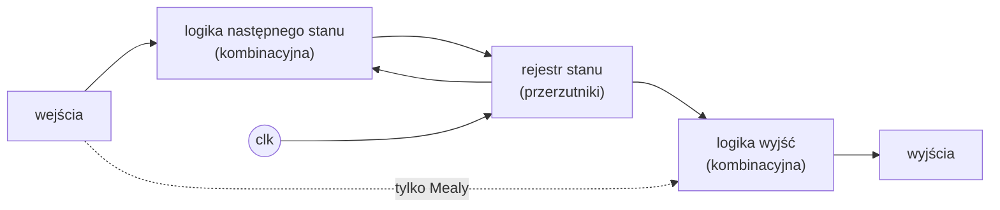
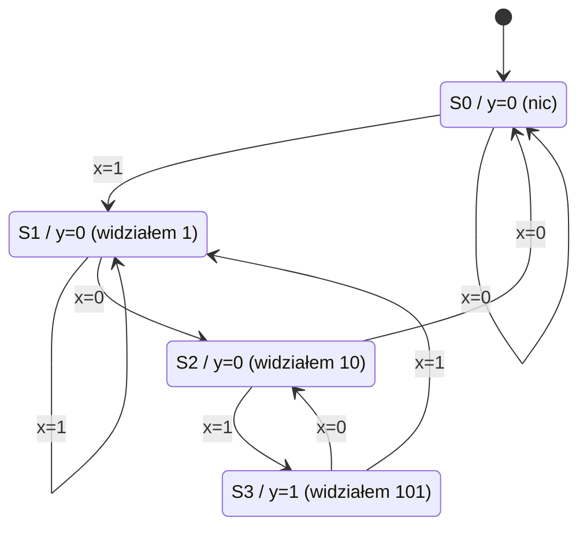
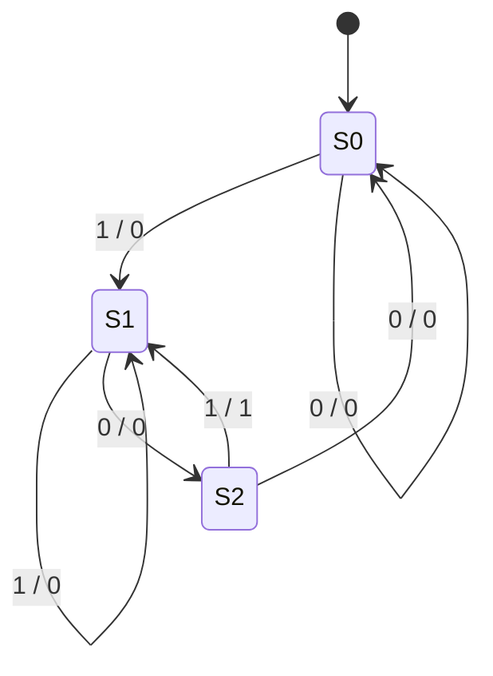

# 01.08 — Automaty skończone na papierze: Moore i Mealy

> **Moduł:** [01 — Logika cyfrowa dla projektanta FPGA](README.md) · **Kod:** — · **DECA:** — · **Status:** ✅ pełny
>
> **Czytaj:**
>
> - S. Harris, D. Harris, *Digital Design and Computer Architecture, RISC-V Edition* 💲, rozdz. 3.4 (automaty skończone: projektowanie, kodowanie stanów, Moore i Mealy, dekompozycja)
> - C. Cummings, *The Fundamentals of Efficient Synthesizable Finite State Machine Design using NC-Verilog and BuildGates* oraz *Coding And Scripting Techniques For FSM Designs…* — [Sunburst Design](http://www.sunburst-design.com/papers/)
> - [HDLBits](https://hdlbits.01xz.net/) — dział *Finite State Machines* (od prostych automatów Moore'a po detektory sekwencji)

← [01.07](01.07-metastabilnosc-pierwsze-spotkanie.md) · [spis modułu](README.md) · →

## Po co to jest

Automat skończony (*finite state machine*, FSM) steruje prawie każdym układem w FPGA: protokołem UART, kontrolerem pamięci, sekwencją inicjalizacji czujnika, arbitrem magistrali. Zanim automat trafi do kodu, trzeba go zaprojektować na papierze: stany, przejścia, wyjścia. Błąd na tym etapie kosztuje najwięcej, bo kod wiernie odtworzy zły projekt. Na rozmowach kwalifikacyjnych „narysuj automat wykrywający sekwencję 101” to klasyk. Kodowanie automatów w HDL — [moduł 08](../08-automaty-stanow/README.md).

## Intuicja

Automat to schemat blokowy, który pamięta, **w którym miejscu jest**. Stan to cała pamięć układu — wszystko, co trzeba wiedzieć o przeszłości, żeby zdecydować, co dalej. Na każdym zboczu zegara automat patrzy na obecny stan i wejścia, a potem przechodzi do następnego stanu.

Różnica między dwoma rodzajami automatów dotyczy tego, skąd biorą się wyjścia:

- **Moore** — wyjście zależy **tylko od stanu**. „Jestem w stanie ZIELONE, więc świeci zielone.” Wyjście zmienia się dopiero po przejściu do nowego stanu, czyli o takt później niż wejście.
- **Mealy** — wyjście zależy od **stanu i wejść**. „Jestem w stanie CZEKAJ i właśnie przyszło żądanie, więc od razu odpowiadam.” Reaguje w tym samym takcie, ale wejście przechodzi do wyjścia przez logikę kombinacyjną.

## Teoria

### Budowa automatu

Trzy części, które pojawią się też w kodzie: rejestr stanu, logika następnego stanu, logika wyjść.

### Moore a Mealy

| | Moore | Mealy |
|--|-------|-------|
| Wyjście zależy od | stanu | stanu i wejść |
| Reakcja wyjścia na wejście | w następnym takcie | w tym samym takcie |
| Liczba stanów | zwykle więcej | zwykle mniej |
| Ścieżka kombinacyjna wejście → wyjście | brak | jest — wydłuża ścieżki czasowe, może przenosić hazardy |
| Hazardy na wyjściu | tylko z dekodowania stanu | także od wejść |
| W praktyce FPGA | domyślny wybór, często z wyjściami z rejestru | gdy reakcja w tym samym takcie jest konieczna (np. sygnał gotowości w uzgadnianiu) |

Wyjścia **rejestrowane** (*registered outputs*) to trzeci wariant: wyjście jest osobnym przerzutnikiem, ustawianym razem z przejściem do stanu. Daje czyste sygnały bez hazardów i najkrótsze ścieżki — przy zachowaniu zależności czasowych automatu Mealy'ego, ale przesuniętych o takt.

### Proces projektowania na papierze

1. **Zrozum specyfikację.** Wypisz wejścia, wyjścia i zachowanie na przykładowych sekwencjach — także na nietypowych (dwa żądania naraz, reset w trakcie).
2. **Narysuj diagram stanów.** Każdy stan ma nazwę mówiącą, co automat „wie”. Z każdego stanu musi wychodzić przejście dla **każdej** kombinacji wejść (także pętla w miejscu).
3. **Wybierz stan początkowy** i sposób dojścia do niego (reset).
4. **Zapisz tablicę przejść** — stan, wejście → następny stan, wyjście.
5. **Zminimalizuj** — stany, które dla każdego wejścia dają to samo wyjście i przechodzą do równoważnych stanów, można połączyć.
6. **Wybierz kodowanie stanów.**
7. Dopiero teraz — kod i testbench.

### Kodowanie stanów

| Kodowanie | Bity dla $n$ stanów | Zalety | Wady |
|-----------|--------------------|--------|------|
| binarne (*binary*, *sequential*) | $\lceil \log_2 n \rceil$ | najmniej przerzutników | dekodowanie stanu wymaga szerokich funkcji |
| 1 z n (*one-hot*) | $n$ | proste, szybkie dekodowanie; zmiana stanu = 2 bity | dużo przerzutników (w FPGA tanie) |
| Gray | $\lceil \log_2 n \rceil$ | przy przejściach po kolei zmienia się 1 bit | korzyść tylko dla automatów „liniowych” |
| własne | dowolne | bity stanu mogą być od razu wyjściami | ręczna praca |

Syntezatory FPGA wykrywają automaty w kodzie i same wybierają kodowanie (Quartus: ustawienie *State Machine Processing*; domyślnie zwykle 1 z n dla małych automatów). Projektant pisze stany jako typ wyliczeniowy (`type state_t is (IDLE, …)` w VHDL, `enum` w SystemVerilogu) i nie zajmuje się kodowaniem, chyba że ma powód.

### Stany niedozwolone i bezpieczeństwo

Przy kodowaniu 1 z n z 8 stanami jest $2^8 - 8 = 248$ wzorów bitów, które nie są żadnym stanem. Normalnie automat nigdy w nie nie wejdzie — chyba że przez błąd metastabilności ([01.07](01.07-metastabilnosc-pierwsze-spotkanie.md)) albo zakłócenie (promieniowanie, zasilanie). Automat **bezpieczny** (*safe FSM*) wykrywa wzór niedozwolony i wraca do znanego stanu. Kosztuje to logikę, więc stosuje się go tam, gdzie wymaga tego niezawodność ([moduł 29](../29-konfiguracja-niezawodnosc/README.md)). Gałąź `others` / `default` w kodzie **nie wystarczy** — syntezator może ją usunąć jako nieosiągalną, jeśli nie włączy się trybu bezpiecznego.

## Schemat i przebiegi

### Przykład: detektor sekwencji 101 (z nakładaniem)

Wejście szeregowe `x`, jeden bit na takt. Wyjście `y = 1`, gdy trzy ostatnie bity to `1, 0, 1`. Sekwencje mogą się nakładać: w `10101` są dwa wystąpienia.

**Moore** — 4 stany; nazwa stanu mówi, jaki fragment wzorca automat już widział:

**Mealy** — 3 stany; wyjście zapisane przy przejściu jako `wejście / wyjście`:

Tablica przejść automatu Mealy'ego:

| Stan | `x = 0`: następny / `y` | `x = 1`: następny / `y` |
|------|-------------------------|-------------------------|
| S0 | S0 / 0 | S1 / 0 |
| S1 | S2 / 0 | S1 / 0 |
| S2 | S0 / 0 | S1 / **1** |

Ta sama sekwencja wejściowa w obu automatach (stan i wyjście w każdym takcie, przed zboczem):

| Takt | 0 | 1 | 2 | 3 | 4 | 5 | 6 | 7 | 8 |
|------|---|---|---|---|---|---|---|---|---|
| `x` | 1 | 0 | 1 | 0 | 1 | 1 | 0 | 1 | 0 |
| stan Mealy | S0 | S1 | S2 | S1 | S2 | S1 | S1 | S2 | S1 |
| `y` Mealy | 0 | 0 | **1** | 0 | **1** | 0 | 0 | **1** | 0 |
| stan Moore | S0 | S1 | S2 | S3 | S2 | S3 | S1 | S2 | S3 |
| `y` Moore | 0 | 0 | 0 | **1** | 0 | **1** | 0 | 0 | **1** |

Automat Mealy'ego zgłasza wykrycie w tym samym takcie, w którym przyszła ostatnia jedynka; Moore'a — w następnym.

## Reguły i liczby do zapamiętania

| Reguła lub liczba | Kiedy obowiązuje |
|-------------------|------------------|
| Moore: wyjście = f(stan); Mealy: wyjście = f(stan, wejścia) | zawsze |
| Mealy reaguje w tym samym takcie, Moore — o takt później | projektowanie protokołów |
| Z każdego stanu przejście dla każdej kombinacji wejść | diagram stanów |
| $n$ stanów: binarnie $\lceil \log_2 n \rceil$ bitów, 1 z n — $n$ bitów | kodowanie stanów |
| W FPGA domyślnie 1 z n — przerzutniki są tanie, dekodowanie szybkie | małe i średnie automaty |
| Wejście asynchroniczne do automatu — tylko przez synchronizator | zawsze ([01.07](01.07-metastabilnosc-pierwsze-spotkanie.md)) |
| Gałąź `others`/`default` nie czyni automatu bezpiecznym | automaty o wysokich wymaganiach niezawodności |

## Typowe pułapki

- **Brakujące przejścia.** Stan, z którego dla jakiejś kombinacji wejść nie ma przejścia, w kodzie zamienia się w „zostań w miejscu” (rejestr) albo w zatrzask (logika wyjść Mealy'ego). Na papierze opisz każdą kombinację.
- ⚠️ **Wejście asynchroniczne bez synchronizatora.** Różne bity stanu mogą zobaczyć wejście w różnych taktach i automat trafia w stan niedozwolony — błąd losowy, niewidoczny w symulacji.
- **Wyjście Mealy'ego w długiej ścieżce.** Gdy wyjście automatu Mealy'ego steruje wejściem innego automatu Mealy'ego, powstaje długa ścieżka kombinacyjna przez oba — a czasem pętla kombinacyjna. Rejestruj wyjścia na granicach bloków.
- **Za dużo stanów.** Automat z kilkudziesięcioma stanami często da się rozbić na automat sterujący i licznik (np. „czekaj 1000 taktów” to jeden stan + licznik, a nie 1000 stanów).
- **Automat bez stanu po resecie.** Bez resetu automat startuje ze stanu odpowiadającego wartości początkowej rejestrów — zwykle zera, które może nie być żadnym stanem w kodowaniu 1 z n.

## Pytania rekrutacyjne

1. **Czym różni się automat Moore'a od automatu Mealy'ego? Który wybierzesz?**

Odpowiedź

W automacie Moore'a wyjścia zależą tylko od stanu, w Mealy'ego — od stanu i wejść. Mealy reaguje w tym samym takcie i zwykle ma mniej stanów, ale ma ścieżkę kombinacyjną od wejścia do wyjścia (dłuższe ścieżki, hazardy). Domyślnie wybieram Moore'a albo wyjścia rejestrowane; Mealy'ego — gdy reakcja w tym samym takcie jest wymagana przez protokół.

2. **Narysuj automat wykrywający sekwencję 101 z nakładaniem.**

Odpowiedź

Mealy: trzy stany — S0 (nic), S1 (ostatni bit 1), S2 (ostatnie bity 10). S0: 1→S1, 0→S0. S1: 1→S1, 0→S2. S2: 1→S1 z wyjściem 1, 0→S0. Nakładanie zapewnia przejście z S2 przy wejściu 1 do S1 (końcowa jedynka zaczyna nowy wzorzec). Moore potrzebuje czwartego stanu S3 z wyjściem 1, z którego 1→S1, 0→S2.

3. **Jakie kodowanie stanów wybierzesz w FPGA i dlaczego?**

Odpowiedź

Zwykle 1 z n: FPGA ma dużo przerzutników, a każdy bit stanu odpowiada jednemu stanowi, więc logika następnego stanu i wyjść jest płytka i szybka. Binarne przy bardzo dużych automatach albo gdy brakuje rejestrów. W praktyce piszę typ wyliczeniowy i pozwalam syntezatorowi wybrać, chyba że wymagania (np. niezawodność, wyjścia prosto z bitów stanu) mówią inaczej.

4. **Co się stanie, gdy automat w kodowaniu 1 z n wejdzie w wzór z dwiema jedynkami?**

Odpowiedź

Zachowanie jest nieokreślone — logika następnego stanu zakłada dokładnie jedną jedynkę. Automat może się „zawiesić” albo krążyć między stanami niedozwolonymi. Zabezpieczeniem jest automat bezpieczny: syntezator dodaje logikę wykrywającą stan niedozwolony i wracającą do stanu znanego (w Quartusie opcja *Safe State Machine*). Sama gałąź `default` w kodzie tego nie gwarantuje.

## Zadania

1. Zaprojektuj automat Moore'a wykrywający sekwencję `110` z nakładaniem. Narysuj diagram i zapisz tablicę przejść.

Odpowiedź

Stany: A (nic), B (1), C (11), D (110, `y = 1`). A: 1→B, 0→A. B: 1→C, 0→A. C: 1→C, 0→D. D: 1→B, 0→A. Po `110` końcowe zero nie zaczyna nowego wzorca, więc z D przy 0 wracamy do A, a przy 1 — do B.

2. Zamień automat Mealy'ego wykrywający `101` na automat Moore'a. Ile stanów przybyło i dlaczego?

Odpowiedź

Przybył jeden stan (S3). W automacie Mealy'ego wyjście 1 jest związane z przejściem S2 → S1 przy `x = 1`. W automacie Moore'a wyjście musi być związane ze stanem, więc to przejście potrzebuje własnego stanu docelowego z `y = 1`. Przejścia z S3 są takie same jak z S1, bo oba „widziały ostatnią jedynkę” — różnią się tylko wyjściem.

3. Automat sterujący ma 12 stanów. Ile przerzutników zajmie przy kodowaniu binarnym, Graya i 1 z n? Ile jest wzorów niedozwolonych w każdym przypadku?

Odpowiedź

Binarne i Gray: 4 przerzutniki, $16 - 12 = 4$ wzory niedozwolone. 1 z n: 12 przerzutników, $2^{12} - 12 = 4084$ wzory niedozwolone.

4. Zaprojektuj na papierze sterownik świateł na skrzyżowaniu: kierunek główny ma zielone, dopóki czujnik `car` na drodze bocznej nie wykryje samochodu; wtedy po żółtym (2 s) zielone dostaje droga boczna na 5 s, potem żółte (2 s) i powrót. Zegar 50 MHz. **Kryterium zaliczenia:** diagram z najwyżej 4 stanami i jednym licznikiem czasu, tablica wyjść dla obu kierunków, wejście `car` zsynchronizowane.

Wskazówka

Stany: GŁÓWNA_ZIELONE, GŁÓWNA_ŻÓŁTE, BOCZNA_ZIELONE, BOCZNA_ŻÓŁTE. Licznik zerowany przy każdej zmianie stanu; przejście, gdy licznik osiągnie $2 \cdot 50 \cdot 10^6 - 1$ albo $5 \cdot 50 \cdot 10^6 - 1$. Licznik do $2{,}5 \cdot 10^8$ potrzebuje 28 bitów. W [module 08](../08-automaty-stanow/README.md) ten automat zostanie zakodowany i uruchomiony na DECA.

## Źródła

- Harris & Harris, *Digital Design and Computer Architecture, RISC-V Edition*, rozdz. 3.4.
- C. Cummings — artykuły o automatach stanów, [Sunburst Design](http://www.sunburst-design.com/papers/).
- [HDLBits](https://hdlbits.01xz.net/) — *Finite State Machines*.
- [Quartus Prime Standard Edition — Design Recommendations](https://www.intel.com/content/www/us/en/docs/programmable/683323/) — rozdział o automatach stanów (*State Machines*, *Safe State Machine*).
