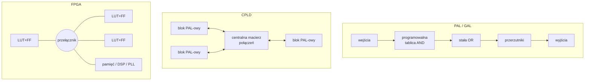

# 02.01 — Od PAL i CPLD do FPGA — ewolucja układów programowalnych

> **Moduł:** [02 — Architektura układów FPGA](README.md) · **Kod:** — · **DECA:** —
>
> **Czytaj:**
>
> - S. Harris, D. Harris, *Digital Design and Computer Architecture, RISC-V Edition* 💲, rozdz. 5.6 (tablice logiczne: PLA i FPGA)
> - [MAX 10 FPGA Device Overview](https://www.intel.com/content/www/us/en/docs/programmable/683658/) — cechy rodziny: proces 55 nm z wbudowaną pamięcią flash, konfiguracja w czasie poniżej 10 ms
> - [ETH Zürich — Digital Design and Computer Architecture](https://safari.ethz.ch/digitaltechnik/) — wykład o układach programowalnych i FPGA

← · [spis modułu](README.md) · [02.02](02.02-lut-przerzutnik-i-blok-logiczny-le-alm-clb-slice.md) →

## Po co to jest

Nazwy w katalogach producentów (CPLD, FPGA, SoC FPGA, „non-volatile FPGA”) mają historię, a historia wyjaśnia architekturę: dlaczego FPGA ma tablice LUT, a CPLD sumy iloczynów, dlaczego MAX 10 nazywa się jak rodzina CPLD, choć jest pełnym FPGA. To wiedza potrzebna przy wyborze układu do projektu i przy pytaniu na rozmowie „czym różni się CPLD od FPGA”.

## Intuicja

Każdy układ programowalny to kompromis między trzema rzeczami: ile logiki mieści, jak przewidywalne są opóźnienia i czy pamięta konfigurację po wyłączeniu zasilania.

- Wczesne układy (PAL, GAL) to jedna tablica AND-OR — mało logiki, ale każda funkcja ma to samo, znane opóźnienie.
- CPLD to kilka takich tablic połączonych wspólną magistralą — więcej logiki, wciąż przewidywalnie.
- FPGA to „morze” małych bloków i programowalnych połączeń między nimi — bardzo dużo logiki, ale opóźnienie zależy od tego, gdzie narzędzie umieściło bloki i jak je połączyło.

## Teoria

### Krótka historia

| Okres | Układ | Budowa | Uwagi |
|-------|-------|--------|-------|
| lata 70. | PROM, PLA | stała tablica AND + programowalna OR (PROM) albo obie programowalne (PLA) | programowane raz, przepalanymi połączeniami |
| 1978 | PAL (MMI) | programowalna tablica AND, stała OR, przerzutniki na wyjściach | prosty, szybki, popularny w logice „klejącej” |
| 1985 | GAL (Lattice), np. 16V8, 22V10 | PAL z komórkami EEPROM — wielokrotnie programowalny | 22V10 bywa używany do dziś |
| 1985 | pierwsze FPGA — Xilinx XC2064 | 64 bloki logiczne z LUT, konfiguracja w SRAM | wynalazek przypisywany Rossowi Freemanowi |
| lata 80.–90. | CPLD (Altera MAX 5000/7000, Xilinx XC9500) | kilka bloków sum iloczynów z makrokomórkami i globalna macierz połączeń | nieulotne, natychmiast gotowe po włączeniu |
| lata 90. | FPGA antifuse (Actel) | połączenia tworzone jednorazowo przez przebicie izolacji | odporne na promieniowanie — lotnictwo, kosmos |
| 2000+ | FPGA z blokami wyspecjalizowanymi | pamięci blokowe, mnożarki/DSP, PLL, nadajniki-odbiorniki szeregowe | FPGA staje się platformą systemową |
| 2010+ | SoC FPGA (Zynq, Cyclone V SoC) | twarde rdzenie ARM + FPGA w jednym układzie | [moduł 27](../27-procesory-i-soc/README.md) |
| 2014 | MAX 10 | FPGA z wbudowaną pamięcią flash konfiguracji, ADC, jedno zasilanie (wersje S) | nazwa po rodzinie CPLD, architektura FPGA (LUT4) |
| 2018+ | adaptacyjne SoC (AMD Versal), Agilex, eFPGA | FPGA + procesory + silniki AI + sieć na chipie; FPGA jako blok IP w ASIC | |

### CPLD a FPGA

| Cecha | CPLD | FPGA |
|-------|------|------|
| Podstawowy blok | makrokomórka: suma iloczynów + przerzutnik | blok logiczny: LUT + przerzutnik |
| Połączenia | jedna centralna macierz | hierarchiczna sieć segmentów i przełączników |
| Opóźnienia | prawie stałe, niezależne od rozmieszczenia | zależne od rozmieszczenia i trasowania |
| Pojemność | dziesiątki–setki makrokomórek | tysiące–miliony LUT |
| Konfiguracja | nieulotna (EEPROM/flash), działa od razu | zwykle SRAM ładowany z pamięci zewnętrznej; wyjątki: flash (MAX 10, Microchip PolarFire, Lattice MachXO), antifuse |
| Bloki wyspecjalizowane | brak | pamięci, DSP, PLL, nadajniki-odbiorniki |
| Typowe zastosowanie | logika „klejąca”, sekwencjonowanie zasilania, dekodowanie adresów | przetwarzanie danych, interfejsy, systemy na chipie |

Granica się zatarła. Rodziny MAX II i MAX V nazywane są CPLD, ale wewnątrz mają LUT. MAX 10 i Lattice MachXO2/3 to małe FPGA, które przejęły rolę CPLD: konfigurują się w milisekundy z wewnętrznej pamięci flash i nie potrzebują zewnętrznego układu konfiguracyjnego.

### Dlaczego LUT wygrały

Suma iloczynów dobrze realizuje szerokie funkcje AND-OR, ale źle — XOR, sumatory i logikę o wielu poziomach. Tablica LUT realizuje **dowolną** funkcję kilku zmiennych w tym samym czasie, łatwo się skaluje (więcej identycznych bloków) i dobrze współpracuje z rejestrami — a projekty synchroniczne potrzebują dużo rejestrów, w FPGA jest jeden przy każdej LUT.

### Technologie konfiguracji (zapowiedź)

| Technologia | Ulotna | Wielokrotnie programowalna | Przykłady |
|-------------|--------|----------------------------|-----------|
| SRAM | tak — potrzebna pamięć zewnętrzna lub wbudowana | tak | AMD, większość Altera, Lattice ECP5, Gowin |
| flash | nie | tak | MAX 10 (flash ładuje wewnętrzną SRAM), Microchip PolarFire/IGLOO2 (flash steruje połączeniami bezpośrednio), Lattice MachXO |
| antifuse | nie | **nie** (jednorazowo) | Microchip RTAX, RT4G — zastosowania kosmiczne |

Szczegóły i konsekwencje dla MAX 10 — [02.09](02.09-konfiguracja-sram-flash-antifuse-max-10-jako.md).

## Schemat i przebiegi

## Reguły i liczby do zapamiętania

| Reguła lub liczba | Kiedy obowiązuje |
|-------------------|------------------|
| CPLD: suma iloczynów, stałe opóźnienia, mało logiki, nieulotny | układy klasyczne (MAX 7000, XC9500, GAL) |
| FPGA: LUT + przerzutnik, opóźnienia zależne od rozmieszczenia, dużo logiki | wszystkie współczesne rodziny |
| Pierwsze FPGA: Xilinx XC2064, 1985 | historia, rozmowy |
| MAX 10 = FPGA (LUT4) z wbudowaną pamięcią flash, konfiguracja poniżej 10 ms | płytka DECA |
| Antifuse — programowany raz, odporny na promieniowanie | lotnictwo, kosmos |

## Typowe pułapki

- **„CPLD jest prostszy, więc szybszy”.** CPLD ma przewidywalne opóźnienie pin–pin, ale małe FPGA z LUT bywają szybsze i dużo pojemniejsze. Wybór zależy od tego, czy potrzebna jest gotowość od razu po włączeniu i stałe opóźnienia, czy logika.
- **Mylenie „flash” z „nieulotny przez cały czas”.** W MAX 10 flash przechowuje konfigurację, a logika działa z wewnętrznej SRAM, do której konfiguracja jest kopiowana po włączeniu. W PolarFire flash steruje połączeniami bezpośrednio — to inna architektura z innymi cechami (np. odpornością na błędy wywołane promieniowaniem).
- **Ocena układów po liczbie „bramek” lub „komórek logicznych”.** Producenci liczą zasoby różnie — porównuj LUT o tej samej liczbie wejść, rejestry, pamięć w Kb i liczbę bloków DSP ([02.10](02.10-przeglad-rynku-amd-altera-lattice-microchip.md)).

## Pytania rekrutacyjne

1. **Czym różni się CPLD od FPGA?**

Odpowiedź

CPLD zbudowany jest z kilku bloków typu PAL (suma iloczynów i przerzutnik w makrokomórce) połączonych centralną macierzą — ma mało logiki, przewidywalne opóźnienia i nieulotną konfigurację. FPGA to tablica bloków z LUT i przerzutnikami połączonych hierarchiczną siecią; ma dużo więcej logiki, bloki wyspecjalizowane (pamięci, DSP, PLL), a opóźnienia zależą od rozmieszczenia. Większość FPGA konfiguruje się do SRAM i potrzebuje pamięci zewnętrznej; wyjątki to układy z flash (np. MAX 10) i antifuse.

2. **Dlaczego MAX 10 bywa używany tam, gdzie kiedyś stosowano CPLD?**

Odpowiedź

Bo konfiguruje się sam z wewnętrznej pamięci flash w kilka milisekund po włączeniu, nie potrzebuje zewnętrznego układu konfiguracyjnego, a wersje z jednym zasilaniem upraszczają płytkę. Daje przy tym zasoby FPGA: dużo LUT, pamięć, mnożarki, PLL i ADC. Dlatego nadaje się do sterowania zasilaniem, logiki „klejącej” i zarządzania systemem, gdzie wcześniej był CPLD.

3. **Gdzie stosuje się FPGA antifuse i dlaczego?**

Odpowiedź

W lotnictwie, kosmosie i zastosowaniach wojskowych. Połączenie antifuse jest trwałe i nie ma komórek pamięci konfiguracji, które promieniowanie mogłoby przestawić, więc układ jest odporny na błędy konfiguracji (SEU). Wada: programuje się go tylko raz.

## Zadania

1. Do każdego zastosowania dobierz rodzaj układu (GAL, CPLD/małe FPGA z flash, FPGA SRAM, FPGA antifuse) i uzasadnij jednym zdaniem: (a) sekwencjonowanie zasilania na płycie głównej serwera, (b) przetwarzanie obrazu z kamery 4K, (c) sterownik satelity na orbicie geostacjonarnej, (d) dekoder adresów w odnawianym komputerze z lat 80.

Odpowiedź

(a) Małe FPGA z flash lub CPLD — musi działać natychmiast po włączeniu, zanim cokolwiek innego wystartuje. (b) FPGA SRAM średniej lub dużej klasy — potrzeba dużo logiki, pamięci, DSP i szybkich interfejsów. (c) FPGA antifuse albo FPGA odporne na promieniowanie (flash) — konfiguracja nie może zostać przestawiona przez promieniowanie. (d) GAL (np. 22V10) — wystarczy kilka równań AND-OR, układ jest tani i zgodny z logiką 5 V.

2. Znajdź w [MAX 10 FPGA Device Overview](https://www.intel.com/content/www/us/en/docs/programmable/683658/) tabelę zasobów i wypisz dla 10M50 liczbę LE, pamięć M9K w Kb, liczbę mnożarek 18 × 18, liczbę PLL i bloków ADC. Porównaj z [opisem płytki](../../plytka-deca/README.md).

Odpowiedź

Ok. 50 tys. LE, 1638 Kb M9K, 144 mnożarki 18 × 18, 4 PLL, 2 bloki ADC (w obudowie F484). Wartości zgadzają się z tabelą w opisie płytki DECA.

## Źródła

- Harris & Harris, *Digital Design and Computer Architecture, RISC-V Edition*, rozdz. 5.6.
- [MAX 10 FPGA Device Overview](https://www.intel.com/content/www/us/en/docs/programmable/683658/).
- [ETH Zürich — Digital Design and Computer Architecture](https://safari.ethz.ch/digitaltechnik/).
