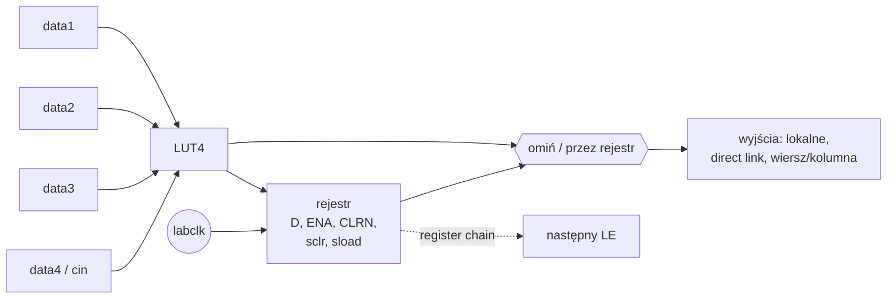

# 02.02 — LUT, przerzutnik i blok logiczny: LE, ALM, CLB, slice

> **Moduł:** [02 — Architektura układów FPGA](README.md) · **Kod:** — · **DECA:** — · **Status:** ✅ pełny
>
> **Czytaj:**
>
> - [MAX 10 FPGA Handbook](https://www.intel.com/programmable/technical-pdfs/max10-handbook.pdf) — *MAX 10 FPGA Device Architecture*, rozdz. *Logic Array Block*: LE, tryby pracy, sygnały sterujące LAB
> - AMD UG474 — *7 Series FPGAs Configurable Logic Block User Guide* ([docs.amd.com](https://docs.amd.com/)) — CLB, SLICEL i SLICEM, LUT6, CARRY4
> - [UG949 — UltraFast Design Methodology Guide](https://docs.amd.com/r/en-US/ug949-vivado-design-methodology) — rozdział o zestawach sygnałów sterujących (*control sets*)

← [02.01](02.01-od-pal-i-cpld-do-fpga-ewolucja-ukladow.md) · [spis modułu](README.md) · [02.03](02.03-lancuchy-przeniesien-i-logika-arytmetyczna.md) →

## Po co to jest

Raport zasobów po syntezie podaje liczbę LE (Altera, starsze rodziny), ALM (Altera, nowsze), LUT i rejestrów w slice'ach (AMD). Żeby wiedzieć, czy projekt się zmieści, dlaczego narzędzie nie upakowało rejestrów i czemu porównanie „50 tys. LE” z „33 tys. LUT” wymaga przeliczenia, trzeba znać budowę bloku logicznego. To też podstawa zaleceń stylu kodu: ile różnych sygnałów zegara, zezwolenia i resetu może mieć grupa rejestrów.

## Intuicja

Blok logiczny to „klocek”, z którego zbudowany jest układ: tablica LUT (dowolna funkcja kilku zmiennych), przerzutnik za nią i kilka multiplekserów, które pozwalają wybrać, czy wyjście idzie przez przerzutnik, czy omija go. Klocki są pogrupowane po kilka–kilkanaście (LAB, CLB) i dzielą część sygnałów sterujących — jak mieszkania w bloku, które mają wspólną klatkę schodową. Rejestry z różnymi zegarami lub resetami nie zawsze zmieszczą się w tej samej grupie.

## Teoria

### Element logiczny MAX 10 (LE)

Każdy LE zawiera:

- **LUT o 4 wejściach**,
- **jeden programowalny rejestr** (przerzutnik D z wejściami zezwolenia, asynchronicznego kasowania, synchronicznego kasowania i synchronicznego ładowania),
- logikę **łańcucha przeniesień** i **łańcucha rejestrów** (*register chain* — wyjście rejestru prosto do rejestru sąsiedniego LE, np. w rejestrach przesuwnych),
- wyjścia do połączeń lokalnych, bezpośrednich (*direct link*) do sąsiednich bloków i do połączeń wierszowych/kolumnowych.

Tryby pracy LE:

| Tryb | Konfiguracja LUT | Zastosowanie |
|------|------------------|--------------|
| normalny (*normal*) | jedna LUT4 | logika ogólna |
| arytmetyczny (*arithmetic*) | dwie LUT3: suma i przeniesienie, plus łańcuch przeniesień | sumatory, liczniki, komparatory, akumulatory ([02.03](02.03-lancuchy-przeniesien-i-logika-arytmetyczna.md)) |

**Pakowanie rejestrów** (*register packing*): LUT i rejestr tego samego LE mogą realizować niezależne funkcje — LUT jedną funkcję logiczną, rejestr przechowuje inny sygnał. **Sprzężenie rejestru** (*register feedback*): wyjście rejestru wraca na wejście LUT tego samego LE.

### Blok LAB i sygnały sterujące

16 LE tworzy **LAB** (*logic array block*). LAB ma wspólne połączenia lokalne i wspólny blok sygnałów sterujących:

| Sygnały na cały LAB | Liczba |
|---------------------|--------|
| zegary | 2 (każdy powiązany z własnym zezwoleniem) |
| zezwolenia zegara | 2 |
| asynchroniczne kasowanie | 2 |
| synchroniczne kasowanie | 1 |
| synchroniczne ładowanie | 1 |

Wniosek: w jednym LAB mogą być rejestry z co najwyżej dwoma różnymi zegarami, dwoma różnymi zezwoleniami i jednym synchronicznym resetem. Rejestry o innych kombinacjach trafią do innych LAB — nawet jeśli LUT w nich zostaną puste.

### Zestawy sygnałów sterujących

**Zestaw sterujący** (*control set*) to unikalna kombinacja sygnałów: zegar, zezwolenie, reset synchroniczny, reset asynchroniczny. Rejestry z tym samym zestawem można pakować razem. Projekt z setkami różnych zezwoleń i resetów marnuje miejsce i utrudnia rozmieszczenie. Dlatego:

- nie dawaj każdemu rejestrowi osobnego resetu ani zezwolenia, jeśli nie jest potrzebne,
- nie łącz zezwolenia z logiką danych w sposób, który tworzy wiele różnych zezwoleń (narzędzie może też przenieść zezwolenie do LUT, ale to kosztuje logikę),
- reset tylko tam, gdzie jest potrzebny ([01.05](../01-logika-cyfrowa/01.05-przerzutniki-zatrzaski-i-rejestry.md)).

### Inne architektury

| Producent / rodzina | Blok | Zawartość | Grupa |
|---------------------|------|-----------|-------|
| Altera MAX 10, Cyclone IV, Cyclone 10 LP | **LE** | LUT4, 1 rejestr | LAB = 16 LE |
| Altera Cyclone V, Arria, Stratix, Agilex | **ALM** (*adaptive logic module*) | podzielna LUT o 8 wejściach (np. jedna LUT6 albo dwie mniejsze funkcje o wspólnych wejściach), 2 pełne sumatory, kilka rejestrów | LAB = 10 ALM; część LAB to MLAB — pamięć |
| AMD seria 7 | **slice** w **CLB** | 4 LUT6 (każda może działać jako dwie LUT5 o wspólnych wejściach), 8 rejestrów, CARRY4 | CLB = 2 slice'y; SLICEM może być pamięcią (LUTRAM) lub rejestrem przesuwnym SRL32 |
| AMD UltraScale/UltraScale+ | **CLB** | 8 LUT6, 16 rejestrów, CARRY8 | 1 slice na CLB |
| Lattice ECP5, MachXO | **slice** | 2 LUT4, 2 rejestry, przeniesienia | PFU = 4 slice'y |
| Gowin | **CLS** | 2 LUT4, 2 rejestry, ALU | CFU = 4 CLS |

LUT6 realizuje funkcję 6 zmiennych w jednym poziomie, więc te same projekty mają mniej poziomów logiki niż w LUT4. Dlatego liczby nie są porównywalne wprost: producenci podają „równoważne elementy logiczne” (*logic cells*, LE) przeliczane współczynnikiem — np. AMD liczy komórkę logiczną jako ok. 1,6 × LUT6 — a realna pojemność zależy od projektu.

## Schemat i przebiegi

Uproszczony LE MAX 10 w trybie normalnym:

## Reguły i liczby do zapamiętania

| Reguła lub liczba | Kiedy obowiązuje |
|-------------------|------------------|
| MAX 10: LE = LUT4 + 1 rejestr; LAB = 16 LE | szacowanie zasobów |
| LAB MAX 10: 2 zegary, 2 zezwolenia, 2 asynchroniczne kasowania, 1 synchroniczne kasowanie, 1 synchroniczne ładowanie | pakowanie rejestrów |
| AMD seria 7: slice = 4 LUT6 + 8 rejestrów; CLB = 2 slice'y | porównywanie rodzin |
| Mniej zestawów sterujących = lepsze upakowanie i rozmieszczenie | styl kodu |
| Liczba LE/komórek logicznych różnych producentów nie jest porównywalna wprost | wybór układu |

## Typowe pułapki

- **Za dużo zestawów sterujących.** Każdy rejestr z innym resetem albo zezwoleniem zmniejsza możliwość pakowania. Objaw: wysoki odsetek zajętych LAB przy niskim odsetku zajętych LUT.
- **Asynchroniczny reset tam, gdzie nie trzeba.** W rodzinach AMD rejestr ma jedno wejście set/reset — mieszanie resetu synchronicznego i asynchronicznego blokuje pakowanie i użycie rejestrów w blokach DSP i pamięci.
- **Porównywanie układów po liczbie LE.** 50 tys. LE (LUT4) to mniej logiki niż 50 tys. LUT6.

## Pytania rekrutacyjne

1. **Co jest w elemencie logicznym MAX 10 (albo w slice AMD)?**

Odpowiedź

LE MAX 10: LUT o 4 wejściach, jeden rejestr z zezwoleniem i resetami, logika łańcucha przeniesień i łańcucha rejestrów, multipleksery wyboru wyjścia. Pracuje w trybie normalnym (LUT4) albo arytmetycznym (dwie LUT3 i przeniesienie). 16 LE tworzy LAB ze wspólnymi sygnałami sterującymi. Slice AMD serii 7: 4 LUT6, 8 rejestrów, łańcuch przeniesień CARRY4 i multipleksery szerokich funkcji; w SLICEM LUT mogą być pamięcią lub rejestrem przesuwnym.

2. **Co to jest zestaw sygnałów sterujących i dlaczego ma znaczenie?**

Odpowiedź

To unikalna kombinacja zegara, zezwolenia i resetów rejestru. Rejestry w jednym bloku logicznym (LAB, slice) dzielą te sygnały, więc rejestry z różnymi zestawami nie mogą być w tym samym bloku. Dużo różnych zestawów oznacza gorsze upakowanie, więcej zajętych bloków i trudniejsze rozmieszczenie — czasem projekt nie mieści się, choć LUT jest dość.

3. **Dlaczego projekt na LUT6 ma zwykle mniej poziomów logiki niż na LUT4?**

Odpowiedź

Bo jedna LUT6 realizuje dowolną funkcję 6 zmiennych, a w LUT4 taka funkcja wymaga kilku LUT w dwóch poziomach. Drzewo dla $n$ wejść ma $\lceil \log_k n \rceil$ poziomów — dla $k = 6$ rośnie wolniej niż dla $k = 4$. Mniej poziomów to krótsza ścieżka krytyczna i wyższa częstotliwość.

## Zadania

1. Projekt ma 2000 rejestrów: 1000 z zegarem `clk_a` bez zezwolenia, 600 z `clk_a` i zezwoleniem `en1`, 400 z `clk_b` i zezwoleniem `en2`. Ile co najmniej LAB MAX 10 zajmą same rejestry? Co się zmieni, jeśli każda grupa 100 rejestrów z `clk_a` i `en1` ma inne zezwolenie?

Odpowiedź

LAB mieści 16 rejestrów i dwie pary zegar–zezwolenie, więc wszystkie trzy grupy pakują się bez kłopotu: $\lceil 2000 / 16 \rceil = 125$ LAB (narzędzie może łączyć dwie grupy w jednym LAB). Jeśli zamiast `en1` jest sześć różnych zezwoleń po 100 rejestrów, każdy LAB może mieszać najwyżej dwie z nich i resztki grup (100 = 6 · 16 + 4) zostawiają niepełne LAB — liczba zajętych LAB rośnie. Przy setkach różnych zezwoleń problem staje się poważny.

2. Otwórz raport *Fitter → Resource Section → Resource Usage Summary* projektu `blink` z modułu 00 i znajdź: liczbę LE użytych tylko jako logika, tylko jako rejestr i jako logika z rejestrem; liczbę zajętych LAB. **Kryterium zaliczenia:** umiesz wyjaśnić, dlaczego licznik 25-bitowy zajmuje ok. 25 LE z rejestrem.

## Źródła

- [MAX 10 FPGA Handbook](https://www.intel.com/programmable/technical-pdfs/max10-handbook.pdf) — *Logic Array Block*, *LAB Control Signals*, *Logic Elements*.
- AMD UG474 — *7 Series FPGAs Configurable Logic Block User Guide*.
- [UG949 — UltraFast Design Methodology Guide](https://docs.amd.com/r/en-US/ug949-vivado-design-methodology) — *control sets*.
