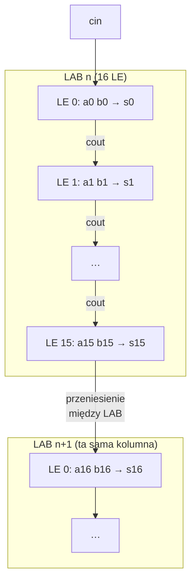

# 02.03 — Łańcuchy przeniesień i logika arytmetyczna

> **Moduł:** [02 — Architektura układów FPGA](README.md) · **Kod:** — · **DECA:** — · **Status:** ✅ pełny
>
> **Czytaj:**
>
> - [MAX 10 FPGA Handbook](https://www.intel.com/programmable/technical-pdfs/max10-handbook.pdf) — *Logic Elements*: tryb arytmetyczny, łańcuchy przeniesień między LAB
> - AMD UG474 — *7 Series FPGAs Configurable Logic Block User Guide* — rozdział o logice przeniesień CARRY4
> - Harris & Harris, *Digital Design and Computer Architecture* 💲, rozdz. 5.2.1 — sumatory (dla porównania z ASIC)

← [02.02](02.02-lut-przerzutnik-i-blok-logiczny-le-alm-clb-slice.md) · [spis modułu](README.md) · [02.04](02.04-siec-polaczen-i-dlaczego-trasowanie-kosztuje.md) →

## Po co to jest

Liczniki, sumatory, komparatory i akumulatory są w każdym projekcie, a wszystkie korzystają z jednego zasobu — łańcucha przeniesień. Wiedza o tym, jak jest zbudowany i jak biegnie przez układ, wyjaśnia, dlaczego 64-bitowy licznik ma inną maksymalną częstotliwość niż 16-bitowy, dlaczego narzędzie układa liczniki w pionowe kolumny i kiedy warto podzielić długi sumator. [01.04](../01-logika-cyfrowa/01.04-uklady-arytmetyczne-sumatory-przeniesienia.md) pokazało, *co* liczy sumator; tu — *jak* robi to sprzęt FPGA.

## Intuicja

Łańcuch przeniesień to „ekspresowy pas” między sąsiednimi elementami logicznymi. Zwykłe połączenia w FPGA przechodzą przez programowalne przełączniki, a każdy przełącznik dodaje opóźnienie. Przeniesienie biegnie osobnym, krótkim, stałym przewodem od jednego LE do następnego — bez przełączników. Cena: łańcuch idzie tylko w jednym kierunku (w MAX 10 w dół kolumny), więc kolejne bity sumatora muszą leżeć w sąsiednich LE jeden pod drugim.

## Teoria

### Tryb arytmetyczny LE w MAX 10

W trybie arytmetycznym LUT4 jest dzielona na dwie LUT3. Obie mają te same wejścia: dwa bity danych i przeniesienie wejściowe `cin`.

- pierwsza LUT3 liczy **sumę** (np. $a \oplus b \oplus c_{in}$),
- druga LUT3 liczy **przeniesienie wyjściowe** $c_{out}$, które idzie dedykowanym połączeniem do następnego LE.

Ponieważ to LUT3, a nie bramki, ta sama struktura realizuje też: odejmowanie ($b$ odwrócone), licznik (jeden składnik stały), licznik z ładowaniem i kasowaniem (sygnały LAB), komparator (tylko przeniesienie, bez sumy). Rejestr w tym samym LE może przechować wynik — licznik $N$-bitowy zajmuje $N$ LE.

### Długość łańcucha

| Rodzina | Jednostka łańcucha | Przejście między blokami |
|---------|--------------------|--------------------------|
| MAX 10, Cyclone IV | 1 bit na LE, 16 bitów na LAB | do następnego LAB w tej samej kolumnie |
| Cyclone V, Arria, Stratix, Agilex | 2 bity na ALM (dwa pełne sumatory), 20 bitów na LAB | do następnego LAB w kolumnie |
| AMD seria 7 | CARRY4: 4 bity na slice | do slice'a powyżej |
| AMD UltraScale | CARRY8: 8 bitów na CLB | do CLB powyżej |

Długi łańcuch biegnie przez wiele bloków w jednej kolumnie. Konsekwencje:

- opóźnienie rośnie liniowo z szerokością — przy zegarze rzędu 100–200 MHz łańcuch kilkudziesięciu bitów w MAX 10 zwykle się mieści, ale dla bardzo szerokich sumatorów (np. 64 bity i więcej) i wysokich zegarów trzeba je dzielić,
- łańcuch nie może zostać „przerwany” w połowie bloku, więc wpływa na rozmieszczenie: fitter musi znaleźć wolną kolumnę o odpowiedniej długości,
- wyjście ze środka łańcucha (np. pośrednie przeniesienie) wymaga wyprowadzenia na zwykłe połączenia.

### Co trafia na łańcuch przeniesień

Syntezator rozpoznaje w kodzie:

| Konstrukcja w HDL | Realizacja |
|-------------------|------------|
| `a + b`, `a - b`, `a + b + cin` | sumator na łańcuchu |
| `cnt + 1` w procesie taktowanym | licznik na łańcuchu, rejestr w tym samym LE |
| `a < b`, `a >= b` | komparator na łańcuchu (tylko przeniesienie) |
| `a == b` | zwykle drzewo LUT (choć narzędzie może wybrać łańcuch) |
| `acc <= acc + x` | akumulator na łańcuchu |
| sumator z bramek (`full_adder` w pętli `generate`) | zależnie od narzędzia: LUT i zwykłe połączenia albo łańcuch |

### Gdy łańcuch jest za wolny

1. **Potokowanie sumatora** — podział na dwie połowy: niższa połowa w takcie $n$, wyższa w takcie $n+1$ z przeniesieniem zapisanym w rejestrze.
2. **Carry-select** — wyższa połowa liczona dwa razy (dla przeniesienia 0 i 1), a wybór multiplekserem.
3. **Liczniki**: zamiast jednego szerokiego licznika — kilka węższych połączonych zezwoleniem (*prescaler*), albo licznik z rejestrowanym przeniesieniem między segmentami.
4. **Inna arytmetyka** — sumator carry-save przy sumowaniu wielu składników.

Szczegóły — [moduł 16](../16-wydajnosc-zasoby-moc/README.md).

## Schemat i przebiegi

## Reguły i liczby do zapamiętania

| Reguła lub liczba | Kiedy obowiązuje |
|-------------------|------------------|
| MAX 10: 1 bit sumatora/licznika = 1 LE; łańcuch 16 bitów na LAB, dalej w tej samej kolumnie | szacowanie zasobów i rozmieszczenia |
| Tryb arytmetyczny: LUT4 → dwie LUT3 (suma i przeniesienie) | MAX 10, Cyclone IV |
| Opóźnienie łańcucha rośnie liniowo z liczbą bitów | szerokie sumatory i liczniki |
| `+`, `-`, `<`, `>` i liczniki trafiają na łańcuch przeniesień | styl kodu |
| Za wolny łańcuch → potokowanie, carry-select, liczniki segmentowane | zamykanie timingu |

## Typowe pułapki

- **Bardzo szeroki licznik „na wszelki wypadek”.** 64-bitowy licznik czasu przy 200 MHz zajmuje długą kolumnę i może być ścieżką krytyczną. Często wystarczy 32 bity albo licznik dwustopniowy.
- **Logika między bitami sumatora.** Jeśli bit przeniesienia pośredniego trzeba wyprowadzić do logiki, narzędzie może nie zrealizować sumatora w jednym łańcuchu.
- **Wiele sumatorów jeden za drugim w jednym takcie.** Każdy z osobna jest szybki, ale ścieżka przechodzi przez kilka łańcuchów i połączenia między nimi.

## Pytania rekrutacyjne

1. **Jak FPGA realizuje sumator i dlaczego jest szybki?**

Odpowiedź

Na dedykowanym łańcuchu przeniesień: każdy element logiczny liczy jeden (w ALM — dwa, w CARRY4 — cztery) bity sumy, a przeniesienie biegnie do następnego elementu krótkim, stałym połączeniem bez programowalnych przełączników. Jest wielokrotnie szybsze niż przejście przez LUT i zwykłe połączenia, więc nawet sumator ripple-carry na kilkadziesiąt bitów mieści się w typowych zegarach.

2. **64-bitowy licznik nie spełnia wymagań czasowych. Co zrobisz?**

Odpowiedź

Podzielę go na segmenty, np. dwa 32-bitowe, z rejestrowanym sygnałem przeniesienia z niższego segmentu jako zezwoleniem dla wyższego — wyższy segment zwiększa się o takt później, co trzeba uwzględnić przy odczycie (albo odczytywać z korektą). Inne opcje: sprawdzić, czy naprawdę potrzeba 64 bitów, dodać potokowanie odczytu albo użyć licznika z prescalerem.

## Zadania

1. Ile LAB MAX 10 zajmie łańcuch przeniesień 40-bitowego akumulatora i jak będzie ułożony?

Odpowiedź

40 LE w trybie arytmetycznym → $\lceil 40/16 \rceil = 3$ LAB w jednej kolumnie (16 + 16 + 8 LE). Pozostałe LE trzeciego LAB mogą być użyte przez inną logikę.

2. Napisz licznik z parametrem szerokości `W` (`q <= q + 1` w procesie taktowanym, wyjście `q` na piny albo do jednej diody przez XOR wszystkich bitów, żeby syntezator go nie usunął) i skompiluj go w Quartusie dla `W` = 8, 16, 32 i 64 z zegarem 50 MHz z [deca_piny.tcl](../../plytka-deca/deca_piny.tcl). Zapisz $f_{max}$ z raportu *Timing Analyzer → Fmax Summary* (model *Slow 1200mV 85C*). **Kryterium zaliczenia:** tabela z czterema wartościami i wyjaśnienie trendu.

## Źródła

- [MAX 10 FPGA Handbook](https://www.intel.com/programmable/technical-pdfs/max10-handbook.pdf) — *Logic Elements*, *Arithmetic Mode*.
- AMD UG474 — *7 Series FPGAs Configurable Logic Block User Guide*, rozdz. o CARRY4.
- Harris & Harris, *Digital Design and Computer Architecture*, rozdz. 5.2.1.
