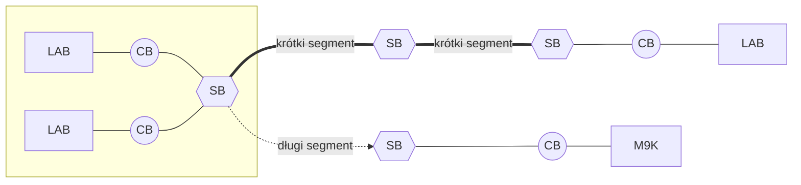

# 02.04 — Sieć połączeń i dlaczego trasowanie kosztuje czas

> **Moduł:** [02 — Architektura układów FPGA](README.md) · **Kod:** — · **DECA:** —
>
> **Czytaj:**
>
> - [MAX 10 FPGA Handbook](https://www.intel.com/programmable/technical-pdfs/max10-handbook.pdf) — *LAB Interconnects*: połączenia lokalne, bezpośrednie i wierszowo-kolumnowe (*MultiTrack*)
> - [UG949 — UltraFast Design Methodology Guide](https://docs.amd.com/r/en-US/ug949-vivado-design-methodology) — rozdziały o zatłoczeniu (*congestion*), dużym rozgałęzieniu (*fanout*) i wykorzystaniu układu
> - [Quartus Prime — przewodniki użytkownika](https://www.altera.com/design/guidance/software/quartus-user-guides) — *Design Optimization*: optymalizacja rozmieszczenia i trasowania, *Chip Planner*

← [02.03](02.03-lancuchy-przeniesien-i-logika-arytmetyczna.md) · [spis modułu](README.md) · [02.05](02.05-bloki-pamieci-i-pamiec-rozproszona.md) →

## Po co to jest

W raporcie czasowym ścieżki krytycznej FPGA zwykle ponad połowa opóźnienia to połączenia (*interconnect*, *routing*), a nie logika. Kto o tym nie wie, optymalizuje nie to, co trzeba — skraca logikę, a problemem jest odległość albo sygnał rozprowadzany do tysiąca odbiorników. Ten temat wyjaśnia, jak zbudowana jest sieć połączeń, dlaczego zatłoczony układ zwalnia i co z tego wynika dla kodu.

## Intuicja

FPGA to miasto z ulicami. Bloki logiczne to budynki, połączenia to ulice, a skrzyżowania to programowalne przełączniki. Każde skrzyżowanie spowalnia. Są uliczki lokalne (w obrębie bloku), ulice łączące sąsiednie budynki i trasy szybkiego ruchu przez całe miasto — ale tych jest mniej. Gdy budynki stoją daleko od siebie albo wszyscy jadą tą samą trasą, robi się korek. Narzędzie (fitter) jest urbanistą: decyduje, gdzie postawić każdy budynek i którędy poprowadzić każdy sygnał.

## Teoria

### Budowa sieci połączeń

Większość FPGA ma architekturę „wyspową” (*island-style*): bloki logiczne leżą w siatce, a między nimi biegną kanały z przewodami. Przewody łączą się przez:

- **bloki połączeń** (*connection boxes*) — między wejściami/wyjściami bloku a przewodami kanału,
- **bloki przełączające** (*switch boxes*) — na skrzyżowaniach kanałów; każdy przełącznik to multiplekser lub tranzystor sterowany komórką pamięci konfiguracji, czyli dodatkowe opóźnienie i pojemność.

Przewody mają różne długości:

| Poziom | MAX 10 | Zastosowanie |
|--------|--------|--------------|
| lokalny | połączenia wewnątrz LAB | sygnały między LE tego samego bloku — najszybsze |
| bezpośredni (*direct link*) | do sąsiednich LAB, M9K, mnożarek, PLL i IOE po lewej i prawej | sąsiedzi |
| wiersze i kolumny (*MultiTrack*) | segmenty o kilku długościach, krótkie i długie | sygnały na większe odległości |
| sieci globalne | osobne sieci zegarów i sygnałów o dużym rozgałęzieniu | zegary, resety ([02.07](02.07-zegary-sieci-globalne-pll-i-mmcm.md)) |

Według dokumentacji MAX 10 jeden LE może przez połączenia lokalne i bezpośrednie sterować do 48 LE bez korzystania z dłuższych linii.

### Ile kosztują połączenia

- Sieć połączeń zajmuje większość powierzchni krzemu FPGA — znacznie więcej niż same LUT. To cena programowalności.
- Opóźnienie przewodu rośnie z długością i liczbą przełączników po drodze. W ścieżkach krytycznych FPGA połączenia stanowią zwykle **połowę lub więcej** całkowitego opóźnienia.
- Opóźnienie połączeń jest znane dopiero **po rozmieszczeniu i trasowaniu**. Raporty z syntezy podają tylko szacunki.

### Co pogarsza trasowanie

| Problem | Objaw | Rozwiązanie |
|---------|-------|-------------|
| **duże rozgałęzienie** (*high fanout*) — jeden sygnał steruje tysiącami wejść (reset, zezwolenie, sygnał wyboru) | długie ścieżki z jednego rejestru | sieć globalna, powielenie rejestru (*register duplication*), potokowanie rozprowadzania |
| **zatłoczenie** (*congestion*) — dużo sygnałów w małym obszarze | trasowanie trwa długo, ścieżki „objeżdżają” obszar | mniej szerokich multiplekserów, rozproszenie logiki, mniej połączeń wszystkich ze wszystkimi |
| **wysokie wykorzystanie układu** (powyżej ok. 80% LUT/LAB) | spadek $f_{max}$, długi czas kompilacji | mniejszy projekt, większy układ |
| **odległe zasoby stałe** — piny, pamięci, mnożarki, PLL mają stałe położenie | długie ścieżki od pinu do logiki | rejestr przy pinie (w IOE), rejestry na wejściu i wyjściu bloków |
| **logika „wszyscy do wszystkich”** (np. szeroki crossbar) | zatłoczenie | architektura z magistralą, potokowanie |

### Co może zrobić projektant

1. **Rejestry na granicach**: wejścia i wyjścia modułów, pamięci i bloków DSP rejestrowane — połączenie długości „cały układ” zaczyna się i kończy w rejestrze, a nie w środku logiki.
2. **Potokowanie** długich ścieżek ([moduł 16](../16-wydajnosc-zasoby-moc/README.md)).
3. **Ograniczenie rozgałęzienia**: atrybut maksymalnego rozgałęzienia (Quartus: `maxfan`, Vivado: `MAX_FANOUT`) albo ręczne powielenie rejestru.
4. **Zostawienie zapasu**: projekt zajmujący 95% układu będzie trudny do zamknięcia timingu niezależnie od jakości kodu.
5. **Planowanie rozmieszczenia** (*floorplanning*) — regiony LogicLock w Quartusie, Pblock w Vivado — dla dużych projektów i bloków o krytycznym czasie.

## Schemat i przebiegi

CB — blok połączeń, SB — blok przełączający. Każde przejście przez SB to dodatkowe opóźnienie.

Przykładowa ścieżka z raportu czasowego (rozbicie typowe dla FPGA):

| Element | Typ | Opóźnienie |
|---------|-----|-----------|
| wyjście rejestru źródłowego | $t_{co}$ | 0,2–0,6 ns |
| połączenie → LUT 1 | IC | 0,5–1,5 ns |
| LUT 1 | CELL | 0,3–0,5 ns |
| połączenie → LUT 2 | IC | 0,5–1,5 ns |
| LUT 2 | CELL | 0,3–0,5 ns |
| połączenie → rejestr docelowy | IC | 0,5–1,5 ns |
| setup rejestru docelowego | $t_{su}$ | 0,1–0,3 ns |

Wartości są poglądowe — zakresy rzędu wielkości dla układów tej klasy. Rzeczywiste odczytasz z *Report Path* w Timing Analyzer (kolumny *IC* i *CELL*).

## Reguły i liczby do zapamiętania

| Reguła lub liczba | Kiedy obowiązuje |
|-------------------|------------------|
| Połączenia to zwykle połowa lub więcej opóźnienia ścieżki krytycznej | układy FPGA |
| Opóźnienia połączeń są znane dopiero po rozmieszczeniu i trasowaniu | czytanie raportów |
| Rejestruj wejścia i wyjścia modułów, pamięci i DSP | projekty powyżej kilkudziesięciu MHz |
| Wykorzystanie powyżej ok. 80% utrudnia zamknięcie timingu | wybór układu |
| Sygnały o dużym rozgałęzieniu: sieć globalna albo powielenie rejestru | resety, zezwolenia, sygnały wyboru |

## Typowe pułapki

- **Optymalizacja logiki zamiast połączeń.** Jeśli w *Report Path* większość czasu to *IC*, skracanie logiki niewiele da — problem to odległość lub rozgałęzienie.
- **Jeden rejestr zezwolenia dla całego toru danych.** Rozgałęzienie w tysiące — powiel rejestr albo rozprowadź sygnał potokowo.
- **Wejście z pinu prosto do głębokiej logiki.** Pin ma stałe położenie; pierwszy rejestr powinien być w IOE albo tuż obok.
- **„Wystarczy większy układ”.** Większy układ to dłuższe połączenia przy rozproszonym projekcie; pomaga przy zatłoczeniu, ale nie skróci ścieżki między odległymi blokami stałymi.

## Pytania rekrutacyjne

1. **Dlaczego opóźnienie połączeń w FPGA jest tak duże w porównaniu z ASIC?**

Odpowiedź

Bo każde połączenie przechodzi przez programowalne przełączniki (multipleksery sterowane komórkami konfiguracji) i przez segmenty przewodów o stałych długościach, a nie przez przewód zaprojektowany dokładnie dla tej ścieżki. Przełączniki dodają opóźnienie i pojemność, a trasa rzadko jest najkrótsza możliwa. Dlatego w FPGA połączenia to zwykle połowa lub więcej opóźnienia ścieżki.

2. **Sygnał zezwolenia steruje 5000 rejestrów i jest na ścieżce krytycznej. Jak to poprawisz?**

Odpowiedź

Powielę rejestr źródłowy, tak żeby każda kopia sterowała mniejszą grupą (ręcznie albo atrybutem maksymalnego rozgałęzienia), albo rozprowadzę sygnał potokowo w drzewie rejestrów, kompensując opóźnienie w reszcie toru. Jeśli sygnał jest wolnozmienny, może iść siecią globalną. Sprawdzę też, czy wszystkie rejestry naprawdę potrzebują zezwolenia.

3. **Dlaczego przy wykorzystaniu układu powyżej 80–90% trudno zamknąć timing?**

Odpowiedź

Bo fitter ma mało swobody: nie może umieścić logiki blisko jej źródeł i odbiorników, a kanały połączeń są zatłoczone, więc sygnały idą okrężnymi trasami. Rosną opóźnienia połączeń i czas kompilacji. Wyjście: mniejszy projekt, większy układ albo planowanie rozmieszczenia.

## Zadania

1. Otwórz w Quartusie *Timing Analyzer → Report Timing* dla najgorszej ścieżki dowolnego projektu z tej bazy (np. `blink`). Zsumuj osobno opóźnienia typu *IC* i *CELL*. **Kryterium zaliczenia:** podany udział połączeń w procentach całego opóźnienia danych.

2. Ścieżka: $t_{co} = 0{,}5$ ns, 3 LUT po 0,4 ns, 4 odcinki połączeń po 1,1 ns, $t_{su} = 0{,}2$ ns. Jaki procent opóźnienia stanowią połączenia? O ile wzrośnie $f_{max}$, jeśli fitter skróci połączenia o 30%?

Odpowiedź

Całość: $0{,}5 + 1{,}2 + 4{,}4 + 0{,}2 = 6{,}3$ ns; połączenia 4,4 ns, czyli ok. 70%. $f_{max} = 1/6{,}3\ \text{ns} \approx 159$ MHz. Po skróceniu połączeń do 3,08 ns: $4{,}98$ ns, $f_{max} \approx 201$ MHz — wzrost o ok. 27%. Skrócenie logiki o 30% (z 1,2 do 0,84 ns) dałoby tylko ok. 6%.

## Źródła

- [MAX 10 FPGA Handbook](https://www.intel.com/programmable/technical-pdfs/max10-handbook.pdf) — *LAB Interconnects*.
- [UG949 — UltraFast Design Methodology Guide](https://docs.amd.com/r/en-US/ug949-vivado-design-methodology) — zatłoczenie, rozgałęzienie, wykorzystanie.
- [Quartus Prime — przewodniki użytkownika](https://www.altera.com/design/guidance/software/quartus-user-guides) — *Design Optimization*, *Chip Planner*.
