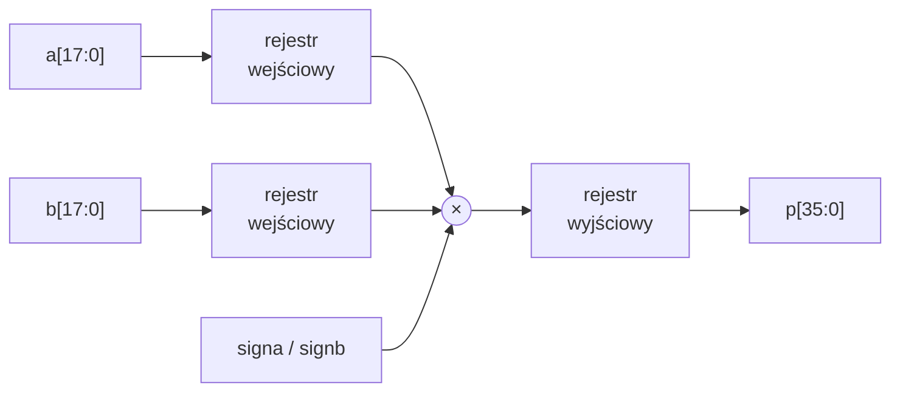
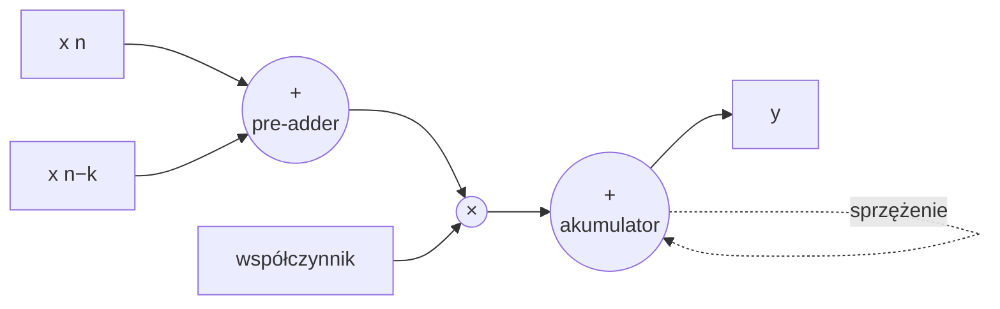

# 02.06 — Bloki DSP i mnożarki sprzętowe

> **Moduł:** [02 — Architektura układów FPGA](README.md) · **Kod:** — · **DECA:** —
>
> **Czytaj:**
>
> - [MAX 10 Embedded Multipliers User Guide](https://www.intel.com/content/www/us/en/docs/programmable/683467/) — rozdz. 1–2: tryby 18 × 18 i 9 × 9, rejestry wejściowe i wyjściowe, liczba bloków w układach, mnożarki programowe w M9K
> - [Quartus Prime Standard Edition — Design Recommendations](https://www.intel.com/content/www/us/en/docs/programmable/683323/) — rozdział o wnioskowaniu mnożarek i funkcji DSP z HDL
> - AMD UG479 — *7 Series DSP48E1 Slice User Guide* ([docs.amd.com](https://docs.amd.com/)) — dla porównania: pełny blok DSP z sumatorem i akumulatorem

← [02.05](02.05-bloki-pamieci-i-pamiec-rozproszona.md) · [spis modułu](README.md) · [02.07](02.07-zegary-sieci-globalne-pll-i-mmcm.md) →

## Po co to jest

Mnożenie w logice (LUT) jest drogie: mnożarka 18 × 18 zbudowana z LE zajmuje setki elementów i jest wolna. Dlatego FPGA mają sprzętowe mnożarki i bloki DSP. Każdy filtr, przetwarzanie obrazu, sterowanie silnikiem czy sieć neuronowa w FPGA stoi na tych blokach. Projektant musi wiedzieć, ile ich jest, jakie mają szerokości i rejestry, żeby kod trafiał w ich możliwości — wtedy dostaje wysoką częstotliwość „za darmo”. Arytmetyka DSP — [moduł 19](../19-arytmetyka/README.md) i [moduł 26](../26-dsp-w-fpga/README.md).

## Intuicja

Blok mnożarki to gotowy „kalkulator” wbudowany w krzem obok bloków logicznych. Jest dużo mniejszy i szybszy niż ten sam układ złożony z LUT, ale ma stałe rozmiary — jak szuflady o jednym wymiarze. Mnożenie 12 × 12 zmieści się w szufladzie 18 × 18 (marnując część), mnożenie 24 × 24 wymaga czterech szuflad i sumatorów, a mnożenie 4 × 4 może być tańsze w logice.

Bloki DSP w większych rodzinach to więcej niż mnożarka: mają też sumator przed mnożeniem (*pre-adder*), akumulator po nim i rejestry na każdym etapie — czyli cały krok filtru FIR w jednym bloku.

## Teoria

### Mnożarki w MAX 10

| Cecha | Wartość |
|-------|---------|
| Tryby jednego bloku | jedna mnożarka 18 × 18 (wynik 36 bitów) albo dwie niezależne 9 × 9 (wyniki po 18 bitów) |
| Liczba w 10M50 | 144 bloki = 144 × (18 × 18) lub 288 × (9 × 9) |
| Liczby | ze znakiem lub bez (sygnały `signa`, `signb`; w trybie 9 × 9 wspólne dla obu mnożarek) |
| Rejestry | opcjonalne rejestry wejściowe i wyjściowe w bloku |
| Sumatory i akumulatory | **w logice** (LE) — blok MAX 10 to sama mnożarka |
| Mnożarki programowe | Quartus potrafi zrealizować mnożarkę w M9K jako tablicę (dla 10M50 dodatkowo do 182 mnożarek 16 × 16) |

Mnożenie szersze niż 18 × 18 narzędzie składa z kilku bloków i sumatorów w logice ([01.04](../01-logika-cyfrowa/01.04-uklady-arytmetyczne-sumatory-przeniesienia.md)).

### Bloki DSP w innych rodzinach

| Rodzina | Blok | Mnożarka | Dodatki |
|---------|------|----------|---------|
| MAX 10, Cyclone IV, Cyclone 10 LP | *embedded multiplier* | 18 × 18 lub 2 × (9 × 9) | rejestry wejścia/wyjścia |
| Cyclone V, Arria V | *variable-precision DSP* | 27 × 27, 2 × (18 × 19) lub 3 × (9 × 9) | sumator wstępny, akumulator 64 bity, łączenie bloków w łańcuch |
| Arria 10, Stratix 10, Agilex | *variable-precision DSP* | jak wyżej | sprzętowy zmiennoprzecinkowy pojedynczej precyzji (IEEE 754) |
| AMD seria 7 | DSP48E1 | 25 × 18 (U2) | sumator wstępny 25 bitów, ALU/akumulator 48 bitów, detektor wzorca, łańcuch kaskadowy |
| AMD UltraScale/UltraScale+ | DSP48E2 | 27 × 18 | jak wyżej + rozszerzenia |
| AMD Versal | DSP58 | 27 × 24 | zmiennoprzecinkowe, tryby wektorowe |
| Lattice ECP5 | sysDSP | 18 × 18 lub 9 × 9 | sumatory, akumulator |

### Jak kod trafia do bloku DSP

Syntezator rozpoznaje `a * b` i dobiera blok, jeśli szerokości są „rozsądne” (dla MAX 10 zwykle od kilku bitów). Dobre praktyki:

1. **Rejestry wokół mnożarki.** Rejestr na wejściach i na wyjściu (`p_q <= a_q * b_q`) pozwala narzędziu użyć rejestrów wewnątrz bloku — mnożenie nie wydłuża ścieżek logiki. W większych rodzinach potrzeba 2–3 stopni rejestrów, żeby osiągnąć maksymalną częstotliwość bloku.
2. **Szerokości dopasowane do bloku.** Mnożenie 18 × 18 zajmuje jeden blok, 19 × 18 — już kilka. Obcięcie jednego bitu bywa warte rozważenia.
3. **Typy ze znakiem.** `signed` w VHDL/Verilog — blok obsługuje liczby U2 natywnie.
4. **Wymuszenie realizacji**: atrybut `multstyle` w Quartusie (`"dsp"` albo `"logic"`), `use_dsp` w Vivado — gdy brakuje bloków lub gdy mnożenie przez stałą jest tańsze w logice.

### Mnożenie przez stałą

Mnożenie przez stałą syntezator często zamienia na przesunięcia i sumy ([01.04](../01-logika-cyfrowa/01.04-uklady-arytmetyczne-sumatory-przeniesienia.md)) — szczególnie gdy stała ma mało jedynek. Dla stałych „gęstych” (np. współczynniki filtrów) blok mnożarki jest zwykle lepszy.

## Schemat i przebiegi

Blok mnożarki MAX 10 w trybie 18 × 18 z rejestrami:

Kolejność operacji typowa dla bloku DSP z akumulatorem (np. DSP48 lub variable-precision DSP) — krok filtru FIR:

## Reguły i liczby do zapamiętania

| Reguła lub liczba | Kiedy obowiązuje |
|-------------------|------------------|
| MAX 10: blok = 18 × 18 albo 2 × (9 × 9); 10M50 — 144 bloki | szacowanie zasobów |
| MAX 10: sumatory i akumulatory przy mnożarkach są w LE | filtry, MAC |
| AMD DSP48E1: 25 × 18, akumulator 48 bitów, sumator wstępny | porównania, przenoszenie projektów |
| Rejestruj wejścia i wyjście mnożarki — rejestry wejdą do bloku | wysoka częstotliwość |
| Mnożenie $N \times M$ powyżej szerokości bloku = kilka bloków + sumatory | szerokie mnożenia |
| Wymuszenie realizacji: `multstyle` (Quartus), `use_dsp` (Vivado) | brak bloków, stałe |

## Typowe pułapki

- **Mnożarka bez rejestrów w długiej ścieżce.** Logika → mnożenie → logika w jednym takcie to długa ścieżka; blok nie może użyć swoich rejestrów.
- **Szerokość o bit za duża.** Mnożenie 19 × 19 w MAX 10 zajmuje kilka bloków i sumatory zamiast jednego.
- **Mieszanie `signed` i `unsigned`** (Verilog) — wynik liczony bez znaku ([01.01](../01-logika-cyfrowa/01.01-systemy-liczbowe-kody-i-liczby-ze-znakiem.md)).
- **Reset na rejestrach potoku mnożarki.** W niektórych rodzinach rejestry wewnątrz DSP mają ograniczone resety; reset asynchroniczny może uniemożliwić ich użycie. Rejestry danych często nie potrzebują resetu.

## Pytania rekrutacyjne

1. **Ile bloków mnożarek MAX 10 zajmie mnożenie 24 × 24 i jak narzędzie je zrealizuje?**

Odpowiedź

Cztery bloki 18 × 18 (lub mniej, jeśli narzędzie użyje trybu 9 × 9 dla części iloczynów). Argumenty dzieli się na część starszą i młodszą, liczy cztery iloczyny częściowe i sumuje je z przesunięciami w logice (LE). Wynik ma 48 bitów.

2. **Co zawiera blok DSP48 i dlaczego nadaje się do filtrów FIR?**

Odpowiedź

Sumator wstępny (25 bitów), mnożarkę 25 × 18, ALU/akumulator 48 bitów, rejestry na każdym etapie i połączenia kaskadowe do sąsiednich bloków. Krok filtru FIR to mnożenie próbki (lub sumy dwóch próbek przy filtrze symetrycznym — stąd sumator wstępny) przez współczynnik i dodanie do sumy częściowej — dokładnie to, co blok robi w jednym takcie, a kaskada przenosi sumę do następnego bloku bez użycia logiki.

3. **Kiedy lepiej zrealizować mnożenie w logice niż w bloku DSP?**

Odpowiedź

Gdy mnożenie jest bardzo wąskie (kilka bitów), gdy mnożymy przez stałą z małą liczbą jedynek (przesunięcia i sumy), albo gdy w układzie brakuje bloków DSP. W pozostałych przypadkach blok jest mniejszy, szybszy i zużywa mniej energii.

## Zadania

1. Filtr FIR ma 64 współczynniki 16-bitowe i próbki 12-bitowe, wszystkie mnożenia liczone równolegle co takt. Ile bloków mnożarek MAX 10 zajmie? Czy zmieści się w 10M50? Jak zmieni się wynik dla filtru symetrycznego?

Odpowiedź

12 × 16 mieści się w 18 × 18, więc 64 bloki — 10M50 ma 144, zmieści się. Sumatory (drzewo 64 składników) trafią do LE. Filtr symetryczny: najpierw dodaje się pary próbek o tych samych współczynnikach (13-bitowe sumy), więc mnożeń jest 32 — o połowę mniej bloków kosztem 32 sumatorów w logice.

2. Opisz w wybranym języku mnożarkę 18 × 18 ze znakiem z rejestrami na wejściach i wyjściu. Skompiluj ją w Quartusie dla DECA i sprawdź w raporcie *Fitter → Resource Usage Summary* liczbę użytych *Embedded Multiplier 9-bit elements* oraz w *Technology Map Viewer*, czy rejestry trafiły do bloku. **Kryterium zaliczenia:** 2 elementy 9-bitowe (jeden blok 18 × 18), rejestry wewnątrz bloku.

## Źródła

- [MAX 10 Embedded Multipliers User Guide](https://www.intel.com/content/www/us/en/docs/programmable/683467/).
- [Quartus Prime Standard Edition — Design Recommendations](https://www.intel.com/content/www/us/en/docs/programmable/683323/) — wnioskowanie mnożarek.
- AMD UG479 — *7 Series DSP48E1 Slice User Guide*.
