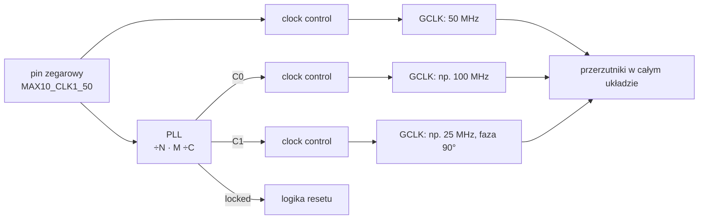

# 02.07 — Zegary: sieci globalne, PLL i MMCM

> **Moduł:** [02 — Architektura układów FPGA](README.md) · **Kod:** — · **DECA:** —
>
> **Czytaj:**
>
> - [MAX 10 FPGA Handbook](https://www.intel.com/programmable/technical-pdfs/max10-handbook.pdf) — *MAX 10 Clocking and PLL User Guide*: sieci GCLK, piny zegarowe, bloki sterowania zegarem, PLL i wewnętrzny oscylator
> - AMD UG472 — *7 Series FPGAs Clocking Resources* ([docs.amd.com](https://docs.amd.com/)) — BUFG, regiony zegarowe, MMCM i PLL
> - [UG949 — UltraFast Design Methodology Guide](https://docs.amd.com/r/en-US/ug949-vivado-design-methodology) — zalecenia dotyczące zegarów

← [02.06](02.06-bloki-dsp-i-mnozarki-sprzetowe.md) · [spis modułu](README.md) · [02.08](02.08-bloki-wejscia-wyjscia-i-banki-i-o.md) →

## Po co to jest

Zegar dociera do tysięcy przerzutników i każda różnica w czasie dotarcia (przesunięcie, [01.06](../01-logika-cyfrowa/01.06-parametry-czasowe-propagacja-setup-hold-clock.md)) zjada zapas czasowy. Dlatego FPGA ma osobne, zrównoważone sieci zegarowe i pętle PLL, które mnożą, dzielą i przesuwają w fazie zegar wejściowy. Projektant musi wiedzieć, skąd wziąć zegar (który pin, który PLL), ile zegarów zmieści się w układzie i dlaczego zegara nie wolno robić z logiki. Zarządzanie zegarami i resetami — [moduł 15](../15-zegary-reset-cdc/README.md).

## Intuicja

Zwykłe połączenia w FPGA to sieć ulic — szybka dla jednego sygnału do kilku odbiorników. Zegar musi dotrzeć do wszystkich przerzutników **w tej samej chwili**. Do tego służy osobna sieć w kształcie drzewa (*H-tree* albo ości ryby), o równych długościach gałęzi i mocnych buforach — jak system wodociągowy, w którym woda ma dopłynąć do każdego kranu z tym samym ciśnieniem.

PLL (*phase-locked loop*) to „przekładnia” zegara: z 50 MHz robi 25, 100, 148,5 MHz albo zegar przesunięty w fazie o 90°. W środku jest oscylator sterowany napięciem, który pętla sprzężenia zwrotnego „dostraja” do zegara wejściowego.

## Teoria

### Sieci zegarowe w MAX 10

| Zasób | MAX 10 (10M16–10M50) |
|-------|----------------------|
| Globalne sieci zegarowe (GCLK) | do 20 (10M02–10M08: 10) — każda dociera do całego układu |
| Dedykowane piny zegarowe | wejścia `CLK[0..7]` (pary p/n, mogą być różnicowe) |
| Bloki sterowania zegarem (*clock control*) | wybór źródła dla GCLK (pin, PLL, logika), dynamiczne włączanie/wyłączanie sieci |
| PLL | 4 w obudowie F484 (PLL1–PLL4), każdy z 5 wyjściami C0–C4 |
| Wewnętrzny oscylator | oscylator pierścieniowy, dzielony do niższych częstotliwości; do zastosowań bez dokładności (np. zegar zapasowy, konfiguracja) |

Źródła GCLK: dedykowany pin zegarowy (najlepsze — zrównoważona ścieżka do sieci i do PLL), wyjście PLL albo sygnał wewnętrzny (możliwe, ale z dużym opóźnieniem i przesunięciem — unikaj).

Na płytce DECA: `MAX10_CLK1_50` (pin M8) i `MAX10_CLK2_50` (pin P11) — dwa niezależne zegary 50 MHz, `ADC_CLK_10` (pin M9) — 10 MHz dla przetworników ADC, `DDR3_CLK_50` (pin N15) — zegar dla kontrolera DDR3. Wszystkie są na pinach zegarowych ([piny.md](../../plytka-deca/piny.md)).

### PLL

Częstotliwość wyjściowa:

$$f_{out} = f_{in} \cdot \frac{M}{N \cdot C}$$

gdzie $N$ — dzielnik wejściowy, $M$ — mnożnik w pętli sprzężenia, $C$ — dzielnik danego wyjścia (C0–C4). Oscylator (VCO) pracuje z częstotliwością $f_{in} \cdot M / N$, która musi mieścić się w zakresie podanym w karcie katalogowej; z jednego VCO powstaje kilka wyjść o różnych dzielnikach $C$.

Możliwości PLL:

- **synteza częstotliwości** — np. 50 MHz → 148,5 MHz dla HDMI 1080p ([moduł 24](../24-wideo-i-grafika/README.md)),
- **przesunięcie fazy** wyjść (np. zegar 90° dla pamięci DDR),
- **kompensacja opóźnienia** sieci zegarowej (tryby *normal*, *source-synchronous*, *zero-delay buffer*) — zegar przy przerzutnikach jest wyrównany z zegarem na pinie,
- **filtrowanie drżenia** wejściowego (w ograniczonym zakresie),
- **przełączanie źródła** (*clock switchover*) między dwoma wejściami,
- sygnał **`locked`** — PLL ustabilizował się; do tego czasu wyjścia są nieprawidłowe, więc `locked` zwykle trzyma układ w resecie.

W MAX 10 wyjście C0 pętli PLL1 lub PLL3 może taktować blok ADC ([moduł 20](../20-interfejsy-szeregowe/README.md)).

PLL konfiguruje się przez IP (*ALTPLL* w Quartusie) albo prymitywy — to element zależny od producenta. W kodzie niezależnym od producenta opakowuje się go cienkim modułem, który łatwo wymienić ([moduł 15](../15-zegary-reset-cdc/README.md)).

### AMD: MMCM i PLL

| Zasób | AMD seria 7 |
|-------|-------------|
| Bufory globalne | 32 BUFG (+ BUFGCE z zezwoleniem, BUFGMUX z przełączaniem) |
| Regiony zegarowe | układ podzielony na regiony; bufory regionalne BUFR, BUFH, BUFIO dla szybkiego I/O |
| CMT (*clock management tile*) | 1 MMCM + 1 PLL w każdym |
| MMCM | jak PLL, plus dzielnik ułamkowy, precyzyjne dynamiczne przesuwanie fazy, więcej wyjść |
| PLL | prostszy, mniej wyjść, mniejszy pobór mocy |

### Dlaczego nie robi się zegarów z logiki

- **Przesunięcie i opóźnienie**: zegar z wyjścia rejestru lub LUT idzie zwykłymi połączeniami; dociera do odbiorników w różnych chwilach i jest opóźniony względem zegara źródłowego — przejścia danych między tymi domenami łatwo łamią hold.
- **Hazardy**: zegar z logiki kombinacyjnej może mieć dodatkowe zbocza ([01.02](../01-logika-cyfrowa/01.02-algebra-boole-a-i-minimalizacja-co-z-tego-robi.md)).
- **Analiza czasowa**: każdy taki zegar trzeba ręcznie opisać w SDC (`create_generated_clock`).

Zamiast tego: **zezwolenie zegara** (*clock enable*) dla wolniejszych części układu, **PLL** dla innych częstotliwości, **blok sterowania zegarem** do bezpiecznego wyłączania zegara (oszczędzanie energii).

## Schemat i przebiegi

## Reguły i liczby do zapamiętania

| Reguła lub liczba | Kiedy obowiązuje |
|-------------------|------------------|
| $f_{out} = f_{in} \cdot M / (N \cdot C)$; VCO $= f_{in} \cdot M / N$ w zakresie z karty katalogowej | PLL |
| MAX 10 (10M50, F484): do 20 GCLK, 4 PLL, po 5 wyjść C0–C4 | płytka DECA |
| Zegar z pinu zegarowego, nie z dowolnego pinu | projekt płytki, przypisanie pinów |
| Wyjścia PLL są ważne dopiero po `locked = 1` | reset układu |
| Nie robi się zegarów z logiki — zezwolenie albo PLL | zawsze |
| AMD seria 7: CMT = MMCM + PLL; 32 BUFG | porównania |

## Typowe pułapki

- ⚠️ **Zegar wprowadzony zwykłym pinem.** Ścieżka do sieci globalnej jest długa i nieprzewidywalna, PLL może być nieosiągalny. Zawsze dedykowany pin zegarowy — to decyzja przy projektowaniu płytki.
- ⚠️ **Praca przed `locked`.** Logika taktowana wyjściem PLL startuje, zanim zegar jest stabilny. `locked` (zsynchronizowany) powinien trzymać reset.
- **Dzielnik zegara w logice** (`clk_div <= ~clk_div` i dalej `always @(posedge clk_div)`). Nowa domena zegara z przesunięciem i bez automatycznych ograniczeń. Zamiast tego impuls zezwolenia.
- **Za dużo różnych zegarów.** Każdy zegar to sieć globalna i potencjalne przejścia między domenami. Mniej zegarów = prostszy projekt.

## Pytania rekrutacyjne

1. **Po co FPGA ma osobne sieci zegarowe?**

Odpowiedź

Żeby zegar docierał do wszystkich przerzutników prawie w tej samej chwili (małe przesunięcie) i z małym opóźnieniem. Sieci globalne to zrównoważone drzewa z mocnymi buforami, osobne od zwykłych połączeń. Zegar prowadzony zwykłymi połączeniami miałby duże i zmienne przesunięcie, co psuje zarówno setup, jak i hold.

2. **Jak z zegara 50 MHz otrzymać 74,25 MHz w PLL?**

Odpowiedź

$74{,}25 / 50 = 1{,}485 = 297/200$, więc szukam $M/(N \cdot C) = 297/200$ przy VCO w dozwolonym zakresie. Przykład: $N = 20$, $M = 297$ → VCO $= 50 \cdot 297 / 20 = 742{,}5$ MHz, $C = 10$ → 74,25 MHz. Trzeba sprawdzić, czy VCO i wartości liczników mieszczą się w zakresach z karty katalogowej; jeśli nie, szuka się innej kombinacji albo akceptuje przybliżenie. W praktyce wartości dobiera kreator IP, a projektant sprawdza dokładność wyniku.

3. **Czym różni się MMCM od PLL w układach AMD?**

Odpowiedź

Oba syntetyzują częstotliwości i przesuwają fazę. MMCM jest bardziej rozbudowany: ma dzielnik ułamkowy, precyzyjne dynamiczne przesuwanie fazy i więcej wyjść; PLL jest prostszy i zużywa mniej energii. W serii 7 każdy CMT ma jeden MMCM i jeden PLL.

4. **Dlaczego nie powinno się dzielić zegara licznikiem i używać wyniku jako zegara?**

Odpowiedź

Bo wyjście rejestru idzie zwykłymi połączeniami do sieci zegarowej: zegar jest opóźniony i przesunięty względem źródłowego, tworzy nową domenę z ryzykiem naruszeń hold na przejściach i wymaga ręcznych ograniczeń w SDC. Lepiej użyć zezwolenia zegara (impuls co N taktów) albo wyjścia PLL.

## Zadania

1. PLL ma wejście 50 MHz, $N = 1$, $M = 12$. Jakie częstotliwości otrzymasz na wyjściach z $C$ = 4, 6, 24? Ile wynosi VCO?

Odpowiedź

VCO = 600 MHz. Wyjścia: 150 MHz, 100 MHz, 25 MHz.

2. Otwórz w Quartusie kreator IP *ALTPLL* dla układu 10M50DAF484C6G, ustaw wejście 50 MHz i wyjścia 100 MHz oraz 25 MHz z przesunięciem 90°. Zapisz wartości $M$, $N$, $C$ i VCO wybrane przez kreator. **Kryterium zaliczenia:** wartości spełniają wzór $f_{out} = f_{in} \cdot M / (N \cdot C)$.

## Źródła

- [MAX 10 FPGA Handbook](https://www.intel.com/programmable/technical-pdfs/max10-handbook.pdf) — *Clocking and PLL User Guide*.
- AMD UG472 — *7 Series FPGAs Clocking Resources*.
- [UG949 — UltraFast Design Methodology Guide](https://docs.amd.com/r/en-US/ug949-vivado-design-methodology) — zegary.
