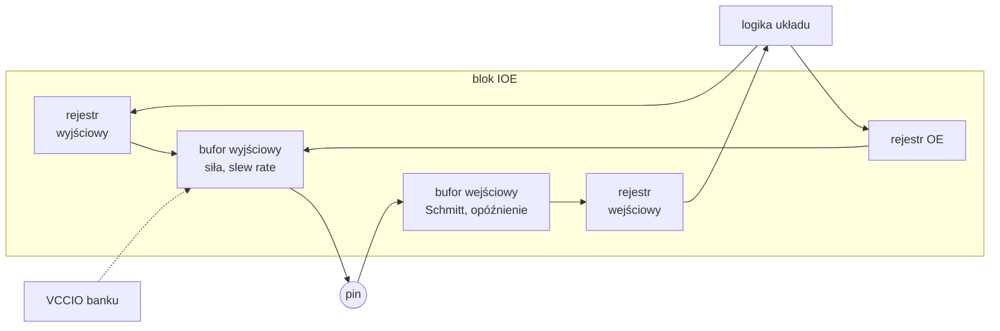

# 02.08 — Bloki wejścia-wyjścia i banki I/O

> **Moduł:** [02 — Architektura układów FPGA](README.md) · **Kod:** — · **DECA:** —
>
> **Czytaj:**
>
> - [MAX 10 FPGA Handbook](https://www.intel.com/programmable/technical-pdfs/max10-handbook.pdf) — *MAX 10 General Purpose I/O User Guide*: banki, standardy, budowa IOE, terminacja, LVDS
> - [MAX 10 FPGA Device Datasheet](https://www.intel.com/content/www/us/en/docs/programmable/683794/) — parametry elektryczne standardów I/O
> - *DECA User Manual*, rozdz. 3 — przypisanie banków i napięć na płytce ([zrodla.md](../../plytka-deca/zrodla.md))

← [02.07](02.07-zegary-sieci-globalne-pll-i-mmcm.md) · [spis modułu](README.md) · [02.09](02.09-konfiguracja-sram-flash-antifuse-max-10-jako.md) →

## Po co to jest

Piny FPGA nie są uniwersalne: każdy należy do banku zasilanego jednym napięciem, a każde napięcie dopuszcza tylko część standardów. Błąd w tej warstwie kończy się odrzuceniem projektu przez Quartusa — albo, gorzej, uszkodzeniem układu podłączonego do pinu. Blok wejścia-wyjścia (IOE) ma też rejestry, linie opóźniające i terminację, które decydują o tym, czy szybki interfejs zadziała. Projektowanie interfejsów — [moduł 22](../22-io-i-szybkie-interfejsy/README.md).

## Intuicja

Bank I/O to grupa pinów ze wspólnym zasilaniem wyjść (VCCIO) — jak listwa zasilająca z kilkoma gniazdkami tego samego typu. Do gniazdka 1,2 V nie podłączysz urządzenia 3,3 V. Dlatego projektant płytki dzieli peryferia między banki według napięcia, a projektant FPGA musi trzymać się tego podziału.

Blok IOE to „bramka celna” między krzemem a światem: bufor wejściowy i wyjściowy, rejestry tuż przy pinie (najkrótsza możliwa droga), regulowana siła wyjścia, rezystory podciągające, terminacja.

## Teoria

### Banki i standardy

Wszystkie piny w banku mają wspólne **VCCIO**. Wynikają z tego zasady:

- standard wyjściowy musi mieć to samo napięcie co VCCIO banku (LVCMOS 1,2 V w banku 1,2 V itd.),
- standardy wejściowe tolerują czasem inne napięcia, ale tylko zgodnie z tabelami producenta,
- standardy z napięciem odniesienia (SSTL, HSTL — pamięci DDR) wymagają pinu **VREF** w banku,
- standardy różnicowe (LVDS) zajmują dwa piny (p i n).

Płytka DECA — podział banków ([piny.md](../../plytka-deca/piny.md)):

| Bank | VCCIO | Przykłady sygnałów | Typowe standardy |
|------|-------|--------------------|------------------|
| 1A, 1B, 2 | 2,5 V | `MAX10_CLK1_50`, Ethernet | `2.5 V` |
| 3, 4 | 3,3 V | złącza P8 i P9, czujniki | `3.3-V LVTTL`, `3.3-V LVCMOS` |
| 5, 6 | 1,5 V | DDR3, przyciski, przełączniki | `SSTL-15`, `1.5 V`, `1.5 V SCHMITT TRIGGER` |
| 7 | 1,8 V | HDMI, USB | `1.8 V` |
| 8 | 1,2 V | diody LED | `1.2 V` |

Dlatego diody DECA mają standard `1.2 V`, a przyciski `1.5 V SCHMITT TRIGGER` — wynika to z napięć banków, nie z wyboru projektanta FPGA.

### Budowa IOE w MAX 10

| Element | Do czego |
|---------|----------|
| bufory wejściowy i wyjściowy z buforem trójstanowym (*output enable*) | piny jedno- i dwukierunkowe |
| rejestry wejściowy, wyjściowy i OE | najkrótsza ścieżka pin–rejestr; przewidywalne $t_{su}$, $t_{co}$ na pinach ([01.06](../01-logika-cyfrowa/01.06-parametry-czasowe-propagacja-setup-hold-clock.md)) |
| rejestry DDIO | dane na obu zboczach zegara (DDR), szeregowanie LVDS |
| programowalne opóźnienia (*delay chains*) | wyrównanie wejść i wyjść względem zegara |
| programowalna siła wyjścia (*current strength*) i szybkość zboczy (*slew rate*) | kompromis między szybkością a zakłóceniami |
| rezystor podciągający (*weak pull-up*), podtrzymanie stanu (*bus hold*) | wejścia niepodłączone, magistrale |
| terminacja na chipie (*on-chip termination*, OCT) | dopasowanie impedancji szybkich linii, bez rezystorów na płytce |
| wejście z przerzutnikiem Schmitta | powolne lub zaszumione sygnały (przyciski) |

### Interfejsy różnicowe i szybkie

- **LVDS**: odbiorniki LVDS we wszystkich bankach; prawdziwe nadajniki LVDS tylko w bankach dolnych, w pozostałych nadajnik emulowany (dwa wyjścia jednostronne z rezystorami na płytce). Szybkość do 720 Mb/s na parę. Serializacja (SERDES) w MAX 10 jest programowa — w rejestrach LE.
- **Pamięci zewnętrzne** (DDR3, DDR2, LPDDR2) — tylko w bankach po prawej stronie układu i tylko w 10M16 i większych; na DECA DDR3 jest w bankach 5 i 6.

### Rejestry w IOE a kod

Żeby rejestr trafił do IOE, musi być pierwszym (wejście) albo ostatnim (wyjście) elementem między pinem a logiką — bez logiki pomiędzy. Quartus ma ustawienia *Fast Input Register* / *Fast Output Register* (`FAST_INPUT_REGISTER`, `FAST_OUTPUT_REGISTER`) wymuszające to umieszczenie. Wynik: stałe, krótkie czasy na pinach, niezależne od rozmieszczenia reszty projektu.

## Schemat i przebiegi

## Reguły i liczby do zapamiętania

| Reguła lub liczba | Kiedy obowiązuje |
|-------------------|------------------|
| Wszystkie piny banku mają wspólne VCCIO — standard musi pasować | przypisywanie pinów |
| DECA: banki 1A/1B/2 — 2,5 V, 3/4 — 3,3 V, 5/6 — 1,5 V, 7 — 1,8 V, 8 — 1,2 V | płytka DECA |
| Rejestr przy pinie (IOE) = przewidywalne czasy na pinach | interfejsy synchroniczne |
| MAX 10: LVDS do 720 Mb/s; prawdziwe nadajniki LVDS tylko w bankach dolnych | szybkie interfejsy |
| Pamięci DDR tylko w bankach po prawej stronie (10M16+) | projekt płytki z MAX 10 |
| SSTL/HSTL wymagają VREF w banku | interfejsy pamięci |

## Typowe pułapki

- ⚠️ **Sygnał 3,3 V do banku 1,2–1,8 V.** Przekroczenie dopuszczalnego napięcia wejścia może uszkodzić układ. Przy podłączaniu modułów do złączy DECA sprawdź bank i napięcie złącza.
- **Standard niezgodny z bankiem.** Quartus przerywa kompilację w fazie fittera z błędem o niezgodnym VCCIO — sprawdź [piny.md](../../plytka-deca/piny.md).
- **Niepodłączone wejście bez podciągania.** Pływające wejście zbiera zakłócenia i może powodować losowe zmiany stanu oraz pobór prądu.
- **Maksymalna siła wyjścia „na wszelki wypadek”.** Szybkie zbocza i duży prąd powodują dzwonienie na liniach i zakłócenia w sąsiednich sygnałach (*simultaneous switching noise*).

## Pytania rekrutacyjne

1. **Co to jest bank I/O i jakie ograniczenia z niego wynikają?**

Odpowiedź

Grupa pinów ze wspólnym zasilaniem wyjść VCCIO (i ewentualnie wspólnym VREF). Wszystkie wyjścia w banku muszą używać standardów o tym samym napięciu, standardy z napięciem odniesienia wymagają pinu VREF, a niektóre funkcje (prawdziwe nadajniki LVDS, interfejsy pamięci) są dostępne tylko w wybranych bankach. Podział peryferiów między banki to decyzja przy projektowaniu płytki.

2. **Po co umieszczać rejestry w blokach IOE?**

Odpowiedź

Rejestr w IOE ma najkrótszą możliwą ścieżkę do pinu, więc czasy setup/hold na wejściu i clock-to-out na wyjściu są małe i stałe — niezależne od tego, gdzie fitter umieścił resztę logiki. To podstawa dla interfejsów synchronicznych, w których zewnętrzny układ ma określone wymagania czasowe.

3. **Czym jest terminacja na chipie i kiedy jest potrzebna?**

Odpowiedź

To programowalne rezystory w buforze I/O (szeregowe na wyjściu lub równoległe na wejściu), które dopasowują impedancję do linii na płytce. Potrzebna przy szybkich sygnałach, gdy linia jest na tyle długa, że odbicia psują sygnał — typowo pamięci DDR i szybkie interfejsy. Zastępuje rezystory na płytce, oszczędzając miejsce.

## Zadania

1. Do złącza P8 płytki DECA (bank 3, 3,3 V) chcesz podłączyć: (a) moduł z wyjściem 5 V, (b) czujnik I²C 3,3 V, (c) czujnik zasilany 1,8 V z wyjściem 1,8 V. Co jest bezpieczne i co trzeba zrobić w pozostałych przypadkach?

Odpowiedź

(a) Niebezpieczne — 5 V przekracza dopuszczalne napięcie wejścia; potrzebny konwerter poziomów albo dzielnik/bufor. (b) Bezpieczne — standard `3.3-V LVCMOS` lub `3.3-V LVTTL`. (c) Wyjście czujnika 1,8 V zostanie odczytane przez wejście 3,3 V niepewnie (poziom wysoki 1,8 V może być poniżej progu $V_{IH}$), a sygnał 3,3 V z FPGA może uszkodzić czujnik — potrzebny konwerter poziomów.

2. Znajdź w [piny.md](../../plytka-deca/piny.md) standard I/O sygnałów HDMI i DDR3. Wyjaśnij na podstawie tabeli banków, skąd się wziął.

## Źródła

- [MAX 10 FPGA Handbook](https://www.intel.com/programmable/technical-pdfs/max10-handbook.pdf) — *General Purpose I/O User Guide*, *High-Speed LVDS I/O User Guide*.
- [MAX 10 FPGA Device Datasheet](https://www.intel.com/content/www/us/en/docs/programmable/683794/).
- *DECA User Manual*, rozdz. 3 ([zrodla.md](../../plytka-deca/zrodla.md)).
