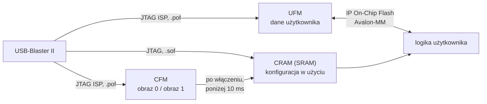

# 02.09 — Konfiguracja: SRAM, flash, antifuse — MAX 10 jako FPGA z wbudowaną pamięcią flash

> **Moduł:** [02 — Architektura układów FPGA](README.md) · **Kod:** — · **DECA:** 🛠️ tak
>
> **Czytaj:**
>
> - [MAX 10 FPGA Configuration User Guide](https://www.intel.com/content/www/us/en/docs/programmable/683865/) — rozdz. 1–2: schematy konfiguracji (JTAG, wewnętrzna), tryby obrazów, podwójny obraz, pamięć CFM i UFM, piny konfiguracyjne
> - [MAX 10 FPGA Device Overview](https://www.intel.com/content/www/us/en/docs/programmable/683658/) — warianty rodziny (kompaktowe, z flash, z analogiem) i oznaczenia układów
> - [UG949 — UltraFast Design Methodology Guide](https://docs.amd.com/r/en-US/ug949-vivado-design-methodology) — dla porównania: konfiguracja FPGA SRAM z zewnętrznej pamięci

← [02.08](02.08-bloki-wejscia-wyjscia-i-banki-i-o.md) · [spis modułu](README.md) · [02.10](02.10-przeglad-rynku-amd-altera-lattice-microchip.md) →

## Po co to jest

Konfiguracja to sposób, w jaki projekt trafia do układu i pozostaje w nim po wyłączeniu zasilania. Od niej zależy: czy na płytce potrzebna jest zewnętrzna pamięć, jak szybko układ startuje, czy można aktualizować projekt w terenie i jak chronić go przed skopiowaniem. W module 00 wgrywaliśmy plik `.sof` (do SRAM) i `.pof` (do flash) — tu wyjaśniamy, co się wtedy dzieje w środku MAX 10. Niezawodność konfiguracji i zdalna aktualizacja — [moduł 29](../29-konfiguracja-niezawodnosc/README.md).

## Intuicja

Konfiguracja FPGA to ogromna liczba bitów: zawartość każdej LUT, ustawienie każdego przełącznika połączeń, każdego bloku I/O. W większości FPGA te bity siedzą w komórkach **SRAM** rozsianych po układzie — szybkich, ale ulotnych. Po włączeniu zasilania układ jest „pusty” i musi skądś wczytać konfigurację: z zewnętrznej pamięci flash albo z procesora.

MAX 10 ma tę pamięć flash **w tym samym układzie**. Po włączeniu zasilania sam kopiuje z niej konfigurację do swojej SRAM — w kilka milisekund. Zewnętrznie wygląda to jak układ nieulotny, choć logika nadal pracuje na SRAM.

## Teoria

### Technologie konfiguracji

| Technologia | Gdzie są bity konfiguracji | Po włączeniu | Wielokrotne programowanie | Odporność na promieniowanie (SEU w konfiguracji) |
|-------------|---------------------------|--------------|---------------------------|--------------------------------------------------|
| SRAM + pamięć zewnętrzna | komórki SRAM w układzie | ładowanie z zewnętrznej flash: zwykle dziesiątki–setki ms | tak | niska — potrzebne skanowanie i poprawianie (*scrubbing*) |
| SRAM + flash w układzie (MAX 10, Lattice MachXO2/3) | SRAM, kopia w wewnętrznej flash | kopiowanie wewnętrzne: MAX 10 poniżej 10 ms | tak | jak SRAM |
| flash sterujący połączeniami (Microchip PolarFire, IGLOO2) | komórki flash bezpośrednio w strukturze | natychmiast („live at power-up”) | tak | wysoka |
| antifuse (Microchip RTAX, RT4G) | trwałe połączenia | natychmiast | **nie** | bardzo wysoka |

### Pamięć wewnętrzna MAX 10

| Obszar | Zawartość |
|--------|-----------|
| **CFM** (*configuration flash memory*) | jeden lub dwa obrazy konfiguracji |
| **UFM** (*user flash memory*) | dane użytkownika — dostęp z logiki przez IP *On-Chip Flash* (interfejs Avalon-MM) |
| **CRAM** (*configuration RAM*) | SRAM, w której faktycznie pracuje konfiguracja |

Podział flash między CFM i UFM zależy od wybranego **trybu konfiguracji**:

| Tryb (Quartus: *Configuration mode*) | Obrazy | Uwagi |
|--------------------------------------|--------|-------|
| *Single Uncompressed Image* | 1 | najszybszy start |
| *Single Compressed Image* | 1 | mniejszy obraz — więcej miejsca na UFM |
| *Single (Un)compressed Image with Memory Initialization* | 1 | z początkową zawartością pamięci M9K; na DECA domyślny (`SINGLE IMAGE WITH ERAM` w [deca_piny.tcl](../../plytka-deca/deca_piny.tcl)) |
| *Dual Compressed Images* | 2 | dwa niezależne projekty, np. „produkcyjny” i „zapasowy” do bezpiecznej aktualizacji |

Dla 10M50 łączna pojemność flash (CFM + UFM) to do ok. 5888 Kb; ile zostaje na UFM, podaje kreator IP *On-Chip Flash* dla wybranego trybu.

### Schematy konfiguracji MAX 10

| Schemat | Źródło | Plik | Trwałe |
|---------|--------|------|--------|
| JTAG do CRAM | programator USB-Blaster → JTAG → SRAM | `.sof` | nie — znika po wyłączeniu zasilania |
| programowanie flash przez JTAG (ISP) | programator → JTAG → CFM/UFM | `.pof` | tak |
| konfiguracja wewnętrzna | po włączeniu: CFM → CRAM | — | — |

JTAG ma pierwszeństwo przed konfiguracją wewnętrzną. Pliki `.pof` z innymi ustawieniami (np. dwa obrazy) tworzy się narzędziem *File → Convert Programming Files* (lub `quartus_cpf`).

Inne funkcje związane z konfiguracją: ponowna konfiguracja na żądanie (pin `nCONFIG` lub IP *Dual Configuration*), wybór obrazu pinem `CONFIG_SEL`, szyfrowanie obrazu (AES) w wariantach, które to obsługują, unikatowy numer układu (*Unique Chip ID*).

### Oznaczenie układu na DECA

`10M50DAF484C6G` (często z dopiskiem `ES` — wersja inżynierska):

| Część | Znaczenie |
|-------|-----------|
| `10M50` | rodzina MAX 10, ok. 50 tys. LE |
| `D` | dwa napięcia zasilania (rdzeń 1,2 V osobno); wersje `S` mają jedno zasilanie |
| `A` | wariant z blokami analogowymi (ADC) i pełnym zestawem funkcji flash (w tym dwa obrazy); `C` — kompaktowy, `F` — z flash bez ADC |
| `F484` | obudowa FineLine BGA, 484 wyprowadzenia |
| `C` | zakres temperatur komercyjny (0–85 °C złącza) |
| `6` | klasa szybkości — najszybsza |
| `G` | wersja bezołowiowa (RoHS) |

### FPGA SRAM — jak to wygląda gdzie indziej

Układy SRAM (AMD, większość Altera, Lattice ECP5) konfigurują się z zewnętrznej pamięci: najczęściej szeregowej flash SPI/QSPI, którą FPGA czyta samo (tryb *Master SPI* w AMD, *Active Serial* w Altera). Obraz ma od kilku do setek megabitów; czas startu zależy od rozmiaru i szybkości interfejsu. Na płytce trzeba przewidzieć pamięć, piny konfiguracyjne i ich napięcia — dlatego MAX 10 jest wygodny w małych projektach.

## Schemat i przebiegi



## Na płytce DECA

Doświadczenie z projektem `blink` z [modułu 00](../00-srodowisko-pracy/00.06-pierwszy-projekt-migajaca-dioda-w-trzech.md) (projekt musi być już skompilowany):

```bash
cd modules/00-srodowisko-pracy/deca/blink

# 1. konfiguracja ulotna: .sof przez JTAG do CRAM
quartus_pgm -c 1 -m jtag -o "p;output_files/blink.sof"
#    → diody migają; odłącz i podłącz zasilanie → wraca poprzedni projekt z flash (albo fabryczny)

# 2. konfiguracja trwała: .pof do CFM
quartus_pgm -c 1 -m jtag -o "p;output_files/blink.pof"
#    → po wyłączeniu i włączeniu zasilania diody migają od razu
```

Co sprawdzić w Quartusie (*Assignments → Device → Device and Pin Options → Configuration*):

| Ustawienie | Wartość w projektach tej bazy | Skąd |
|------------|-------------------------------|------|
| *Configuration scheme* | *Internal Configuration* | domyślne dla MAX 10 |
| *Configuration mode* | *Single Uncompressed Image with Memory Initialization* | `INTERNAL_FLASH_UPDATE_MODE "SINGLE IMAGE WITH ERAM"` |
| *Enable configuration device* | wyłączone | `USE_CONFIGURATION_DEVICE OFF` |
| *Enable CONFIG_SEL pin* | wyłączone | `ENABLE_BOOT_SEL_PIN OFF` |

Wszystkie te przypisania ustawia `deca_ustawienia_ukladu` w [deca_piny.tcl](../../plytka-deca/deca_piny.tcl). Zmień *Configuration mode* na *Dual Compressed Images* i porównaj w raporcie *Fitter → Resource Section* oraz w kreatorze IP *On-Chip Flash*, jak zmienia się rozmiar UFM.

## Reguły i liczby do zapamiętania

| Reguła lub liczba | Kiedy obowiązuje |
|-------------------|------------------|
| `.sof` → CRAM przez JTAG (ulotne), `.pof` → wewnętrzny flash (trwałe) | MAX 10, Quartus |
| MAX 10 konfiguruje się z wewnętrznej flash w czasie poniżej 10 ms | start systemu |
| CFM — obrazy konfiguracji, UFM — dane użytkownika, CRAM — konfiguracja w pracy | MAX 10 |
| Tryb konfiguracji decyduje o liczbie obrazów i rozmiarze UFM | MAX 10 |
| FPGA SRAM potrzebuje zewnętrznej pamięci konfiguracji | AMD, większość Altera, Lattice ECP5 |
| Antifuse: jednorazowe, odporne na promieniowanie; flash (PolarFire): odporne, wielokrotne | zastosowania specjalne |

## Typowe pułapki

- **„Wgrałem, a po wyłączeniu zniknęło”.** Wgrany był `.sof`. Do trwałej konfiguracji — `.pof`.
- **Inicjalizacja pamięci a tryb konfiguracji.** Zawartość początkowa M9K (np. program procesora) jest wczytywana tylko w trybach *with Memory Initialization*. W trybie bez inicjalizacji pamięci startują z zerami — projekt działa w symulacji i po wgraniu `.sof`, a po starcie z flash już nie.
- **Konfiguracja wewnętrzna MAX 10 ≠ odporność na promieniowanie.** Logika pracuje z CRAM (SRAM), więc błędy SEU w konfiguracji są możliwe jak w każdym FPGA SRAM.
- **Zbyt duży UFM w planach.** Rozmiar UFM zależy od trybu konfiguracji i rozmiaru obrazu — sprawdź w kreatorze IP przed projektowaniem płytki bez zewnętrznej pamięci.

## Pytania rekrutacyjne

1. **Jaka jest różnica między FPGA konfigurowanym z SRAM a z flash?**

<details>
<summary>Odpowiedź</summary>

W FPGA SRAM konfiguracja jest w ulotnych komórkach SRAM i po każdym włączeniu zasilania musi zostać wczytana z zewnętrznej pamięci — start trwa dziesiątki–setki milisekund, a komórki są podatne na błędy SEU. W FPGA flash (np. PolarFire) konfiguracja jest w nieulotnych komórkach flash sterujących strukturą — układ działa od razu i jest odporny na SEU w konfiguracji. MAX 10 to wariant pośredni: ma flash w układzie, ale logika pracuje z SRAM, do której konfiguracja jest kopiowana po włączeniu.
</details>

2. **Do czego służy podwójny obraz konfiguracji?**

<details>
<summary>Odpowiedź</summary>

Do bezpiecznej aktualizacji w terenie: jeden obraz jest „zapasowy” (fabryczny), drugi — aktualizowany. Jeśli zapis nowego obrazu się nie powiedzie albo nowy obraz nie działa, układ może wrócić do obrazu zapasowego. W MAX 10 obrazy wybiera pin `CONFIG_SEL` albo logika przez IP *Dual Configuration*.
</details>

3. **Dlaczego na płytce z MAX 10 często nie ma zewnętrznej pamięci konfiguracji?**

<details>
<summary>Odpowiedź</summary>

Bo konfiguracja jest przechowywana w wewnętrznej pamięci CFM, a układ sam kopiuje ją do CRAM po włączeniu zasilania. Pamięć zewnętrzna jest potrzebna tylko wtedy, gdy projekt potrzebuje więcej pamięci nieulotnej, niż daje UFM.
</details>

## Zadania

1. Wyjaśnij każdą część oznaczenia układu `10M16SCU169I7G`.

<details>
<summary>Odpowiedź</summary>

`10M16` — MAX 10, ok. 16 tys. LE; `S` — jedno zasilanie; `C` — wariant kompaktowy (jeden obraz, bez ADC); `U169` — obudowa Ultra FineLine BGA, 169 wyprowadzeń; `I` — zakres przemysłowy; `7` — klasa szybkości 7 (wolniejsza niż 6); `G` — bezołowiowy.
</details>

2. Wykonaj doświadczenie z sekcji „Na płytce DECA”. **Kryterium zaliczenia:** po wgraniu `.sof` i ponownym włączeniu zasilania projekt `blink` znika, a po wgraniu `.pof` — zostaje.

## Źródła

- [MAX 10 FPGA Configuration User Guide](https://www.intel.com/content/www/us/en/docs/programmable/683865/).
- [MAX 10 FPGA Device Overview](https://www.intel.com/content/www/us/en/docs/programmable/683658/) — oznaczenia i warianty.
- *DECA User Manual*, rozdz. 3.1 — konfiguracja MAX 10 przez wbudowany USB-Blaster II ([zrodla.md](../../plytka-deca/zrodla.md)).
