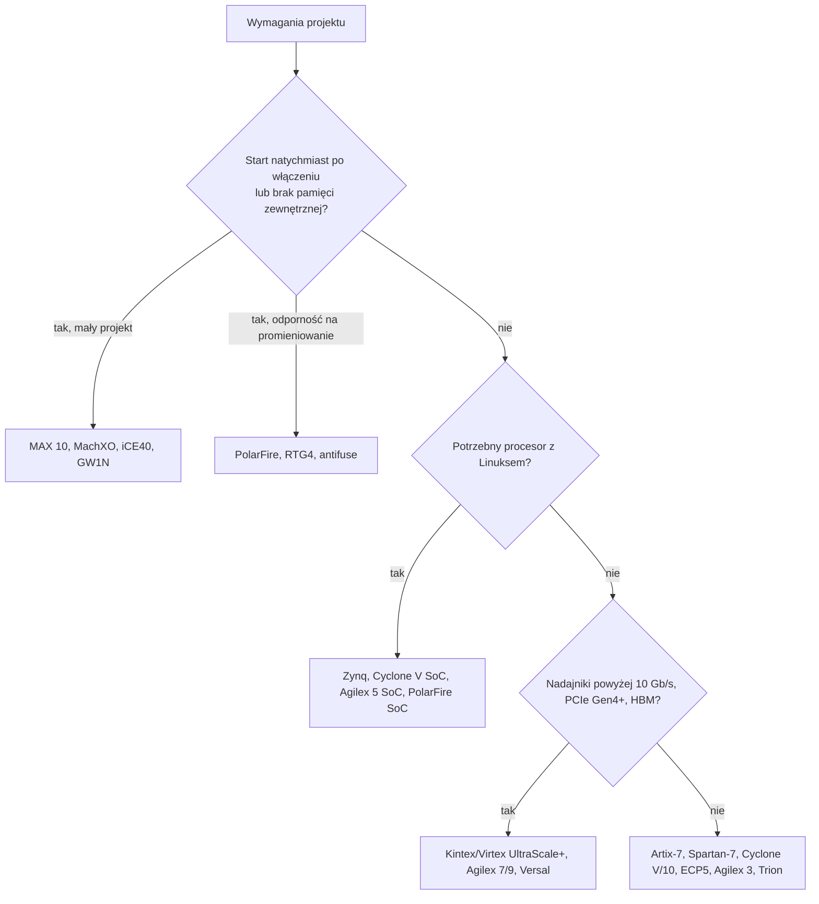

# 02.10 — Przegląd rynku: AMD, Altera, Lattice, Microchip, Gowin, Efinix

> **Moduł:** [02 — Architektura układów FPGA](README.md) · **Kod:** — · **DECA:** — · **Status:** ✅ pełny
>
> **Czytaj:**
>
> - Strony produktowe producentów: [AMD — Adaptive SoCs & FPGAs](https://www.amd.com/en/products/adaptive-socs-and-fpgas.html), [Altera — FPGAs](https://www.altera.com/fpga), [Lattice — FPGA](https://www.latticesemi.com/Products), [Microchip — FPGAs](https://www.microchip.com/en-us/products/fpgas-and-plds) — tabele rodzin i zasobów
> - [Yosys i nextpnr — dokumentacja](https://yosyshq.readthedocs.io/) — które rodziny mają w pełni otwarty przepływ projektowy
> - [UG949 — UltraFast Design Methodology Guide](https://docs.amd.com/r/en-US/ug949-vivado-design-methodology) — wstęp: jak AMD opisuje swoje rodziny

← [02.09](02.09-konfiguracja-sram-flash-antifuse-max-10-jako.md) · [spis modułu](README.md) · →

## Po co to jest

Ta baza uczy na MAX 10, ale w pracy spotkasz układy wielu producentów — a przy nowym projekcie trzeba wybrać układ. Wybór decyduje o narzędziach, dostępnych blokach (procesory, nadajniki-odbiorniki, ADC), cenie, poborze mocy i dostępności przez lata produkcji. Na rozmowach często pada pytanie „z jakimi rodzinami pracowałeś i czym się różnią”. Stan opisany tutaj dotyczy 2026 roku — linie produktów zmieniają się co kilka lat, więc przed decyzją sprawdź strony producentów.

## Intuicja

Rynek FPGA przypomina rynek samochodów. Dwóch dużych producentów (AMD i Altera) ma pełną gamę: od małych, tanich modeli po ciężarówki do centrów danych. Pozostali wyspecjalizowali się: Lattice — małe i bardzo energooszczędne, Microchip — niezawodne i odporne na promieniowanie, Gowin i Efinix — tanie układy dla masowych produktów. Do nauki wystarczy jeden „samochód”, bo zasady prowadzenia (RTL, timing, CDC) są te same; różnią się narzędzia i bloki specjalne.

## Teoria

### Producenci i rodziny

| Producent | Rodziny (od najmniejszych) | Narzędzia | Wyróżnik |
|-----------|----------------------------|-----------|----------|
| **AMD** (dawniej Xilinx, przejęty w 2022) | Spartan-7, Artix-7, Spartan/Artix UltraScale+, Kintex-7, Kintex UltraScale(+), Virtex UltraScale+; SoC: Zynq-7000, Zynq UltraScale+ MPSoC i RFSoC; Versal (adaptacyjne SoC z silnikami AI) | Vivado, Vitis; bezpłatna edycja dla mniejszych układów | największy wybór, dominacja w zastosowaniach wysokiej klasy, bogaty ekosystem IP |
| **Altera** (od 2015 w Intelu, od 2025 znów niezależna firma) | MAX 10, Cyclone IV / 10 LP, Cyclone V (także SoC), Cyclone 10 GX, Arria 10, Stratix 10, Agilex 3/5/7/9 | Quartus Prime Lite (bezpłatny, starsze rodziny — w tym MAX 10), Standard, Pro (Agilex, Stratix 10) | pełna gama, układy z wbudowaną flash (MAX 10), SoC z ARM |
| **Lattice** | iCE40, MachXO2/3, MachXO5-NX, CrossLink-NX, Certus-NX, CertusPro-NX, ECP5, Avant | Radiant, Diamond; iCE40 i ECP5 — także otwarte narzędzia | małe, energooszczędne, natychmiastowy start (MachXO), ulubione przez społeczność open source |
| **Microchip** (dawniej Microsemi, Actel) | IGLOO2, SmartFusion2, PolarFire, PolarFire SoC (RISC-V), RTG4 / RT PolarFire | Libero SoC | konfiguracja w komórkach flash, odporność na promieniowanie, lotnictwo i kosmos |
| **Gowin** | LittleBee (GW1N), Arora (GW2A, GW5A) | Gowin EDA; częściowo otwarte narzędzia | niska cena, tanie płytki (np. Tang Nano) |
| **Efinix** | Trion, Titanium, Topaz | Efinity | architektura „Quantum” (komórki pracujące jako logika lub połączenia), niska cena i pobór mocy |
| inne | Achronix (Speedster, eFPGA), QuickLogic (eFPGA), Cologne Chip GateMate (UE, otwarte narzędzia), NanoXplore (UE, kosmos), Anlogic i Pango (Chiny) | | nisze |

### Klasy układów

| Klasa | Przykłady | Zasoby | Typowe zastosowania |
|-------|-----------|--------|---------------------|
| bardzo małe, nieulotne | MAX 10 (najmniejsze), MachXO, iCE40, GW1N | od kilkuset do kilkudziesięciu tys. LUT | sterowanie zasilaniem, logika „klejąca”, czujniki |
| niskiego kosztu | Cyclone IV/V/10, Artix-7, Spartan-7, ECP5, Trion | do ok. 100–200 tys. LUT, proste nadajniki | sterowanie, przetwarzanie obrazu, interfejsy, edukacja |
| średniej klasy | Cyclone 10 GX, Arria 10, Agilex 5, Kintex, PolarFire, Certus/Avant | setki tysięcy LUT, nadajniki 10+ Gb/s | komunikacja, wideo, przemysł |
| wysokiej klasy | Stratix 10, Agilex 7/9, Virtex UltraScale+, Versal | miliony LUT, HBM, nadajniki 50–100+ Gb/s | centra danych, telekomunikacja, prototypowanie ASIC |
| SoC | Zynq, Cyclone V SoC, Agilex SoC, PolarFire SoC | rdzenie ARM lub RISC-V + FPGA | systemy wbudowane z Linuksem |

### Otwarte narzędzia

Przepływ Yosys (synteza) + nextpnr (rozmieszczenie i trasowanie) w pełni obsługuje iCE40, ECP5, Gowin (część rodzin) i GateMate; dla AMD serii 7 istnieją projekty eksperymentalne. Dla MAX 10 otwartego przepływu do bitstreamu nie ma — ale symulacja i synteza RTL do sprawdzenia kodu (Yosys) działają ([moduł 03](../03-przeplyw-projektowy/README.md), [moduł 12](../12-weryfikacja-open-source/README.md)).

### Jak wybrać układ

| Pytanie | Co wynika |
|---------|-----------|
| Ile logiki, pamięci, DSP — z zapasem 30–50% na rozwój | rodzina i wielkość |
| Jakie interfejsy: DDR, PCIe, Ethernet 10G+, MIPI, LVDS | nadajniki-odbiorniki, twarde bloki |
| Czy potrzebny procesor z Linuksem | SoC lub procesor programowy ([moduł 27](../27-procesory-i-soc/README.md)) |
| Czy układ musi działać natychmiast po włączeniu | flash w układzie (MAX 10, MachXO, PolarFire) |
| Pobór mocy, chłodzenie | rodziny niskiego poboru, technologia procesu |
| Środowisko: temperatura, promieniowanie, normy (motoryzacja, lotnictwo) | klasy temperaturowe, rodziny odporne na promieniowanie |
| Koszt narzędzi i licencji IP | bezpłatne edycje narzędzi, otwarte narzędzia |
| Dostępność i czas produkcji (10–15 lat w przemyśle) | dojrzałe rodziny, polityka producenta |
| Doświadczenie zespołu i istniejący kod | ten sam producent często wygrywa |

## Schemat i przebiegi

Uproszczona ścieżka wyboru rodziny:

## Reguły i liczby do zapamiętania

| Reguła lub liczba | Kiedy obowiązuje |
|-------------------|------------------|
| AMD (Xilinx) i Altera — pełna gama; Lattice — małe i energooszczędne; Microchip — flash i odporność na promieniowanie | orientacja na rynku |
| MAX 10 obsługuje bezpłatny Quartus Prime Lite | nauka na DECA |
| Pełny otwarty przepływ: iCE40, ECP5, część Gowin, GateMate | projekty open source |
| Zapas zasobów przy wyborze układu: 30–50% | nowy projekt |
| Kod RTL bez prymitywów producenta przenosi się między rodzinami; PLL, pamięci IP, nadajniki — nie | architektura projektu |

## Typowe pułapki

- **Wybór układu „na styk”.** Projekty rosną; układ wypełniony w 95% jest trudny w zamknięciu timingu ([02.04](02.04-siec-polaczen-i-dlaczego-trasowanie-kosztuje.md)) i nie zostawia miejsca na poprawki.
- **Prymitywy producenta rozsiane po całym kodzie.** Utrudniają przeniesienie projektu na inną rodzinę. Zamykaj je w cienkich modułach-opakowaniach.
- **Ignorowanie narzędzi przy wyborze.** Niektóre rodziny wymagają płatnych edycji narzędzi albo licencji na IP (np. kontrolery PCIe, Ethernet).
- **Brak sprawdzenia dostępności.** Zwłaszcza najnowsze i najstarsze rodziny bywają trudno dostępne lub wycofywane.

## Pytania rekrutacyjne

1. **Z jakimi rodzinami FPGA pracowałeś i czym się różnią?**

Odpowiedź

Przykładowa odpowiedź po tej bazie: MAX 10 (Altera) — mały układ z LUT4, wbudowaną flash konfiguracji, ADC i mnożarkami 18 × 18, narzędzie Quartus Prime Lite. Znam różnice względem AMD serii 7: LUT6 i slice'y z 8 rejestrami, DSP48 z akumulatorem, BRAM 36 Kb, pamięć rozproszona w SLICEM, konfiguracja z zewnętrznej flash, Vivado i ograniczenia XDC. Warto mówić konkretnie o zasobach i narzędziach, a nie tylko o nazwach.

2. **Jak dobrałbyś układ do nowego projektu?**

Odpowiedź

Najpierw wymagania: ilość logiki, pamięci i DSP z zapasem, interfejsy (DDR, PCIe, szybkie łącza), czy potrzebny procesor, wymagania startu, poboru mocy, temperatury i norm. Potem koszt układu i narzędzi, dostępność i długość produkcji, doświadczenie zespołu i istniejący kod. Dla kilku kandydatów robię szybką syntezę kluczowych bloków, żeby sprawdzić zasoby i częstotliwość.

3. **Kiedy wybierzesz FPGA z rodziny Microchip PolarFire zamiast układu SRAM?**

Odpowiedź

Gdy ważna jest odporność konfiguracji na promieniowanie (komórki flash nie zmieniają stanu od cząstek tak jak SRAM), natychmiastowy start po włączeniu, niski pobór mocy statycznej albo bezpieczeństwo konfiguracji — np. w lotnictwie, kosmosie, przemyśle i urządzeniach medycznych.

## Zadania

1. Dla trzech zastosowań wybierz producenta i rodzinę, uzasadnij w dwóch zdaniach: (a) kamera przemysłowa z interfejsem MIPI i przetwarzaniem obrazu na brzegu, (b) karta akceleratora w serwerze z PCIe Gen5 i pamięcią HBM, (c) mały moduł sterujący zasilaniem płyty głównej.

Odpowiedź

(a) Np. Lattice CrossLink-NX/Certus-NX albo AMD Artix UltraScale+ — twarde lub łatwe interfejsy MIPI, niski pobór mocy. (b) Np. AMD Versal lub Altera Agilex 7 — PCIe Gen5, HBM, bardzo duże zasoby. (c) Np. MAX 10, Lattice MachXO3 lub MachXO5-NX — natychmiastowy start z wewnętrznej flash, mała obudowa, niska cena. Inne uzasadnione wybory też są poprawne.

2. Wybierz jedną rodzinę AMD (np. Artix-7) i porównaj z MAX 10 10M50 w tabeli: liczba LUT i rejestrów, pamięć blokowa, bloki DSP, PLL/MMCM, szybkość nadajników, pamięć konfiguracji. **Kryterium zaliczenia:** tabela z wartościami z dokumentacji producentów i dwa wnioski.

## Źródła

- Strony produktowe: [AMD](https://www.amd.com/en/products/adaptive-socs-and-fpgas.html), [Altera](https://www.altera.com/fpga), [Lattice](https://www.latticesemi.com/Products), [Microchip](https://www.microchip.com/en-us/products/fpgas-and-plds).
- [Yosys i nextpnr](https://yosyshq.readthedocs.io/) — obsługiwane rodziny.
- [UG949 — UltraFast Design Methodology Guide](https://docs.amd.com/r/en-US/ug949-vivado-design-methodology).
