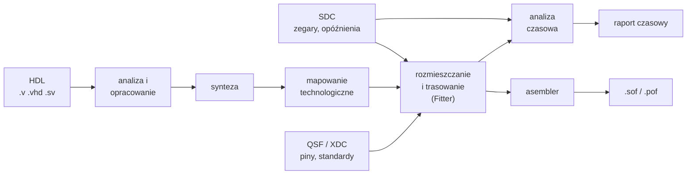

# 03.01 — Etapy: opracowanie, synteza, mapowanie, rozmieszczanie, trasowanie, bitstream

> **Moduł:** [03 — Przepływ projektowy od RTL do bitstreamu](README.md) · **Kod:** — · **DECA:** — · **Status:** ✅ pełny
>
> **Czytaj:**
>
> - [Quartus Prime — przewodniki użytkownika](https://www.altera.com/design/guidance/software/quartus-user-guides) — *Getting Started* (kompilacja i moduły kompilatora) oraz *Design Compilation*
> - [UG949 — UltraFast Design Methodology Guide](https://docs.amd.com/r/en-US/ug949-vivado-design-methodology) — rozdział o przepływie implementacji w Vivado (dla porównania)
> - [Yosys — dokumentacja](https://yosyshq.readthedocs.io/) — rozdział o krokach syntezy (*synth* i jego podpolecenia)

← · [spis modułu](README.md) · [03.02](03.02-synteza-co-robi-syntezator-i-jak-czytac-jego.md) →

## Po co to jest

Przycisk *Start Compilation* w Quartusie uruchamia kilka osobnych programów, a każdy z nich może zgłosić problem. Kto wie, który etap co robi, szybciej znajduje przyczynę błędu („to błąd fittera, więc kod jest poprawny, a nie mieści się w układzie”), wie, który raport czytać, i umie uruchamiać etapy osobno w skryptach. Na rozmowie pada pytanie: „opisz przepływ od kodu RTL do pliku konfiguracyjnego”.

## Intuicja

Przepływ projektowy to linia produkcyjna. Na wejściu jest opis w HDL, na wyjściu — plik z miliardami bitów ustawień układu. Po drodze:

1. **tłumacz** czyta kod i sprawdza, czy jest poprawny językowo (opracowanie),
2. **projektant obwodu** zamienia opis na sieć bramek, rejestrów, sumatorów i pamięci (synteza),
3. **monter** dopasowuje tę sieć do klocków, które ma konkretny układ — LUT, M9K, mnożarki (mapowanie),
4. **urbanista** decyduje, gdzie w układzie postawić każdy klocek (rozmieszczanie),
5. **drogowiec** prowadzi połączenia (trasowanie),
6. **inspektor** sprawdza, czy wszystko zdąży na czas (analiza czasowa),
7. **drukarnia** zapisuje wynik jako plik konfiguracyjny (asembler).

## Teoria

### Etapy

| Etap | Wejście | Wyjście | Co może pójść źle |
|------|---------|---------|-------------------|
| **Analiza i opracowanie** (*analysis & elaboration*) | pliki HDL, parametry | hierarchia modułów z ustalonymi parametrami | błędy składni, niezgodne typy i szerokości, brakujące moduły |
| **Synteza** (*synthesis*) | opracowany opis | sieć ogólnych elementów: rejestry, LUT/bramki, sumatory, mnożarki, pamięci | zatrzaski, wielokrotne sterowanie sygnału, usunięta logika, obcięte wartości |
| **Mapowanie technologiczne** (*technology mapping*) | sieć ogólna | sieć elementów układu: LE, M9K, mnożarki, IOE, PLL | brak zasobów danego typu, nieobsługiwane konfiguracje pamięci |
| **Rozmieszczanie** (*placement*) | sieć elementów + ograniczenia (piny) | położenie każdego elementu | za mało zasobów, konflikty pinów i standardów I/O |
| **Trasowanie** (*routing*) | rozmieszczone elementy | konkretne połączenia | zatłoczenie, nierozprowadzalne sygnały |
| **Analiza czasowa** (*static timing analysis*) | wynik trasowania + ograniczenia SDC | raport zapasów setup/hold | ujemny zapas, ścieżki nieograniczone |
| **Asembler** (*assembler*, generowanie bitstreamu) | wynik trasowania | `.sof`, `.pof` (Quartus); `.bit` (Vivado); `.bin` (iCE40) | — |

Rozmieszczanie i trasowanie razem nazywa się **implementacją**; w Quartusie robi je program *Fitter*. Narzędzia stosują też optymalizacje między etapami: powielanie rejestrów, przesuwanie rejestrów przez logikę (*retiming*), ponowną syntezę fragmentów po rozmieszczeniu.

### Programy Quartusa

| Etap | Program | Raport |
|------|---------|--------|
| analiza, opracowanie, synteza, mapowanie | `quartus_map` (Lite/Standard), `quartus_syn` (Pro) | *Analysis & Synthesis* |
| rozmieszczanie i trasowanie | `quartus_fit` | *Fitter* |
| bitstream | `quartus_asm` | *Assembler* |
| analiza czasowa | `quartus_sta` | *Timing Analyzer* |
| listy połączeń do symulacji po implementacji | `quartus_eda` | *EDA Netlist Writer* |
| całość jednym poleceniem | `quartus_sh --flow compile <projekt>` | wszystkie |
| programowanie | `quartus_pgm` | — |

### Odpowiedniki w innych narzędziach

| Etap | Quartus | Vivado (AMD) | Otwarty przepływ |
|------|---------|--------------|------------------|
| synteza | Analysis & Synthesis | `synth_design` | Yosys (`synth_ice40`, `synth_ecp5`, …) |
| implementacja | Fitter | `opt_design`, `place_design`, `phys_opt_design`, `route_design` | nextpnr |
| analiza czasowa | Timing Analyzer | `report_timing_summary` | nextpnr (wbudowana), OpenSTA |
| bitstream | Assembler | `write_bitstream` | icepack, ecppack, gowin_pack |
| ograniczenia | QSF (piny), SDC (czasy) | XDC (piny i czasy) | PCF, LPF, CST |

### Co jest deterministyczne

Synteza jest prawie deterministyczna. Rozmieszczanie korzysta z algorytmów heurystycznych (np. symulowanego wyżarzania) z ziarnem losowości — zmiana nieistotnego fragmentu kodu potrafi zmienić wynik czasowy o kilka procent. W Quartusie ziarno ustawia *Fitter Initial Placement Seed* (`SEED`); przegląd kilku ziaren (*seed sweep*) to jedna z technik zamykania timingu ([moduł 16](../16-wydajnosc-zasoby-moc/README.md)).

## Schemat i przebiegi



## Reguły i liczby do zapamiętania

| Reguła lub liczba | Kiedy obowiązuje |
|-------------------|------------------|
| Etapy: opracowanie → synteza → mapowanie → rozmieszczanie → trasowanie → analiza czasowa → bitstream | każde narzędzie FPGA |
| Quartus: `quartus_map` → `quartus_fit` → `quartus_asm` → `quartus_sta` | Lite i Standard |
| Ograniczenia czasowe (SDC) wpływają na rozmieszczanie, nie tylko na raport | Quartus, Vivado |
| Wynik rozmieszczenia zależy od ziarna — małe zmiany kodu mogą zmienić timing | zamykanie timingu |
| Opóźnienia połączeń są znane dopiero po trasowaniu | czytanie raportów syntezy |

## Typowe pułapki

- **Ocena timingu po syntezie.** Raport z syntezy podaje tylko szacunki; liczy się analiza czasowa po trasowaniu.
- **Szukanie błędu w złym miejscu.** Błąd fittera o pinach to problem ograniczeń, a nie kodu; ostrzeżenie syntezy o zatrzasku to problem kodu, a nie ograniczeń.
- **Zignorowany etap analizy czasowej.** Projekt „skompilował się bez błędów” również wtedy, gdy timing nie jest spełniony — Quartus zgłasza to jako ostrzeżenie krytyczne, nie błąd.

## Pytania rekrutacyjne

1. **Opisz przepływ projektowy od RTL do bitstreamu.**

<details>
<summary>Odpowiedź</summary>

Analiza i opracowanie kodu (sprawdzenie składni, ustalenie parametrów i hierarchii), synteza do sieci elementów ogólnych, mapowanie technologiczne na zasoby układu (LUT, rejestry, pamięci, DSP), rozmieszczanie i trasowanie z uwzględnieniem ograniczeń pinów i czasów, statyczna analiza czasowa sprawdzająca setup i hold na wszystkich ścieżkach, generowanie pliku konfiguracyjnego. Po drodze czytam raporty: ostrzeżenia syntezy, zużycie zasobów, wynik analizy czasowej i ścieżki nieograniczone.
</details>

2. **Dlaczego dwie kompilacje prawie tego samego projektu mogą dać różne wyniki czasowe?**

<details>
<summary>Odpowiedź</summary>

Bo rozmieszczanie jest heurystyczne i zależy od ziarna losowości oraz od całej sieci — mała zmiana w jednym miejscu zmienia punkt startowy algorytmu i rozmieszczenie wszystkiego. Różnice kilku procent w $f_{max}$ są normalne. Projekt z małym zapasem czasowym trzeba poprawić w kodzie lub ograniczeniach, a nie liczyć na szczęśliwe ziarno.
</details>

## Zadania

1. Uruchom kompilację projektu `blink` etapami w linii poleceń (`quartus_map`, `quartus_fit`, `quartus_asm`, `quartus_sta`) i zapisz czas każdego etapu z raportu *Flow Elapsed Time*. **Kryterium zaliczenia:** wiesz, który etap trwa najdłużej i dlaczego.

<details>
<summary>Wskazówka</summary>

```bash
quartus_map blink && quartus_fit blink && quartus_asm blink && quartus_sta blink
```
</details>

2. Przyporządkuj komunikat do etapu: (a) *Can't place multiple pins assigned to pin location*, (b) *Inferred latch for "y"*, (c) *Timing requirements not met*, (d) *Verilog HDL syntax error*.

<details>
<summary>Odpowiedź</summary>

(a) Fitter (rozmieszczanie, ograniczenia pinów), (b) synteza, (c) analiza czasowa, (d) analiza i opracowanie.
</details>

## Źródła

- [Quartus Prime — przewodniki użytkownika](https://www.altera.com/design/guidance/software/quartus-user-guides) — *Getting Started*, *Design Compilation*.
- [UG949 — UltraFast Design Methodology Guide](https://docs.amd.com/r/en-US/ug949-vivado-design-methodology) — przepływ implementacji.
- [Yosys — dokumentacja](https://yosyshq.readthedocs.io/).
