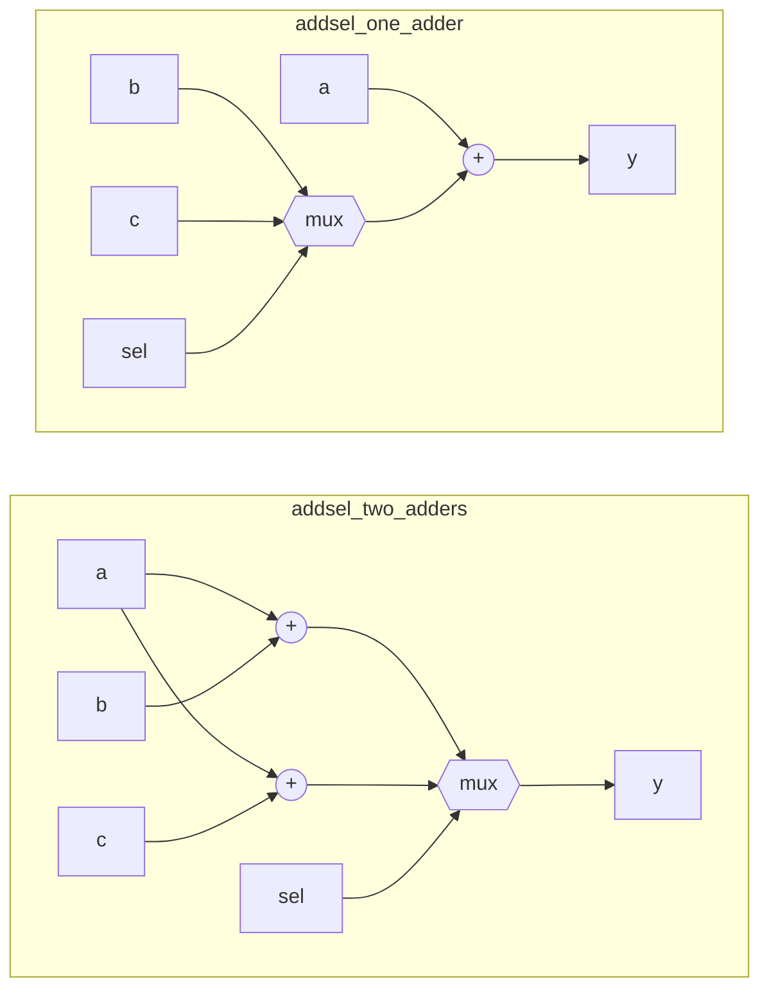

# 03.02 — Synteza: co robi syntezator i jak czytać jego raport

> **Moduł:** [03 — Przepływ projektowy od RTL do bitstreamu](README.md) · **Kod:** VHDL · Verilog · SystemVerilog · **DECA:** —
>
> **Czytaj:**
>
> - [Quartus Prime Standard Edition — Design Recommendations](https://www.intel.com/content/www/us/en/docs/programmable/683323/) — zalecane style HDL i wnioskowanie bloków (rejestry, pamięci, mnożarki, automaty)
> - [Quartus Prime — przewodniki użytkownika](https://www.altera.com/design/guidance/software/quartus-user-guides) — *Synthesis*: ustawienia syntezy, atrybuty (`keep`, `preserve`, `noprune`, `ramstyle`, `multstyle`), raport *Analysis & Synthesis*
> - [UG901 — Vivado Synthesis](https://docs.amd.com/r/en-US/ug901-vivado-synthesis) — rozdział o stylach kodowania HDL (to samo zagadnienie w Vivado)

← [03.01](03.01-etapy-opracowanie-synteza-mapowanie.md) · [spis modułu](README.md) · [03.03](03.03-ograniczenia-piny-standardy-i-o-i-zegary-qsf.md) →

## Po co to jest

Syntezator nie tłumaczy kodu linijka po linijce — rozpoznaje w nim wzorce (rejestr, licznik, pamięć, automat) i optymalizuje całość. Zdarza się, że usuwa logikę, którą projektant uważał za potrzebną, albo buduje coś innego, niż autor miał na myśli. Raport syntezy mówi, co naprawdę powstało. Umiejętność jego czytania odróżnia projektanta, który „kompiluje, aż zadziała”, od takiego, który wie, co ma w układzie.

## Intuicja

Syntezator działa jak dobry tłumacz, który nie tłumaczy słowo w słowo, tylko oddaje sens: zdanie z powtórzeniem skróci, niepotrzebną dygresję wyrzuci, znane powiedzenie zastąpi odpowiednikiem. Zachowuje to, co **widać na zewnątrz** — wyjścia modułu nadrzędnego i ich zależność od wejść. Wszystko, co nie wpływa na żaden pin, zniknie. Rejestr, który zawsze ma tę samą wartość, zamieni się w stałą. Dwa identyczne rejestry staną się jednym.

## Teoria

### Wnioskowanie (*inference*)

| Wzorzec w kodzie | Co powstaje |
|------------------|-------------|
| przypisanie w procesie z `rising_edge(clk)` / `posedge clk` | rejestr (z zezwoleniem i resetem, jeśli są w kodzie) |
| niekompletne przypisanie w procesie kombinacyjnym | zatrzask (ostrzeżenie) |
| `case`, `if`, `?:` wybierające dane | multiplekser |
| `+`, `-`, `<`, `>` | sumator/komparator na łańcuchu przeniesień |
| `*` | mnożarka sprzętowa albo w logice |
| tablica z zapisem w procesie taktowanym i odczytem synchronicznym | pamięć blokowa (M9K) |
| tablica stałych z odczytem synchronicznym | ROM w M9K |
| zmienna stanu z przejściami w procesie taktowanym | automat — syntezator może zmienić kodowanie |

### Optymalizacje

| Optymalizacja | Co robi | Gdy przeszkadza |
|---------------|---------|-----------------|
| propagacja stałych | wejście stałe → upraszcza logikę za nim | — |
| usuwanie logiki bez wpływu na wyjścia | logika, której wynik nigdzie nie trafia, znika | sygnały do debugowania, liczniki „na później” |
| łączenie rejestrów (*register merging*) | identyczne rejestry → jeden | rejestry powielone celowo (rozgałęzienie, [02.04](../02-architektura-fpga/02.04-siec-polaczen-i-dlaczego-trasowanie-kosztuje.md)) |
| usuwanie rejestrów o stałej wartości | rejestr zawsze 0 → stała 0 | — |
| współdzielenie zasobów (*resource sharing*) | dwa wzajemnie wykluczające się operatory → jeden + multiplekser | — (zwykle zysk, czasem dłuższa ścieżka) |
| przekodowanie automatu | zmiana kodowania stanów (np. na 1 z n) | automaty bezpieczne, stany widoczne na zewnątrz |
| retiming | przesuwanie rejestrów przez logikę | — |

Atrybuty, którymi można powstrzymać optymalizację (Quartus):

| Atrybut | Działanie |
|---------|-----------|
| `keep` | sygnał kombinacyjny zostaje w sieci (nie jest „wchłonięty” przez sąsiednie LUT) |
| `preserve` | rejestr nie jest łączony z innymi ani usuwany jako zbędny |
| `noprune` | rejestr zostaje, nawet jeśli nie steruje żadnym wyjściem |
| `ramstyle`, `multstyle` | wybór realizacji pamięci i mnożarek |
| `maxfan` | maksymalne rozgałęzienie — narzędzie powieli rejestr |
| `syn_encoding` | kodowanie stanów automatu |

Składnia: Verilog/SV — `(* preserve *) reg [7:0] cnt;`, VHDL — `attribute preserve : boolean; attribute preserve of cnt : signal is true;`.

### Przykład: dwa sumatory czy jeden?

Funkcja $y = sel\ ?\ a + c : a + b$ da się opisać na dwa sposoby. W pierwszym kod dosłownie opisuje dwa sumatory i multiplekser wyników. W drugim — multiplekser argumentów i jeden sumator. Funkcja jest identyczna (testbench sprawdza to wyczerpująco), ale **sprzęt nie musi być taki sam**: czy syntezator sam zamieni pierwszą postać na drugą, zależy od narzędzia i ustawień (w Quartusie opcja *Auto Resource Sharing*). Druga postać gwarantuje jeden sumator — tak pisze się kod, gdy liczy się każdy LE.

### Raport *Analysis & Synthesis* w Quartusie

| Sekcja | Czego szukać |
|--------|--------------|
| *Summary* | liczba LE, rejestrów, bitów pamięci, mnożarek — pierwsza ocena, czy projekt ma sens |
| *Resource Usage Summary* / *by Entity* | zużycie z podziałem na moduły — który blok jest za duży |
| *Registers Removed During Synthesis* | rejestry usunięte z podaniem powodu (*stuck at GND*, *merged with*, *no fan-out*) — najczęstsze źródło niespodzianek |
| *State Machines* | wykryte automaty i ich kodowanie |
| *RAM Summary*, *DSP Block Usage* | czy pamięci i mnożarki trafiły do bloków |
| *Messages* | ostrzeżenia: zatrzaski, obcięte wartości, sygnały bez sterowania, wielokrotne sterowanie ([03.04](03.04-raporty-zasoby-czasy-i-ostrzezenia-ktorych-nie.md)) |

Do tego narzędzia graficzne: *RTL Viewer* (schemat po opracowaniu — bloki ogólne) i *Technology Map Viewer* (schemat po mapowaniu — elementy układu).

## Schemat i przebiegi



## Kod: VHDL

```vhdl
  -- addsel_two_adders.vhd
  sum_ab <= resize(unsigned(a), W + 1) + resize(unsigned(b), W + 1);
  sum_ac <= resize(unsigned(a), W + 1) + resize(unsigned(c), W + 1);
  y      <= std_logic_vector(sum_ac) when sel = '1' else std_logic_vector(sum_ab);

  -- addsel_one_adder.vhd
  operand <= c when sel = '1' else b;
  y       <= std_logic_vector(resize(unsigned(a), W + 1) + resize(unsigned(operand), W + 1));
```

<!-- plik: hdl/vhdl/addsel_one_adder.vhd -->
Pliki: [addsel_two_adders.vhd](hdl/vhdl/addsel_two_adders.vhd) · [addsel_one_adder.vhd](hdl/vhdl/addsel_one_adder.vhd) · testbench: [tb_addsel.vhd](hdl/vhdl/tb_addsel.vhd)

## Kod: Verilog

```verilog
    // addsel_two_adders.v
    wire [W:0] sum_ab = a + b;
    wire [W:0] sum_ac = a + c;
    assign y = sel ? sum_ac : sum_ab;

    // addsel_one_adder.v
    wire [W-1:0] operand = sel ? c : b;
    assign y = a + operand;
```

<!-- plik: hdl/verilog/addsel_two_adders.v -->
Pliki: [addsel_two_adders.v](hdl/verilog/addsel_two_adders.v) · [addsel_one_adder.v](hdl/verilog/addsel_one_adder.v) · testbench: [tb_addsel.v](hdl/verilog/tb_addsel.v)

Deklaracja z inicjalizacją (`wire [W:0] sum_ab = a + b;`) to w Verilogu skrót od `wire` + `assign`. Szerokość $W + 1$ po lewej stronie sprawia, że dodawanie zachowuje przeniesienie ([01.04](../01-logika-cyfrowa/01.04-uklady-arytmetyczne-sumatory-przeniesienia.md)).

## Kod: SystemVerilog

```systemverilog
    // addsel_one_adder.sv
    logic [W-1:0] operand;
    assign operand = sel ? c : b;
    assign y       = a + operand;
```

<!-- plik: hdl/sv/addsel_one_adder.sv -->
Pliki: [addsel_two_adders.sv](hdl/sv/addsel_two_adders.sv) · [addsel_one_adder.sv](hdl/sv/addsel_one_adder.sv) · testbench: [tb_addsel.sv](hdl/sv/tb_addsel.sv)

## Co powstaje po syntezie

Porównaj obie wersje dla W = 16 w dwóch narzędziach:

```bash
# Yosys: synteza ogólna na LUT4 i statystyka (Verilog)
cd modules/03-przeplyw-projektowy/hdl/verilog
yosys -q -p "read_verilog addsel_two_adders.v; synth -top addsel_two_adders -lut 4; stat"
yosys -q -p "read_verilog addsel_one_adder.v;  synth -top addsel_one_adder  -lut 4; stat"
```

W Quartusie: utwórz projekt z jednym z modułów jako nadrzędnym (bez przypisań pinów — Quartus rozmieści piny sam), skompiluj samą syntezę (`quartus_map`) i porównaj *Total logic elements* w obu wersjach, z włączoną i wyłączoną opcją *Assignments → Settings → Compiler Settings → Advanced Settings (Synthesis) → Auto Resource Sharing*.

Wynik z CI tej bazy (zadanie *Synteza Verilog (Yosys)*, Yosys 0.33, W = 16): **obie wersje — 70 LUT4**. Yosys sam współdzieli sumator: jego optymalizacje (m.in. przebieg `opt_share`) wykrywają dwa operatory, których wyniki trafiają do jednego multipleksera, i zamieniają je na multiplekser argumentów i jeden operator. Bez tej optymalizacji wersja z dwoma sumatorami byłaby wyraźnie większa (dwa sumatory 17-bitowe zamiast jednego). Sprawdź, jak zachowa się Quartus z wyłączonym i włączonym *Auto Resource Sharing* — to zadanie 1 poniżej.

## Weryfikacja

`tb_addsel` porównuje obie wersje z modelem $a + (sel\ ?\ c : b)$ dla W = 4 we wszystkich $2 \cdot 16^3 = 8192$ kombinacjach. To przykład **sprawdzania równoważności** symulacją: zmiana struktury kodu nie może zmienić funkcji. Dla szerokich słów lepiej użyć formalnego sprawdzania równoważności ([moduł 13](../13-weryfikacja-formalna/README.md)).

```bash
python3 tools/run_hdl_tests.py modules/03-przeplyw-projektowy
```

## Reguły i liczby do zapamiętania

| Reguła lub liczba | Kiedy obowiązuje |
|-------------------|------------------|
| Logika bez wpływu na wyjścia jest usuwana | zawsze — sygnały debugowe wyprowadź albo zachowaj atrybutem |
| Identyczne rejestry są łączone; celowe kopie chroni `preserve` | powielanie rejestrów |
| *Registers Removed During Synthesis* — czytaj po każdej większej zmianie | Quartus |
| Struktura opisu wpływa na sprzęt: „mux przed operatorem” daje jeden operator | oszczędzanie zasobów |
| Raport syntezy podaje szacunki; liczy się raport po implementacji | timing |

## Typowe pułapki

- ⚠️ **„Mój moduł zniknął”.** Wyjście modułu nie jest podłączone do niczego, co dochodzi do pinu — syntezator usuwa cały moduł. Objaw: zużycie zasobów bliskie zera, ostrzeżenia o pinach bez sterowania.
- **Rejestr *stuck at GND*.** Rejestr nigdy nie zmienia wartości (np. przez błąd w warunku zapisu) i jest zastąpiony stałą. Raport *Registers Removed* mówi to wprost — to często pierwsza wskazówka błędu funkcjonalnego.
- **Celowo powielone rejestry połączone z powrotem.** Bez `preserve` (albo `dont_touch` / `KEEP` w Vivado) narzędzie łączy kopie, niwecząc ręczną optymalizację rozgałęzienia.
- **`keep` na wszystkim „dla debugowania”.** Blokuje optymalizacje i powiększa projekt. Używaj punktowo.

## Pytania rekrutacyjne

1. **Dlaczego syntezator usunął część mojej logiki i jak temu zapobiec?**

<details>
<summary>Odpowiedź</summary>

Bo nie wpływała na żadne wyjście projektu albo miała stałą wartość — syntezator zachowuje tylko to, co widać na pinach. Najpierw sprawdzam, czy to nie błąd (niepodłączone wyjście, warunek, który nigdy nie jest spełniony) w raporcie *Registers Removed During Synthesis*. Jeśli logika ma zostać celowo (np. do debugowania), wyprowadzam ją albo używam atrybutów `keep`/`preserve`/`noprune` (w Vivado `KEEP`, `DONT_TOUCH`).
</details>

2. **Co to jest współdzielenie zasobów w syntezie?**

<details>
<summary>Odpowiedź</summary>

Gdy dwa operatory (np. sumatory, mnożarki) nigdy nie są potrzebne w tym samym czasie, bo ich wyniki wybiera multiplekser, syntezator może zastąpić je jednym operatorem i przenieść multiplekser na jego wejścia. Oszczędza to zasoby kosztem multipleksera na ścieżce danych. Nie każde narzędzie robi to automatycznie, więc przy oszczędzaniu zasobów lepiej opisać to wprost.
</details>

3. **Czym różni się RTL Viewer od Technology Map Viewer?**

<details>
<summary>Odpowiedź</summary>

RTL Viewer pokazuje schemat po opracowaniu — ogólne bloki: rejestry, multipleksery, operatory, jak je opisał kod. Technology Map Viewer pokazuje wynik mapowania na zasoby układu: LE (LUT i rejestry), M9K, mnożarki, IOE. Pierwszy służy do sprawdzenia, czy kod opisuje zamierzoną strukturę, drugi — co naprawdę jest w układzie.
</details>

## Zadania

1. Wykonaj porównanie z sekcji „Co powstaje po syntezie” w Yosysie i w Quartusie. **Kryterium zaliczenia:** tabela z liczbą LUT/LE dla obu wersji w obu narzędziach i wniosek, czy narzędzie samo współdzieliło sumator.

2. Znajdź błąd — moduł po syntezie zajmuje 0 LE:

```verilog
module top (input wire clk, input wire [7:0] d, output wire [7:0] q);
    reg [7:0] r;
    always @(posedge clk) r <= d + 8'd1;
    assign q = 8'd0;
endmodule
```

<details>
<summary>Odpowiedź</summary>

Wyjście `q` jest stałe, a rejestr `r` nie steruje niczym — syntezator usuwa go jako logikę bez wpływu na wyjścia. Powinno być `assign q = r;`.
</details>

3. Dodaj do modułu `register_en` z [modułu 01](../01-logika-cyfrowa/hdl/verilog/register_en.v) drugi rejestr `q_copy`, zapisywany tymi samymi danymi i wyprowadzony na osobny port (inaczej zostanie usunięty jako nieużywany). Skompiluj w Quartusie z atrybutem `preserve` i bez niego i sprawdź raport *Registers Removed During Synthesis*. **Kryterium zaliczenia:** bez atrybutu kopia jest połączona z oryginałem (*merged*), z atrybutem — zostaje.

## Źródła

- [Quartus Prime Standard Edition — Design Recommendations](https://www.intel.com/content/www/us/en/docs/programmable/683323/).
- [Quartus Prime — przewodniki użytkownika](https://www.altera.com/design/guidance/software/quartus-user-guides) — *Synthesis*.
- [UG901 — Vivado Synthesis](https://docs.amd.com/r/en-US/ug901-vivado-synthesis).
- [Yosys — dokumentacja](https://yosyshq.readthedocs.io/) — polecenia `synth`, `stat`.
