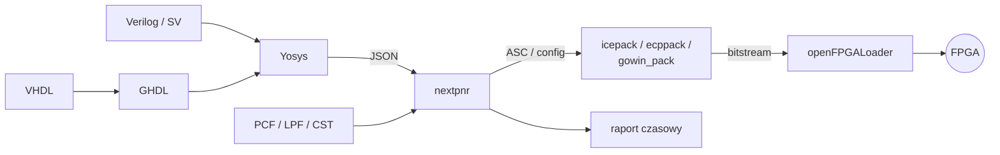

# 03.06 — Otwarty przepływ: Yosys, nextpnr i narzędzia konfiguracyjne

> **Moduł:** [03 — Przepływ projektowy od RTL do bitstreamu](README.md) · **Kod:** — · **DECA:** —
>
> **Czytaj:**
>
> - [Yosys — dokumentacja](https://yosyshq.readthedocs.io/) — *Getting started*, polecenia `synth`, `synth_ice40`, `synth_ecp5`, `stat`, `show`
> - [nextpnr](https://github.com/YosysHQ/nextpnr) — obsługiwane architektury i formaty ograniczeń
> - [openFPGALoader — dokumentacja](https://trabucayre.github.io/openFPGALoader/) — programatory i układy, w tym MAX 10 (pliki `.svf`, `.pof`)

← [03.05](03.05-praca-skryptowa-tcl-tryb-wsadowy-i-makefile.md) · [spis modułu](README.md) · [03.07](03.07-programowanie-ukladu-jtag-pliki-sof-i-pof.md) →

## Po co to jest

Narzędzia producentów są zamknięte, duże (kilkadziesiąt GB) i przywiązane do jednej rodziny. Otwarty przepływ — Yosys, nextpnr i narzędzia do bitstreamu — działa w sekundach, mieści się w CI i obsługuje kilka rodzin (Lattice iCE40 i ECP5, Gowin, Cologne Chip GateMate). Nawet gdy projekt docelowo trafia do Quartusa, Yosys przydaje się jako szybki sprawdzian syntezowalności i zgrubna miara zasobów. Ta baza używa go w CI do syntezy wszystkich modułów Verilog.

## Intuicja

Otwarty przepływ to te same etapy co w Quartusie ([03.01](03.01-etapy-opracowanie-synteza-mapowanie.md)), tylko rozdzielone na osobne programy, które przekazują sobie pliki: Yosys robi syntezę i zapisuje sieć w JSON, nextpnr rozmieszcza i trasuje oraz liczy timing, a mały program „pakujący” zamienia wynik na bitstream. Każdy etap można zastąpić innym narzędziem — jak w potoku poleceń w powłoce.

## Teoria

### Narzędzia

| Etap | Narzędzie | Uwagi |
|------|-----------|-------|
| synteza Verilog/SV | **Yosys** | Verilog-2005 i część SystemVerilog; pełniejszy SV przez wtyczkę *yosys-slang* |
| synteza VHDL | **GHDL** + *ghdl-yosys-plugin* (albo `ghdl --synth`) | VHDL-2008 → sieć dla Yosysa |
| rozmieszczanie i trasowanie | **nextpnr** (`nextpnr-ice40`, `nextpnr-ecp5`, `nextpnr-himbaechel` dla Gowin i innych) | wbudowana analiza czasowa |
| bitstream | **icepack** (IceStorm, iCE40), **ecppack** (Trellis, ECP5), **gowin_pack** (Apicula, Gowin) | bazy danych formatów zdobyte inżynierią wsteczną |
| programowanie | **openFPGALoader**, iceprog, ecpprog | wiele programatorów i rodzin |
| pakiet zbiorczy | **OSS CAD Suite** (YosysHQ) | jeden plik z wszystkimi narzędziami i symulatorami |
| AMD seria 7 | F4PGA, openXC7 | eksperymentalne |

Dla **MAX 10** otwartego przepływu do bitstreamu nie ma — format konfiguracji nie jest opisany. openFPGALoader potrafi jednak **zaprogramować** MAX 10 plikiem z Quartusa (`.svf`, `.pof`) przez USB-Blaster.

### Yosys jako sprawdzian kodu

```bash
# synteza ogólna na LUT4 i statystyka zasobów
yosys -p "read_verilog rca_adder.v full_adder.v; synth -flatten -top rca_adder -lut 4; stat"

# schemat po opracowaniu (wymaga xdot/graphviz)
yosys -p "read_verilog decoder.v; proc; opt; show decoder"

# VHDL przez GHDL (z wtyczką)
yosys -m ghdl -p "ghdl --std=08 util_pkg.vhd prio_enc.vhd -e prio_enc; synth -lut 4; stat"
```

Tak samo działa skrypt [tools/synteza_yosys.py](../../tools/synteza_yosys.py), uruchamiany w CI przy każdej zmianie: syntezuje każdy moduł z katalogów `hdl/verilog/`, sprawdza sieć (`check -assert`) i wypisuje liczbę LUT, przerzutników i zatrzasków. Liczby z Yosysa nie są liczbami z Quartusa — ale różnica 2× między dwiema wersjami kodu będzie widoczna w obu narzędziach.

### Pełny przepływ na przykładzie iCE40

```bash
yosys -p "read_verilog blink.v top.v; synth_ice40 -top top -json top.json"
nextpnr-ice40 --up5k --package sg48 --json top.json --pcf top.pcf --asc top.asc --freq 12
icepack top.asc top.bin
openFPGALoader -b ice40_generic top.bin     # albo iceprog top.bin
```

Plik ograniczeń PCF zawiera tylko piny (`set_io clk 35`); częstotliwość podaje się opcją `--freq`. Ten sam kod `blink` z [modułu 00](../00-srodowisko-pracy/hdl/verilog/blink.v) działa bez zmian — inny jest tylko moduł nadrzędny i ograniczenia.

### Porównanie z narzędziami producentów

| Cecha | Quartus / Vivado | Otwarty przepływ |
|-------|------------------|------------------|
| Obsługiwane rodziny | wszystkie własne | iCE40, ECP5, Gowin, GateMate, częściowo inne |
| Rozmiar instalacji | dziesiątki GB | setki MB |
| Czas kompilacji małego projektu | minuty | sekundy |
| Jakość wyników (LUT, $f_{max}$) | zwykle lepsza | dobra, gorsza dla dużych projektów |
| Rdzenie IP (PLL, pamięci, PCIe) | kreatory, biblioteki | prymitywy opisane ręcznie |
| Skryptowanie, CI | możliwe, ciężkie | naturalne |
| Licencja | bezpłatne edycje z ograniczeniami | otwarte |

## Schemat i przebiegi



## Reguły i liczby do zapamiętania

| Reguła lub liczba | Kiedy obowiązuje |
|-------------------|------------------|
| Yosys (synteza) → nextpnr (implementacja) → icepack/ecppack/gowin_pack (bitstream) → openFPGALoader | iCE40, ECP5, Gowin |
| VHDL do Yosysa przez GHDL (*ghdl-yosys-plugin*) | otwarty przepływ dla VHDL |
| MAX 10: brak otwartego bitstreamu; Yosys do sprawdzania kodu, openFPGALoader do programowania | płytka DECA |
| Liczby zasobów z Yosysa są orientacyjne — porównuj wersje kodu, nie narzędzia | ocena zasobów |

## Typowe pułapki

- **Konstrukcje SystemVerilog nieobsługiwane przez Yosys.** Starsze wersje nie znają części SV (np. `unique case`, interfejsów); kod przechodzi w Verilatorze, a Yosys zgłasza błąd składni. Dlatego CI tej bazy syntezuje w Yosysie wersje Verilog.
- **Różne prymitywy.** PLL, pamięci i bloki I/O opisuje się prymitywami danej rodziny (`SB_PLL40_CORE` dla iCE40) — kod z nimi nie przenosi się do Quartusa.
- **Porównywanie liczby LUT między narzędziami.** Różne algorytmy mapowania dają różne liczby; porównuj zmiany w obrębie jednego narzędzia.

## Pytania rekrutacyjne

1. **Do czego przydaje się Yosys, gdy projekt docelowo jest w Quartusie lub Vivado?**

<details>
<summary>Odpowiedź</summary>

Do szybkiego sprawdzenia w CI, czy kod jest syntezowalny i nie ma problemów strukturalnych (wielokrotne sterowanie, niepodłączone sygnały, zatrzaski), do zgrubnego porównania zasobów dwóch wersji kodu i do weryfikacji formalnej (SymbiYosys — [moduł 13](../13-weryfikacja-formalna/README.md)). Działa w sekundach i nie wymaga licencji ani wielkiej instalacji.
</details>

2. **Jakie są ograniczenia otwartych narzędzi FPGA?**

<details>
<summary>Odpowiedź</summary>

Obsługują ograniczoną liczbę rodzin (głównie Lattice iCE40 i ECP5, Gowin, GateMate), mają niepełne wsparcie SystemVerilog i VHDL (przez dodatki), brak im kreatorów IP i twardych bloków wysokiej klasy (PCIe, szybkie nadajniki), a wyniki dla dużych projektów bywają gorsze niż w narzędziach producentów. Za to są szybkie, skryptowalne i otwarte.
</details>

## Zadania

1. Zainstaluj OSS CAD Suite i zsyntezuj w Yosysie moduły `addsel_two_adders` i `addsel_one_adder` (W = 16). **Kryterium zaliczenia:** liczby LUT z `stat` dla obu wersji i porównanie z wynikiem CI tej bazy (zadanie *Synteza Verilog (Yosys)* w zakładce *Actions* repozytorium).

2. Uruchom `tools/synteza_yosys.py` lokalnie dla modułu 01 i porównaj liczbę LUT `rca_adder` i `adder` (W = 8). Wyjaśnij, dlaczego w Yosysie (synteza ogólna bez łańcucha przeniesień) różnica może być inna niż w Quartusie.

<details>
<summary>Odpowiedź</summary>

`synth -lut 4` to synteza ogólna: sumator jest mapowany na zwykłe LUT bez sprzętowego łańcucha przeniesień, więc obie wersje dają podobną sieć LUT. W Quartusie `adder` trafia na łańcuch przeniesień (1 LE na bit), a `rca_adder` — zależnie od tego, czy narzędzie odtworzy łańcuch z sieci bramek ([01.04](../01-logika-cyfrowa/01.04-uklady-arytmetyczne-sumatory-przeniesienia.md)).
</details>

## Źródła

- [Yosys — dokumentacja](https://yosyshq.readthedocs.io/).
- [nextpnr](https://github.com/YosysHQ/nextpnr).
- [openFPGALoader — dokumentacja](https://trabucayre.github.io/openFPGALoader/).
