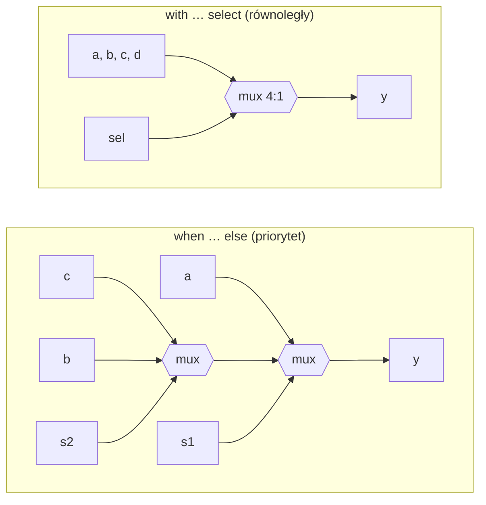

# 04.03 — Instrukcje współbieżne: przypisania, when-else, with-select

> **Moduł:** [04 — VHDL](README.md) · **Kod:** VHDL · Verilog · SystemVerilog · **DECA:** — · **Status:** ✅ pełny
>
> **Czytaj:**
>
> - P. J. Ashenden, *The Designer's Guide to VHDL* 💲, rozdz. 5.3 (przypisania współbieżne: warunkowe i wybierane)
> - [Free Range VHDL](https://github.com/fabriziotappero/Free-Range-VHDL-book) — rozdział o instrukcjach współbieżnych
> - [Nandland — VHDL](https://nandland.com/) — przykłady przypisań `when … else` i `with … select`

← [04.02](04.02-typy-std-logic-wektory-numeric-std-integer-typy.md) · [spis modułu](README.md) · [04.04](04.04-procesy-lista-wrazliwosci-sygnaly-a-zmienne.md) →

## Po co to jest

Większość logiki kombinacyjnej da się opisać bez procesów — jedną linią przypisania współbieżnego. Taki kod jest krótszy, nie grozi mu niepełna lista wrażliwości ani przypadkowy zatrzask w procesie, a jego struktura (multiplekser, priorytet) jest widoczna od razu. Trzeba tylko wiedzieć, która forma daje priorytet, a która równoległy wybór.

## Intuicja

Architektura VHDL to schemat elektryczny zapisany tekstem. Każde przypisanie współbieżne to **jeden element na schemacie**, połączony przewodami z innymi. Kolejność linii w pliku nie ma znaczenia — tak jak kolejność narysowania bramek na schemacie. Element „przelicza się” zawsze, gdy zmieni się któreś z jego wejść.

## Teoria

### Trzy formy przypisania współbieżnego

| Forma | Zapis | Sprzęt |
|-------|-------|--------|
| proste | `y <= a and b;` | logika z wyrażenia |
| warunkowe (*conditional*) | `y <= a when s1 = '1' else b when s2 = '1' else c;` | łańcuch multiplekserów z **priorytetem** — pierwszy spełniony warunek wygrywa |
| wybierane (*selected*) | `with sel select y <= a when "00", b when "01", c when others;` | multiplekser **bez priorytetu** — przypadki rozłączne |

Każde przypisanie współbieżne jest równoważne procesowi z pełną listą wrażliwości: `y <= a and b;` ≡ `process (a, b) begin y <= a and b; end process;`. Dlatego nie może utworzyć zatrzasku, pod warunkiem że forma warunkowa kończy się gałęzią `else`.

### Zasady

- Forma `with … select` musi pokryć **wszystkie** wartości wyrażenia wyboru. Dla `std_logic_vector` oznacza to `when others` (pokrywa też `'X'`, `'U'` itd.).
- Wybory w `with … select` muszą być **stałe** i rozłączne.
- W VHDL-2008 formy warunkowa i wybierana działają także **wewnątrz procesów** ([04.08](04.08-vhdl-2008-i-vhdl-2019-co-ulatwiaja.md)).
- Każdy sygnał ma **jedno** przypisanie współbieżne (albo jeden proces). Dwa przypisania do tego samego sygnału = dwa sterowniki ([04.09](04.09-pulapki-vhdl-rozdzielczosc-sygnalow-konwersje-i.md)).

### Inne instrukcje współbieżne

| Instrukcja | Rozdział |
|------------|----------|
| `process` | [04.04](04.04-procesy-lista-wrazliwosci-sygnaly-a-zmienne.md) |
| instancja komponentu | [04.06](04.06-hierarchia-komponenty-instancjonowanie-generic.md) |
| `generate` | [04.06](04.06-hierarchia-komponenty-instancjonowanie-generic.md) |
| `assert` (współbieżne) | sprawdzenia w symulacji |
| wywołanie procedury (współbieżne) | [04.07](04.07-pakiety-funkcje-procedury-i-atrybuty.md) |

### Odpowiedniki

| VHDL | Verilog / SystemVerilog |
|------|-------------------------|
| `y <= a and b;` | `assign y = a & b;` |
| `y <= a when s = '1' else b;` | `assign y = s ? a : b;` |
| `y <= a when s1 = '1' else b when s2 = '1' else c;` | `assign y = s1 ? a : s2 ? b : c;` |
| `with sel select y <= …` | `always @*` / `always_comb` z `case`; w SV także tablica stałych |

## Schemat i przebiegi



Wskaźnik siedmiosegmentowy — rozmieszczenie segmentów i bity wyjścia `seg`:

```text
  aaa        seg(6) = g    seg(2) = c
 f   b       seg(5) = f    seg(1) = b
  ggg        seg(4) = e    seg(0) = a
 e   c       seg(3) = d
  ddd        cyfra 2 = a, b, g, e, d  →  "1011011"
```

## Kod: VHDL

```vhdl
  with hex select seg <=
    "0111111" when x"0",
    "0000110" when x"1",
    -- …
    "1110001" when x"F",
    "0000000" when others;
```

<!-- plik: hdl/vhdl/seg7_decoder.vhd -->
Pliki: [seg7_decoder.vhd](hdl/vhdl/seg7_decoder.vhd) · testbench: [tb_seg7_decoder.vhd](hdl/vhdl/tb_seg7_decoder.vhd)

- `x"0"` to literał szesnastkowy o szerokości 4 bitów — pasuje do `hex(3 downto 0)`.
- `when others` jest wymagane, mimo że 16 wartości pokrywa wszystkie kombinacje `'0'`/`'1'` — `std_logic` ma 9 wartości, więc `"0X01"` też jest wartością `hex`. W symulacji wyjście pokaże wtedy `"0000000"`.
- Tablica z 16 wierszami to w sprzęcie 7 funkcji czterech zmiennych — po jednej LUT4 na segment.

## Kod: Verilog

<!-- plik: hdl/verilog/seg7_decoder.v -->
Pliki: [seg7_decoder.v](hdl/verilog/seg7_decoder.v) · testbench: [tb_seg7_decoder.v](hdl/verilog/tb_seg7_decoder.v)

- Verilog nie ma odpowiednika `with … select`, więc dekoder jest blokiem `always @*` z `case`. `default` przejmuje cyfrę F.

## Kod: SystemVerilog

<!-- plik: hdl/sv/seg7_decoder.sv -->
Pliki: [seg7_decoder.sv](hdl/sv/seg7_decoder.sv) · testbench: [tb_seg7_decoder.sv](hdl/sv/tb_seg7_decoder.sv)

- Trzeci sposób: tablica stałych `localparam logic [6:0] TABLE [16]` i indeksowanie `TABLE[hex]` — ROM opisany jako dane. Ten zapis jest wygodny, gdy tablicę generuje skrypt.

## Co powstaje po syntezie

Yosys (CI): **7 LUT4** — dokładnie jedna LUT na segment, bo każdy segment jest funkcją czterech bitów `hex`. Tak samo w MAX 10.

## Weryfikacja

Model w testbenchu jest zapisany **inaczej** niż układ: dla każdego segmentu 16-bitowa maska cyfr, przy których segment świeci (np. segment `a` — `0xD7ED`: cyfry 0, 2, 3, 5, 6, 7, 8, 9, A, C, E, F). Gdyby testbench powtarzał tę samą tablicę co układ, literówka w obu miejscach przeszłaby niezauważona. Dwa niezależne zapisy tej samej wiedzy wyłapują pomyłki w każdym z nich.

## Reguły i liczby do zapamiętania

| Reguła lub liczba | Kiedy obowiązuje |
|-------------------|------------------|
| `when … else` — priorytet; `with … select` — wybór równoległy | logika kombinacyjna |
| `when … else` zawsze kończ gałęzią `else`; `with … select` — `when others` | brak zatrzasków, pełne pokrycie |
| Przypisanie współbieżne ≡ proces z pełną listą wrażliwości | semantyka |
| Kolejność instrukcji współbieżnych w pliku nie ma znaczenia | architektura |
| Jeden sygnał — jedno przypisanie współbieżne lub jeden proces | brak wielu sterowników |

## Typowe pułapki

- **Długi łańcuch `when … else` dla rozłącznych przypadków.** Syntezator może zbudować łańcuch priorytetowy dłuższy niż potrzeba. Gdy przypadki się wykluczają, czytelniejsze i często mniejsze jest `with … select`.
- **Dwa przypisania do tego samego sygnału w architekturze** — przy `std_logic` kompilacja przejdzie, w symulacji pojawi się `'X'`, a synteza zgłosi błąd wielu sterowników.
- **Przypisanie warunkowe bez `else`** w procesie (VHDL-2008) — tworzy zatrzask jak niekompletny `if`.

## Pytania rekrutacyjne

1. **Czym różni się `when … else` od `with … select`?**

<details>
<summary>Odpowiedź</summary>

`when … else` sprawdza warunki po kolei i wybiera pierwszy spełniony — tworzy łańcuch priorytetowy; warunki mogą się nakładać i dotyczyć różnych sygnałów. `with … select` wybiera wartość według jednego wyrażenia i stałych, rozłącznych wyborów — tworzy multiplekser bez priorytetu; musi pokryć wszystkie wartości (`when others`).
</details>

2. **Czy kolejność przypisań współbieżnych w architekturze ma znaczenie?**

<details>
<summary>Odpowiedź</summary>

Nie. Każde przypisanie współbieżne to osobny proces reagujący na zmiany swoich wejść; wszystkie działają równolegle, jak elementy na schemacie. Kolejność ma znaczenie tylko dla instrukcji wewnątrz procesu.
</details>

## Zadania

1. Przepisz `seg7_decoder` w VHDL na wersję z wyjściem aktywnym niskim (`seg_n`, `'0'` = świeci), nie przepisując tablicy — jednym dodatkowym przypisaniem. Zmień testbench. **Kryterium zaliczenia:** `PASS`.

<details>
<summary>Odpowiedź</summary>

Wewnętrzny sygnał `seg` z dotychczasową tablicą i `seg_n <= not seg;`. W testbenchu porównanie z `not SEG_MASK(s)(d)`.
</details>

2. Opisz przypisaniem warunkowym enkoder priorytetowy 4 → 2 z wyjściem `valid` (najstarszy bit wygrywa). Ile poziomów multiplekserów tworzy zapis i ile LUT4 zajmie po syntezie?

<details>
<summary>Odpowiedź</summary>

```vhdl
y <= "11" when a(3) = '1' else "10" when a(2) = '1' else "01" when a(1) = '1' else "00";
valid <= a(3) or a(2) or a(1) or a(0);
```

Zapis to łańcuch trzech multiplekserów, ale każde wyjście zależy tylko od 4 bitów `a`, więc po syntezie każdy bit `y` i `valid` to jedna LUT4 — razem 3 LUT. Priorytet w kodzie nie oznacza długiej ścieżki, gdy funkcja mieści się w LUT.
</details>

## Źródła

- P. J. Ashenden, *The Designer's Guide to VHDL*, rozdz. 5.3.
- [Free Range VHDL](https://github.com/fabriziotappero/Free-Range-VHDL-book).
- [Nandland](https://nandland.com/).
