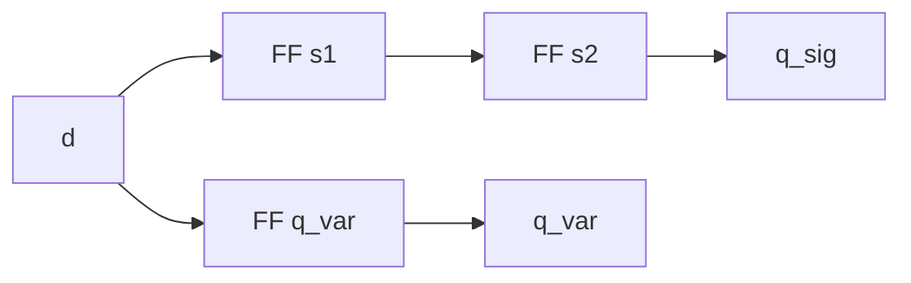

# 04.04 — Procesy, lista wrażliwości, sygnały a zmienne

> **Moduł:** [04 — VHDL](README.md) · **Kod:** VHDL · Verilog · SystemVerilog · **DECA:** — · **Status:** ✅ pełny
>
> **Czytaj:**
>
> - P. J. Ashenden, *The Designer's Guide to VHDL* 💲, rozdz. 5.2 (procesy i model symulacji) i 3 (instrukcje sekwencyjne, zmienne)
> - R. Jasinski, *Effective Coding with VHDL* 💲, rozdz. o sygnałach, zmiennych i modelu symulacji
> - C. Cummings, *Nonblocking Assignments in Verilog Synthesis, Coding Styles That Kill!* — [Sunburst Design](http://www.sunburst-design.com/papers/) (ten sam problem po stronie Verilogu)

← [04.03](04.03-instrukcje-wspolbiezne-przypisania-when-else.md) · [spis modułu](README.md) · [04.05](04.05-instrukcje-sekwencyjne-if-case-i-petle.md) →

## Po co to jest

Proces to miejsce, w którym VHDL pozwala pisać sekwencyjnie — instrukcja po instrukcji — a mimo to opisywać sprzęt równoległy. Różnica między **sygnałem** a **zmienną** decyduje o tym, ile rejestrów powstanie. To najczęstsze źródło niezrozumienia VHDL i stałe pytanie na rozmowach.

## Intuicja

Proces działa jak kadr filmu. Gdy proces się budzi (zmiana sygnału z listy wrażliwości, zbocze zegara), wykonuje instrukcje od góry do dołu w **zerowym czasie symulacji**. Przypisania do sygnałów są tylko **zamówieniami** — wszystkie zostaną zrealizowane razem, dopiero gdy proces się zatrzyma. Zmienna to kartka na biurku: zapisana wartość jest od razu widoczna w następnej linii.

W procesie taktowanym konsekwencja jest sprzętowa:

- `s1 <= d; s2 <= s1;` — `s2` dostaje **starą** wartość `s1`, więc powstają dwa rejestry jeden za drugim,
- `v1 := d; v2 := v1;` — `v2` dostaje **nową** wartość, więc zmienne są tylko połączeniami.

## Teoria

### Proces

```vhdl
etykieta : process (lista wrażliwości)
  -- deklaracje: zmienne, stałe, typy lokalne
begin
  -- instrukcje sekwencyjne
end process etykieta;
```

| Rodzaj procesu | Lista wrażliwości | Treść |
|----------------|-------------------|-------|
| kombinacyjny | wszystkie czytane sygnały — w VHDL-2008 po prostu `process (all)` | każdy sygnał wyjściowy przypisany w każdej ścieżce |
| taktowany, reset synchroniczny | `process (clk)` | `if rising_edge(clk) then …` |
| taktowany, reset asynchroniczny | `process (clk, rst)` | `if rst = '1' then … elsif rising_edge(clk) then …` |
| testbench | brak listy | instrukcje `wait` |

Proces ma **albo** listę wrażliwości, **albo** instrukcje `wait` — nigdy oba.

### Sygnały i zmienne

| | Sygnał | Zmienna |
|--|--------|---------|
| Deklaracja | w architekturze (lub porty) | w procesie (lub podprogramie) |
| Przypisanie | `<=` | `:=` |
| Kiedy zmienia wartość | po zawieszeniu procesu (po cyklu delta) | natychmiast |
| Widoczna poza procesem | tak | nie |
| Kilka przypisań w jednym przebiegu procesu | ostatnie wygrywa | każde od razu zmienia wartość |
| W procesie taktowanym | czytany przed przypisaniem → rejestr | czytana przed przypisaniem w tym samym przebiegu → **rejestr**; przypisana przed odczytem → logika |

Ostatni wiersz jest kluczowy. Zmienna w procesie taktowanym, która jest **odczytywana przed zapisem** (musi pamiętać wartość z poprzedniego taktu), staje się rejestrem. Taki kod działa, ale trudno go czytać — w tej bazie zmienne służą do obliczeń pośrednich (zapis, potem odczyt), a rejestry są sygnałami.

### Lista wrażliwości a synteza

Synteza ignoruje listę wrażliwości — buduje logikę z treści procesu. Symulacja wykonuje proces **tylko** przy zmianie sygnałów z listy. Niepełna lista = symulacja inna niż sprzęt. Rozwiązanie w VHDL-2008: `process (all)` (używane we wszystkich przykładach tej bazy); przed 2008 — wypisać wszystkie czytane sygnały i polegać na ostrzeżeniach narzędzi.

### Cykl delta (w skrócie)

Symulator VHDL rozdziela jedną chwilę czasu na kroki **delta**: w każdym kroku wykonują się procesy obudzone zmianami z poprzedniego kroku, a nowe wartości sygnałów są stosowane razem na końcu kroku. Dzięki temu wynik nie zależy od kolejności wykonywania procesów — VHDL jest pod tym względem deterministyczny, inaczej niż Verilog z przypisaniami blokującymi ([04.09](04.09-pulapki-vhdl-rozdzielczosc-sygnalow-konwersje-i.md)).

### Odpowiedniki w Verilogu i SystemVerilogu

| VHDL | Verilog / SV |
|------|--------------|
| sygnał, `<=` w procesie taktowanym | przypisanie nieblokujące `<=` w `always @(posedge clk)` / `always_ff` |
| zmienna, `:=` | przypisanie blokujące `=`; w SV także zmienna lokalna bloku |
| `process (all)` | `always @*` / `always_comb` |

Różnica: w Verilogu „zmienna” i „sygnał” to ta sama zmienna `reg` — o zachowaniu decyduje rodzaj przypisania, i łatwo je pomieszać. Dlatego reguła Verilogu brzmi: w blokach taktowanych tylko `<=`, w kombinacyjnych tylko `=`.

## Schemat i przebiegi

`sig_var_demo` po syntezie:



```text
takt    0   1   2   3   4   5
d       1   0   1   1   0   0
q_var   ?   1   0   1   1   0      ← d sprzed 1 taktu
q_sig   ?   ?   1   0   1   1      ← d sprzed 2 taktów
```

## Kod: VHDL

```vhdl
  -- sig_var_demo.vhd
  process (clk)
    variable v1, v2 : std_logic;
  begin
    if rising_edge(clk) then
      s1 <= d;        -- sygnały: dwa rejestry
      s2 <= s1;
      v1 := d;        -- zmienne: połączenia
      v2 := v1;
      q_var <= v2;    -- jeden rejestr
    end if;
  end process;

  -- popcount.vhd: zmienna jako akumulator w procesie kombinacyjnym
  process (all)
    variable acc : natural range 0 to W;
  begin
    acc := 0;
    for i in d'range loop
      if d(i) = '1' then
        acc := acc + 1;
      end if;
    end loop;
    count <= acc;
  end process;
```

<!-- plik: hdl/vhdl/popcount.vhd -->
Pliki: [sig_var_demo.vhd](hdl/vhdl/sig_var_demo.vhd) · [popcount.vhd](hdl/vhdl/popcount.vhd) · testbenche: [tb_sig_var_demo.vhd](hdl/vhdl/tb_sig_var_demo.vhd), [tb_popcount.vhd](hdl/vhdl/tb_popcount.vhd)

- W `popcount` zmienna `acc` musi być **zmienną** — gdyby była sygnałem, każde `acc <= acc + 1` w pętli czytałoby tę samą starą wartość, a wynik byłby co najwyżej 1 (i pętla kombinacyjna przez `acc`).
- `acc := 0` na początku procesu zapewnia, że zmienna jest zapisywana przed odczytem w każdym przebiegu — powstaje czysta logika, a nie rejestr.

## Kod: Verilog

<!-- plik: hdl/verilog/sig_var_demo.v -->
Pliki: [sig_var_demo.v](hdl/verilog/sig_var_demo.v) · [popcount.v](hdl/verilog/popcount.v) · testbenche: [tb_sig_var_demo.v](hdl/verilog/tb_sig_var_demo.v), [tb_popcount.v](hdl/verilog/tb_popcount.v)

- Przypisania blokujące `v1 = d; v2 = v1;` w bloku taktowanym działają jak zmienne VHDL. To **celowy przykład** — w kodzie produkcyjnym taka mieszanka jest zabroniona przez większość standardów kodowania, bo inne bloki czytające `v1` widziałyby wartość zależną od kolejności wykonania.

## Kod: SystemVerilog

<!-- plik: hdl/sv/sig_var_demo.sv -->
Pliki: [sig_var_demo.sv](hdl/sv/sig_var_demo.sv) · [popcount.sv](hdl/sv/popcount.sv) · testbenche: [tb_sig_var_demo.sv](hdl/sv/tb_sig_var_demo.sv), [tb_popcount.sv](hdl/sv/tb_popcount.sv)

- Zmienne `v1`, `v2` zadeklarowane **wewnątrz** bloku `always_ff` — nikt spoza bloku ich nie przeczyta, więc problem wyścigu znika. To najbliższy odpowiednik zmiennej procesu VHDL.
- `popcount` używa `foreach (d[i])` i operatora `+=`; testbench porównuje wynik z funkcją systemową `$countones`.

## Co powstaje po syntezie

Yosys (CI): `sig_var_demo` — **3 przerzutniki, 0 LUT** (`s1`, `s2`, `q_var`), dokładnie tak, jak wynika z reguł; `popcount` (W = 8) — **12 LUT4**, drzewo sumatorów bitów.

## Weryfikacja

- `tb_sig_var_demo` podaje 24-bitową sekwencję i w każdym takcie sprawdza `q_var = d` sprzed 1 taktu, `q_sig = d` sprzed 2 taktów.
- `tb_popcount` sprawdza wszystkie 256 wartości; model liczy jedynki dzieleniem przez 2 (VHDL, Verilog) albo `$countones` (SV).

## Reguły i liczby do zapamiętania

| Reguła lub liczba | Kiedy obowiązuje |
|-------------------|------------------|
| Sygnał `<=` zmienia wartość po zawieszeniu procesu; zmienna `:=` — natychmiast | VHDL |
| Łańcuch przypisań sygnałów w procesie taktowanym = łańcuch rejestrów | sprzęt |
| Zmienna czytana przed zapisem w procesie taktowanym = rejestr | sprzęt |
| `process (all)` dla logiki kombinacyjnej | VHDL-2008 |
| Proces ma listę wrażliwości albo `wait`, nigdy oba | VHDL |
| Verilog: `<=` w blokach taktowanych, `=` w kombinacyjnych | Verilog, SV |

## Typowe pułapki

- ⚠️ **Akumulacja w sygnale wewnątrz pętli.** `for i … loop s <= s + x(i); end loop;` — każda iteracja czyta tę samą starą wartość `s`, wynik to tylko ostatnia iteracja. Akumuluj w zmiennej.
- ⚠️ **Niepełna lista wrażliwości** w procesie kombinacyjnym (przed VHDL-2008) — symulacja nie reaguje na pominięty sygnał, sprzęt tak.
- **Odczyt sygnału zaraz po przypisaniu w tym samym procesie** — daje starą wartość. Kod „działa źle o jeden takt”.
- **Zmienna jako ukryty rejestr.** Zmienna czytana przed przypisaniem w procesie taktowanym tworzy rejestr, którego nie widać na liście sygnałów — trudno go znaleźć w przebiegach.

## Pytania rekrutacyjne

1. **Czym różni się sygnał od zmiennej w VHDL?**

<details>
<summary>Odpowiedź</summary>

Sygnał (`<=`) dostaje nową wartość dopiero po zawieszeniu procesu — w następnym cyklu delta; w jednym przebiegu procesu jego odczyt zwraca starą wartość, a z kilku przypisań obowiązuje ostatnie. Zmienna (`:=`) zmienia wartość natychmiast i jest widoczna tylko w procesie. W procesie taktowanym łańcuch przypisań sygnałów tworzy łańcuch rejestrów, a łańcuch przypisań zmiennych — logikę; zmienna czytana przed zapisem staje się rejestrem.
</details>

2. **Ile rejestrów powstanie z kodu poniżej?**

```vhdl
process (clk)
  variable t : unsigned(7 downto 0);
begin
  if rising_edge(clk) then
    t := a + b;
    y <= t + c;
  end if;
end process;
```

<details>
<summary>Odpowiedź</summary>

8 rejestrów — tylko `y`. Zmienna `t` jest zapisywana przed odczytem, więc jest wynikiem pośrednim (sumator kombinacyjny), a cała suma `a + b + c` trafia do rejestru `y` w jednym takcie. Gdyby `t` był sygnałem, powstałyby dwa stopnie rejestrów: `t` i `y`, a `y` zawierałby `a + b` z poprzedniego taktu plus `c`.
</details>

3. **Po co `process (all)`?**

<details>
<summary>Odpowiedź</summary>

W VHDL-2008 oznacza, że proces jest wrażliwy na wszystkie sygnały, które czyta. Eliminuje błąd niepełnej listy wrażliwości, który powoduje różnice między symulacją a syntezą. Odpowiednik `always @*` w Verilogu i `always_comb` w SystemVerilogu.
</details>

## Zadania

1. Zmień w `sig_var_demo.vhd` kolejność linii `v2 := v1;` i `v1 := d;` (najpierw `v2 := v1`). Ile rejestrów powstanie teraz i jak zmieni się wyjście `q_var`? Sprawdź symulacją.

<details>
<summary>Odpowiedź</summary>

Teraz `v1` jest czytana (w `v2 := v1`) **przed** zapisem — musi pamiętać wartość z poprzedniego taktu, więc staje się rejestrem. Rejestry: `s1`, `s2`, `v1`, `q_var` — cztery. `q_var` jest opóźnione o 2 takty, tak jak `q_sig`, i testbench zgłosi `FAIL` dla `q_var`.
</details>

2. Napisz proces kombinacyjny liczący sumę ośmiu 4-bitowych elementów tablicy (`type arr_t is array (0 to 7) of unsigned(3 downto 0)`) do 7-bitowego wyniku. **Kryterium zaliczenia:** testbench z kilkoma przypadkami i `PASS`; akumulacja w zmiennej.

## Źródła

- P. J. Ashenden, *The Designer's Guide to VHDL*, rozdz. 3 i 5.2.
- R. Jasinski, *Effective Coding with VHDL*.
- C. Cummings, *Nonblocking Assignments in Verilog Synthesis…* — [Sunburst Design](http://www.sunburst-design.com/papers/).
