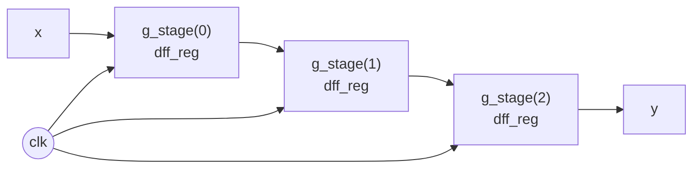

# 04.06 — Hierarchia: komponenty, instancjonowanie, generic i generate

> **Moduł:** [04 — VHDL](README.md) · **Kod:** VHDL · Verilog · SystemVerilog · **DECA:** —
>
> **Czytaj:**
>
> - P. J. Ashenden, *The Designer's Guide to VHDL* 💲, rozdz. 5.4 (opis strukturalny, instancje), 12 (generic) i 14 (`generate`)
> - [Doulos KnowHow — VHDL](https://www.doulos.com/knowhow/vhdl/) — instancjonowanie komponentów i instrukcja `generate`
> - [Free Range VHDL](https://github.com/fabriziotappero/Free-Range-VHDL-book) — rozdział o projektowaniu strukturalnym

← [04.05](04.05-instrukcje-sekwencyjne-if-case-i-petle.md) · [spis modułu](README.md) · [04.07](04.07-pakiety-funkcje-procedury-i-atrybuty.md) →

## Po co to jest

Projekt FPGA to drzewo modułów: moduł nadrzędny łączy interfejsy, każdy interfejs ma swoje bloki, a bloki — mniejsze bloki. Parametry (`generic`) pozwalają napisać blok raz i użyć go z różnymi szerokościami, a `generate` — zbudować z niego regularną strukturę (łańcuch rejestrów, tablicę sumatorów) albo włączyć część logiki warunkowo. To podstawa wielokrotnego użycia kodu.

## Intuicja

Instancja to wstawienie układu scalonego na płytkę i podłączenie jego nóżek przewodami (`port map`). `generic map` to wybór wariantu układu z katalogu (8- czy 16-bitowy). `for … generate` to rząd identycznych układów obok siebie, a `if … generate` — zworka, która decyduje, czy dany układ w ogóle jest na płytce.

## Teoria

### Dwa sposoby instancjonowania

```vhdl
-- 1. Instancja bezpośrednia (VHDL-93 i nowsze) — bez deklaracji komponentu
u_reg : entity work.dff_reg
  generic map (W => 8)
  port map (clk => clk, d => d_in, q => d_out);

-- 2. Instancja komponentu — wymaga deklaracji (w architekturze lub pakiecie)
component dff_reg is
  generic (W : positive);
  port (clk : in std_logic; d : in std_logic_vector(W - 1 downto 0); q : out std_logic_vector(W - 1 downto 0));
end component;
…
u_reg : component dff_reg generic map (W => 8) port map (clk => clk, d => d_in, q => d_out);
```

| | Instancja bezpośrednia | Komponent |
|--|------------------------|-----------|
| Deklaracja | niepotrzebna | kopia interfejsu jednostki |
| Sprawdzenie zgodności portów | przy analizie | dopiero przy elaboracji |
| Kolejność kompilacji | jednostka musi być skompilowana wcześniej | dowolna |
| Kiedy potrzebny | domyślnie | moduły w Verilogu w projekcie mieszanym, czarne skrzynki (IP), konfiguracje |

W tej bazie domyślnie instancja bezpośrednia. `pipe_delay` używa komponentu celowo — żeby pokazać oba zapisy.

### Łączenie portów

- **Nazwami** (`d => d_in`) — zawsze; kolejność nie ma znaczenia, a pomyłka jest widoczna.
- Pozycyjnie (`port map (clk, d_in, d_out)`) — nie używaj; zmiana kolejności portów w module psuje wszystkie instancje bez błędu kompilacji, jeśli typy się zgadzają.
- `open` — wyjście niepodłączone (`q => open`). Wejście musi mieć sygnał albo wartość domyślną w entity.
- Wyrażenia w `port map` (np. `d => not x`) są dozwolone w VHDL-2008.

### Generic

Generic jest stałą ustalaną przy instancji: szerokość, głębokość, wartość licznika, przełącznik funkcji (`boolean`). Może określać typy portów i być używany w `generate`. VHDL-2008 dodaje generic typów, funkcji i pakietów ([04.08](04.08-vhdl-2008-i-vhdl-2019-co-ulatwiaja.md)).

### Generate

```vhdl
g_regs : if DEPTH > 0 generate
  -- część deklaracyjna bloku generate: typy i sygnały lokalne
  type stage_array is array (0 to DEPTH) of std_logic_vector(W - 1 downto 0);
  signal stage : stage_array;
begin
  g_stage : for i in 0 to DEPTH - 1 generate
    u_reg : component dff_reg generic map (W => W) port map (clk => clk, d => stage(i), q => stage(i + 1));
  end generate;
end generate;
```

| Forma | Zastosowanie |
|-------|--------------|
| `for i in … generate` | N kopii instancji lub przypisań, indeks `i` jest stałą |
| `if warunek generate` | logika włączana warunkowo (warunek z generic) |
| `if … elsif … else generate`, `case … generate` | warianty — VHDL-2008 |

Bloki generate **muszą mieć etykiety**. Etykiety tworzą hierarchię nazw, np. `dut3/g_regs/g_stage(2)/u_reg` — widoczną w symulatorze, raportach i ograniczeniach czasowych.

### Odpowiedniki

| VHDL | Verilog | SystemVerilog |
|------|---------|---------------|
| `u : entity work.m generic map (W => 8) port map (a => x)` | `m #(.W(8)) u (.a(x));` | jak Verilog; skróty `.a`, `.*` |
| `for … generate` | `generate for (genvar …)` | `for (genvar i …)` bez `generate` |
| `if … generate` | `generate if (…)` | `if (…)` |
| tablica sygnałów | wektor spłaszczony, `stage[i*W +: W]` | tablica rozpakowana `stage[DEPTH+1]` |

## Schemat i przebiegi



## Kod: VHDL

<!-- plik: hdl/vhdl/pipe_delay.vhd -->
Pliki: [pipe_delay.vhd](hdl/vhdl/pipe_delay.vhd) · [dff_reg.vhd](hdl/vhdl/dff_reg.vhd) · testbench: [tb_pipe_delay.vhd](hdl/vhdl/tb_pipe_delay.vhd)

- Typ tablicy `stage_array` i sygnał `stage` są zadeklarowane **wewnątrz** bloku `if DEPTH > 0 generate` — istnieją tylko wtedy, gdy blok powstaje. Dla DEPTH = 0 w projekcie nie ma żadnych zbędnych sygnałów ani tablic o dziwnych zakresach; to możliwość VHDL-2008 i VHDL-93 (część deklaracyjna bloku generate).
- Generic `DEPTH` jest typu `natural` (może być 0), a `W` — `positive` (co najmniej 1). Właściwy podtyp to darmowa kontrola parametrów.

## Kod: Verilog

<!-- plik: hdl/verilog/pipe_delay.v -->
Pliki: [pipe_delay.v](hdl/verilog/pipe_delay.v) · [dff_reg.v](hdl/verilog/dff_reg.v) · testbench: [tb_pipe_delay.v](hdl/verilog/tb_pipe_delay.v)

- Verilog-2005 nie ma wygodnych tablic sygnałów łączonych z instancjami, więc etapy są spłaszczone w jeden wektor `stage[(DEPTH+1)*W-1:0]`, a wycinki wybiera operator `+:` (`stage[i*W +: W]` — W bitów od pozycji `i*W`).

## Kod: SystemVerilog

<!-- plik: hdl/sv/pipe_delay.sv -->
Pliki: [pipe_delay.sv](hdl/sv/pipe_delay.sv) · [dff_reg.sv](hdl/sv/dff_reg.sv) · testbench: [tb_pipe_delay.sv](hdl/sv/tb_pipe_delay.sv)

- Tablica rozpakowana `logic [W-1:0] stage [DEPTH+1]`, pętla `for (genvar i = 0; …)` bez słowa `generate`, skrót `.clk` przy instancji. Testbench przechowuje historię wejść w kolejce `hist [$]`.

## Co powstaje po syntezie

Yosys (CI, W = 8, DEPTH = 3): **24 przerzutniki, 0 LUT**. W Quartusie, przy dłuższych liniach opóźniających bez resetu, rejestry mogą zostać zamienione na pamięć M9K (*shift register inference*) — oszczędność LE przy DEPTH rzędu kilkudziesięciu i więcej.

## Weryfikacja

Testbench zawiera **dwie instancje** z różnymi parametrami: DEPTH = 3 (wyjście = wejście sprzed 3 taktów) i DEPTH = 0 (połączenie, sprawdzane 1 ns po zmianie wejścia). Dane pochodzą z 8-bitowego rejestru LFSR — sekwencji pseudolosowej, która w 255 krokach przechodzi przez wszystkie niezerowe wartości. Sprawdzanie skrajnych wartości parametrów (tu 0) to dobra praktyka dla każdego modułu z generic.

## Reguły i liczby do zapamiętania

| Reguła lub liczba | Kiedy obowiązuje |
|-------------------|------------------|
| Instancja bezpośrednia `entity work.x` — domyślnie; komponent — gdy potrzebny | VHDL |
| Porty zawsze łączone nazwami, nigdy pozycyjnie | wszystkie języki |
| Bloki generate muszą mieć etykiety | VHDL, dobra praktyka w Verilogu i SV |
| Testuj skrajne wartości generic (0, 1, maksimum) | moduły parametryzowane |
| `natural` dla parametrów mogących być 0, `positive` dla ≥ 1 | generic |

## Typowe pułapki

- **Łączenie pozycyjne** — po dodaniu portu w środku listy instancja nadal się kompiluje (gdy typy pasują), ale sygnały są podłączone do złych portów.
- **Niezgodność deklaracji komponentu z entity** — wychodzi dopiero przy elaboracji; przy instancji bezpośredniej — od razu.
- **Niepodłączone wejście bez wartości domyślnej** — błąd kompilacji (dobrze), albo, przy wartości domyślnej w entity, cicha stała, o której nikt nie pamięta.
- **Etykieta bloku generate taka sama jak nazwa sygnału** — konflikt nazw w hierarchii.

## Pytania rekrutacyjne

1. **Czym różni się instancja komponentu od instancji bezpośredniej `entity work.x`?**

<details>
<summary>Odpowiedź</summary>

Instancja komponentu wymaga deklaracji `component` (kopii interfejsu), a wiązanie z rzeczywistą jednostką następuje przy elaboracji — kompilować można w dowolnej kolejności, a komponent może być czarną skrzynką (np. moduł Verilog, IP). Instancja bezpośrednia nie potrzebuje deklaracji, sprawdza zgodność portów przy analizie, ale jednostka musi być skompilowana wcześniej.
</details>

2. **Jak zbudować parametryzowany łańcuch N rejestrów, który dla N = 0 jest zwykłym połączeniem?**

<details>
<summary>Odpowiedź</summary>

`if N = 0 generate y <= x; end generate;` i `if N > 0 generate` z tablicą etapów i `for i in 0 to N - 1 generate` z instancją rejestru między `stage(i)` a `stage(i + 1)`. W VHDL-2008 można użyć `if … else generate`. Tak jest zbudowany `pipe_delay` w tej bazie.
</details>

## Zadania

1. Dodaj do `pipe_delay` generic `USE_ENABLE : boolean` i wejście `en`; gdy `USE_ENABLE = true`, rejestry zapisują tylko przy `en = '1'`. Użyj `if … generate` (bez `if` w procesie). **Kryterium zaliczenia:** testbench z obiema wartościami generic i `PASS`.

2. Zbuduj z modułu `full_adder` z [modułu 01](../01-logika-cyfrowa/hdl/vhdl/full_adder.vhd) sumator carry-save trzech liczb 8-bitowych (`for … generate`) i dodaj na końcu zwykły sumator. **Kryterium zaliczenia:** testbench porównuje wynik z `a + b + c` dla kilkuset wartości.

## Źródła

- P. J. Ashenden, *The Designer's Guide to VHDL*, rozdz. 5.4, 12, 14.
- [Doulos KnowHow — VHDL](https://www.doulos.com/knowhow/vhdl/).
- [Free Range VHDL](https://github.com/fabriziotappero/Free-Range-VHDL-book).
