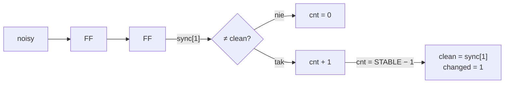

# 05.03 — assign i always: logika kombinacyjna i sekwencyjna

> **Moduł:** [05 — Verilog](README.md) · **Kod:** VHDL · Verilog · SystemVerilog · **DECA:** —
>
> **Czytaj:**
>
> - S. Palnitkar, *Verilog HDL* 💲, rozdz. 6 (modelowanie przepływem danych: `assign`) i 7 (modelowanie behawioralne: `always`, `if`, `case`, pętle)
> - [HDLBits](https://hdlbits.01xz.net/) — dział *Procedures* (`always` kombinacyjny i taktowany, unikanie zatrzasków)
> - [Nandland — debounce a switch](https://nandland.com/) — eliminacja drgań styków na FPGA

← [05.02](05.02-operatory-liczby-rozmiar-i-znak.md) · [spis modułu](README.md) · [05.04](05.04-przypisania-blokujace-i-nieblokujace-reguly.md) →

## Po co to jest

Cały kod RTL w Verilogu składa się z trzech konstrukcji: `assign` (logika kombinacyjna jednym wyrażeniem), `always @*` (logika kombinacyjna z `if` i `case`) i `always @(posedge clk)` (rejestry). Projektant musi świadomie wybrać jedną z nich dla każdego sygnału — wtedy z kodu od razu widać, co jest przewodem, a co przerzutnikiem. Przykładem jest układ potrzebny w każdym projekcie z przyciskiem: eliminacja drgań styków (*debouncing*).

## Intuicja

- `assign` to **przewód z bramkami**: wyjście zawsze równe wyrażeniu.
- `always @*` to **czarna skrzynka z logiką**: w środku można pisać `if` i `case`, ale wynik nadal zależy tylko od bieżących wejść.
- `always @(posedge clk)` to **aparat fotograficzny**: na zboczu zegara zapamiętuje obliczoną wartość.

Przycisk mechaniczny przy wciśnięciu przez kilka milisekund „drga” — styki odbijają się i sygnał zmienia się dziesiątki razy. Przy zegarze 50 MHz FPGA widzi każde odbicie. Debouncer czeka, aż wejście będzie stabilne przez ustalony czas, i dopiero wtedy przyjmuje nowy stan.

## Teoria

### Trzy konstrukcje

| Konstrukcja | Typ lewej strony | Przypisanie | Sprzęt |
|-------------|------------------|-------------|--------|
| `assign y = a & b;` | `wire` | ciągłe | logika kombinacyjna |
| `always @* begin … end` | `reg` | blokujące `=` | logika kombinacyjna (zatrzask, gdy przypisanie niepełne) |
| `always @(posedge clk) begin … end` | `reg` | nieblokujące `<=` | rejestry |
| `always @(posedge clk or posedge rst)` | `reg` | nieblokujące `<=` | rejestry z resetem asynchronicznym |

Reguła **jednego właściciela**: każdy sygnał przypisywany jest w dokładnie jednym miejscu — jednym `assign` albo jednym bloku `always`. Dwa bloki `always` przypisujące ten sam `reg` to wyścig w symulacji i błąd w syntezie.

### Lista wrażliwości

- `always @*` (Verilog-2001) — automatyczna lista wszystkich czytanych sygnałów. Nigdy nie wypisuj ich ręcznie.
- `always @(posedge clk)` — tylko zegar (i ewentualnie zbocze resetu asynchronicznego).
- SystemVerilog: `always_comb`, `always_ff`, `always_latch` — dodatkowo narzędzie sprawdza, czy treść pasuje do zamiaru ([01.05](../01-logika-cyfrowa/01.05-przerzutniki-zatrzaski-i-rejestry.md)).

### Styl: jeden blok czy dwa?

Logikę z rejestrami można zapisać na dwa sposoby:

- **jeden blok taktowany** z całą logiką w środku (jak debouncer w tej lekcji) — krócej, wszystkie wyjścia rejestrowane,
- **blok kombinacyjny** liczący wartości „następne” (`*_next`) i **krótki blok taktowany** przepisujący je do rejestrów — dłużej, ale wartości następne są widoczne (przydatne w automatach i gdy potrzebne jest wyjście przed rejestrem).

Oba są poprawne; w zespole wybiera się jeden i trzyma się go. Automaty stanów — [moduł 08](../08-automaty-stanow/README.md).

### Debouncer



1. Synchronizator dwuprzerzutnikowy — przycisk jest asynchroniczny ([01.07](../01-logika-cyfrowa/01.07-metastabilnosc-pierwsze-spotkanie.md)).
2. Licznik liczy takty, w których zsynchronizowane wejście **różni się** od wyjścia; każda chwila zgodności zeruje licznik.
3. Gdy różnica trwa `STABLE_CYCLES` taktów z rzędu, wyjście przyjmuje nowy stan i przez jeden takt `changed = 1`.

Czas stabilizacji typowego przycisku to od ułamka do kilkunastu milisekund; 10 ms (500 000 taktów przy 50 MHz) to bezpieczna wartość domyślna. Licznik ma $\lceil \log_2 500\,000 \rceil = 19$ bitów.

Na DECA przyciski `KEY` mają standard `1.5 V SCHMITT TRIGGER` — przerzutnik Schmitta w buforze wejściowym usuwa powolne zbocza i szum, ale **nie** drgania styków (to pełne przełączenia poziomu). Debouncer jest więc nadal potrzebny.

## Kod: Verilog

```verilog
    wire differs = sync[1] ^ clean;                // assign: logika kombinacyjna
    wire done    = (cnt == STABLE_CYCLES - 1);

    always @(posedge clk) begin                    // rejestry
        sync    <= {sync[0], noisy};
        changed <= 1'b0;                           // wartość domyślna: impuls trwa 1 takt
        if (rst) begin
            clean <= 1'b0;
            cnt   <= {CW{1'b0}};
        end else if (!differs) begin
            cnt <= {CW{1'b0}};
        end else if (done) begin
            clean   <= sync[1];
            changed <= 1'b1;
            cnt     <= {CW{1'b0}};
        end else begin
            cnt <= cnt + 1'b1;
        end
    end
```

<!-- plik: hdl/verilog/debouncer.v -->
Pliki: [debouncer.v](hdl/verilog/debouncer.v) · testbench: [tb_debouncer.v](hdl/verilog/tb_debouncer.v)

- `wire differs = …;` to skrót: deklaracja i `assign` w jednej linii.
- `changed <= 1'b0;` na początku bloku, a potem `changed <= 1'b1;` w jednej gałęzi — ostatnie przypisanie nieblokujące w bloku wygrywa. Tak zapisuje się impulsy jednego taktu.
- Synchronizator jest w tym samym bloku co reszta — wszystkie rejestry mają ten sam zegar.

## Kod: VHDL

<!-- plik: hdl/vhdl/debouncer.vhd -->
Pliki: [debouncer.vhd](hdl/vhdl/debouncer.vhd) · testbench: [tb_debouncer.vhd](hdl/vhdl/tb_debouncer.vhd)

- Licznik jako `natural range 0 to STABLE_CYCLES - 1` — szerokość wylicza syntezator. Wyjście `clean` czytane wewnątrz, więc stan jest w sygnale `state`.

## Kod: SystemVerilog

<!-- plik: hdl/sv/debouncer.sv -->
Pliki: [debouncer.sv](hdl/sv/debouncer.sv) · testbench: [tb_debouncer.sv](hdl/sv/tb_debouncer.sv)

- Porównanie z rzutowaniem `cnt == CW'(STABLE_CYCLES - 1)` usuwa ostrzeżenie o różnych szerokościach (stała `int` ma 32 bity).

## Co powstaje po syntezie

Dla STABLE_CYCLES = 500 000: 2 przerzutniki synchronizatora, 19 przerzutników licznika, `clean` i `changed` — 23 rejestry. Yosys (CI) potwierdza: **23 przerzutniki i 40 LUT4** (licznik, porównanie z 499 999, logika sterująca). W MAX 10 licznik i porównanie trafiają na łańcuch przeniesień.

## Weryfikacja

Testbench (STABLE_CYCLES = 8) symuluje drgania przy wciśnięciu i puszczeniu: wejście zmienia się co 1–3 takty, potem jest stabilne przez 20 taktów. Sprawdza w każdym takcie:

- każda zmiana `clean` ma impuls `changed` i odwrotnie,
- przy każdej zmianie wejście było stabilne co najmniej `STABLE_CYCLES` taktów (licznik `run` w testbenchu),
- po stabilnym wejściu wyjście ma właściwy stan,
- w całym teście są dokładnie **dwie** zmiany — drgania nie przeszły.

Test nie sprawdza dokładnego taktu zmiany (zależy od synchronizatora), tylko **własności** — to bardziej odporne na drobne zmiany implementacji. To zapowiedź weryfikacji opartej na asercjach ([moduł 10](../10-weryfikacja-systemverilog/README.md)).

## Reguły i liczby do zapamiętania

| Reguła lub liczba | Kiedy obowiązuje |
|-------------------|------------------|
| `assign` → `wire`; `always` → `reg` | Verilog |
| `always @*` z `=`, `always @(posedge clk)` z `<=` | Verilog |
| Każdy sygnał przypisywany w jednym miejscu | wszystkie języki |
| Impuls jednego taktu: wartość domyślna na początku bloku taktowanego | sygnały sterujące |
| Debouncer: ok. 10 ms stabilności; przy 50 MHz licznik 19-bitowy | przyciski mechaniczne |
| Przerzutnik Schmitta na wejściu nie usuwa drgań styków | DECA, `KEY` |

## Typowe pułapki

- **Ręczna lista wrażliwości** (`always @(a or b)`) — pominięty sygnał, symulacja różna od sprzętu.
- **Ten sam `reg` w dwóch blokach `always`** — wyścig; Quartus zgłasza błąd wielu sterowników.
- **Przycisk bez debouncera jako zegar lub zezwolenie licznika** — jedno wciśnięcie liczone wielokrotnie; dodatkowo zegar z pinu przycisku to osobna domena.
- **Debouncer bez synchronizatora** — porównanie asynchronicznego sygnału z rejestrem; rzadkie, losowe błędy ([01.07](../01-logika-cyfrowa/01.07-metastabilnosc-pierwsze-spotkanie.md)).

## Pytania rekrutacyjne

1. **Jak zrobisz eliminację drgań przycisku w FPGA?**

<details>
<summary>Odpowiedź</summary>

Najpierw synchronizator dwuprzerzutnikowy, bo przycisk jest asynchroniczny. Potem licznik, który liczy takty, w których zsynchronizowane wejście różni się od zapamiętanego stanu, i zeruje się przy każdej zgodności. Gdy różnica trwa ustalony czas (np. 10 ms), stan wyjścia zmienia się i generowany jest impuls jednego taktu. Alternatywa: próbkowanie wejścia rzadko (np. co 5 ms, z zezwoleniem z prescalera) i porównanie kilku próbek.
</details>

2. **Kiedy użyjesz `assign`, a kiedy `always @*`?**

<details>
<summary>Odpowiedź</summary>

`assign` dla prostych wyrażeń i multiplekserów `?:` — jest krótszy i nie może utworzyć zatrzasku. `always @*` (w SV `always_comb`), gdy logika wymaga `if`/`case`, kilku kroków obliczeń albo jeden blok liczy kilka powiązanych sygnałów. W bloku `always @*` trzeba przypisać każde wyjście w każdej ścieżce.
</details>

## Zadania

1. Połącz `debouncer` i `edge_detect` w moduł `button`, który daje impuls jednego taktu przy wciśnięciu przycisku DECA (`KEY` aktywny niskim stanem). **Kryterium zaliczenia:** testbench z drganiami — dokładnie jeden impuls na wciśnięcie.

<details>
<summary>Wskazówka</summary>

`noisy = ~KEY[0]`. Wyjście `changed & clean` z debouncera już jest impulsem wciśnięcia — `edge_detect` nie jest wtedy potrzebny. Porównaj oba rozwiązania.
</details>

2. Przepisz debouncer w stylu „blok kombinacyjny + blok taktowany” (`clean_next`, `cnt_next`). **Kryterium zaliczenia:** ten sam testbench daje `PASS`.

## Źródła

- S. Palnitkar, *Verilog HDL*, rozdz. 6–7.
- [HDLBits](https://hdlbits.01xz.net/) — *Procedures*.
- [Nandland](https://nandland.com/) — debouncing.
